# 24bit7 Handbuch

24bit7 erstellt Playlists aus deiner eigenen JRiver-Bibliothek rund um das, was gerade läuft. Drück einen Knopf, und die Aktuelle Wiedergabe wird rund um den aktuellen Titel neu aufgebaut, während die Musik weiterläuft, mit Empfehlungen von Last.fm, ListenBrainz, Deezer, YouTube Music und, wenn du willst, KI. Alles Empfohlene, was du nicht besitzt, wird festgehalten, sodass die Fehlenden zur Einkaufsliste werden.

Dieses Handbuch erklärt jeden Teil der App. Die [README](https://github.com/24bit7/24bit7#readme) auf GitHub hat den Überblick und die Neuigkeiten jeder Version (auf Englisch).

Die Befehle für Alexa und die Menüs von JRiver stehen hier so, wie sie dort heißen, also auf Englisch.

## Inhalt

1. [Erste Schritte](#erste-schritte)
2. [Der Abspielen-Tab](#der-abspielen-tab)
3. [Der Entdecken-Tab](#der-entdecken-tab)
4. [Einstellungen](#einstellungen)
5. [Wie Playlists entstehen](#wie-playlists-entstehen)
6. [Multiroom](#multiroom)
7. [Sprachbefehle](#sprachbefehle)
8. [Den Alexa-Skill einrichten](#den-alexa-skill-einrichten)
9. [Wenn etwas schiefgeht](#wenn-etwas-schiefgeht)
10. [Quellen und deine Daten](#quellen-und-deine-daten)

---

## Erste Schritte

### Was du brauchst

- Einen Windows-PC.
- JRiver Media Center oder Media Server mit eingeschaltetem Mediennetzwerk: in JRiver unter Extras > Optionen > Mediennetzwerk > **Use Media Network to share this library**. 24bit7 spricht standardmäßig mit JRiver auf demselben PC, über Port 52199.
- Sonst erst einmal nichts. Deezer und YouTube Music brauchen keine Schlüssel, eine frische Installation erstellt also sofort Playlists.

Du kannst 24bit7 auch ganz ohne JRiver ausprobieren: Der Suche-Tab mit Ausgabe auf YouTube braucht keine Bibliothek.

### Installation

1. Lade die Zip-Datei der neuesten Version von der Seite [Releases](https://github.com/24bit7/24bit7/releases) herunter. Sie steht unter **Assets** unten in der Version, unter den beiden Downloads "Source code", die nur die Python-Dateien enthalten.
2. Entpack sie, wo du willst, und starte `24bit7.exe`.
3. Windows zeigt beim ersten Mal wahrscheinlich einen blauen Kasten **"Der Computer wurde durch Windows geschützt"**, weil die exe nicht signiert ist. Klick auf **Weitere Informationen** und dann auf **Trotzdem ausführen**. Das kommt nur einmal.

Um stattdessen aus dem Quellcode zu starten, brauchst du Python 3.10 oder neuer. Führ `pip install -r requirements.txt` aus und starte dann `gui.pyw`.

### Der erste Start

24bit7 öffnet mit den Einstellungen und sagt einmal Hallo. Es bringt einen Last.fm-Schlüssel mit, daher beginnt Ähnliche Künstler mit Last.fm und Titel-Abgleich mit Last.fm und YouTube Music, ohne dass du etwas einrichten musst. Für mehr Quellen trag unter **Einstellungen > Schlüssel** ein kostenloses ListenBrainz-Token ein und hake es dann in der Config einer Playlist unter **Einstellungen > Playlist-Einstellungen** an. Jeder Schlüssel hat einen **?**-Knopf mit den Schritten, wie du ihn bekommst.

Die Sprache stellst du unter **Einstellungen > Sonstiges > Sprache** ein. Beim Wechsel startet 24bit7 neu.

### Aktualisieren

Deine Einstellungen und dein Verlauf liegen in zwei Dateien neben der App: `.env` (Einstellungen und Schlüssel) und `24bit7.db` (Cache und Entdecken-Verlauf). Kopier beide in den Ordner der neuen Version, und alles ist wieder da. Einstellungen älterer Versionen werden automatisch umgewandelt. Wenn eine Version den Alexa-Skill ändert, wie 1.31.0 und 1.32.0, füg die neuen Dateien `alexa\interaction_model.json` und `alexa\lambda_function.py` wie in [Schritt 4 und 5](#schritt-4-das-interaktionsmodell-hinzufügen) in die Alexa-Entwicklerkonsole ein und führ dann Build und Deploy aus.

Nach neuen Versionen musst du nicht selbst Ausschau halten: Jedes Mal, wenn 24bit7 startet, fragt es bei GitHub nach der neuesten Version, und ist sie neuer als deine, sagt es eine Zeile in der Konsole, mit einem Link zum Herunterladen. Bist du auf dem neuesten Stand oder offline, sagt es nichts.

---

## Der Abspielen-Tab

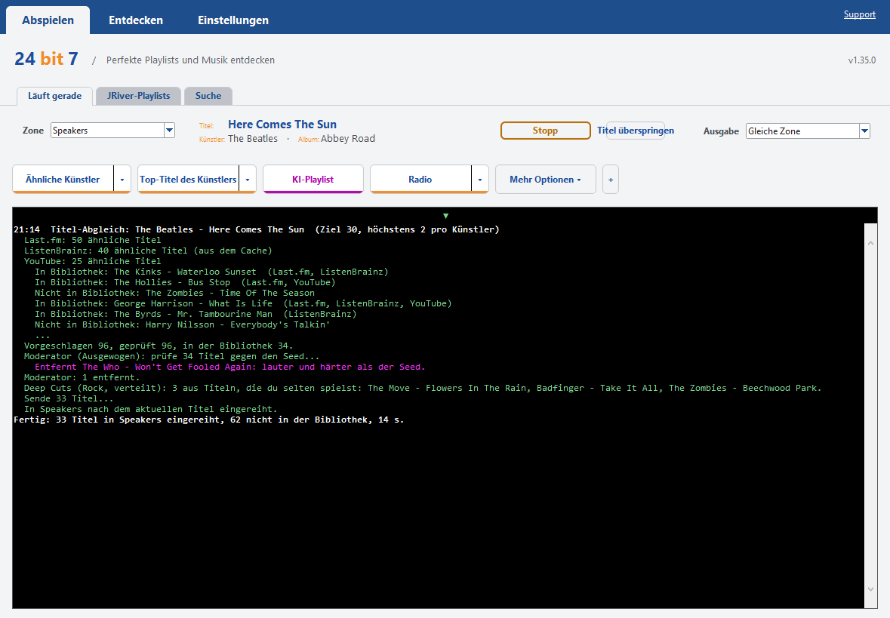

### Der Seed

Jede Playlist beginnt mit einem Seed, dem Ausgangspunkt. Der Seed ist der der drei kleinen Tabs, der gerade zu sehen ist, wenn du auf eine Playlist drückst.

- **Läuft gerade** zeigt, was JRiver spielt. **Zone** wählt, aus welcher JRiver-Zone der Seed kommt. Ist die Aktuelle Wiedergabe dieser Zone leer, nehmen die Playlists den zuletzt von JRiver gespielten Titel als Seed.
- **JRiver-Playlists** spielt eine deiner eigenen JRiver-Playlists oder Smartlists, so wie sie ist oder mit neuen Titeln dazwischen. Siehe [Deine JRiver-Playlists abspielen](#deine-jriver-playlists-abspielen). Die Playlist-Buttons der Reihe werden in diesem Tab grau, weil es keinen Künstler und keinen Titel als Seed gibt; Radio spielt trotzdem.
- **Suche** lässt dich jeden Künstler und Titel eintippen, ob du ihn besitzt oder nicht. Ähnliche Künstler, Top-Titel des Künstlers und Artist + Guests brauchen nur den Künstler. Enter startet Ähnliche Künstler. Ist der eingetippte Künstler nicht in deiner Bibliothek, aber einer, der ihm nahekommt, etwa Finger Eleven für "eleven finger", fragt die Konsole am Ende der Playlist **Meintest du Finger Eleven?**: Ein Klick darauf erstellt die Playlist noch einmal mit diesem Künstler.

**Seed** unter **Mehr Optionen** steht für Ähnliche Künstler und Titel-Abgleich im Tab Läuft gerade auf **Aktueller Titel** oder **Playing Now**. Aktueller Titel geht vom laufenden Titel aus. Playing Now geht von deiner ganzen Aktuellen Wiedergabe aus: Ein paar Künstler (bei Titel-Abgleich: Titel verschiedener Künstler) werden zufällig gewählt, und jeder bringt der Reihe nach seinen Anteil ähnlicher mit, oben aus seiner eigenen Liste gelesen, sodass kein Künstler doppelt vorkommt. Titel, die schon in der Aktuellen Wiedergabe sind, bleiben draußen, und die neue Playlist ersetzt die Aktuelle Wiedergabe wie gewohnt (mit dem Review-Modus kannst du stattdessen hinzufügen). Solange es an ist, werden die Balken unter den beiden Knöpfen türkis. Mit weniger als zwei Titeln in der Aktuellen Wiedergabe ist der aktuelle Titel der Seed. Top-Titel des Künstlers, KI-Playlist, Suche, Sprachbefehle, Tastenkürzel und Non-stop verwenden immer den aktuellen (oder eingetippten) Titel. Die Werte stehen auf der Seite der Standard-Playlist, in der Spalte Playing Now.

**Abspielmodus** oder **Review-Modus**, ebenfalls unter Mehr Optionen, gilt für jede Playlist aus dem Abspielen-Tab. Der Abspielmodus schickt die Playlist an JRiver, während sie gefunden wird. Der Review-Modus schickt nichts: Die Titel werden stattdessen in 24bit7 aufgelistet, im Bereich der Konsole, mit einem Schalter **Konsole | Review**, um zwischen beiden zu wechseln. Sprachbefehle, Tastenkürzel und Non-stop spielen immer sofort.

### Deine JRiver-Playlists abspielen

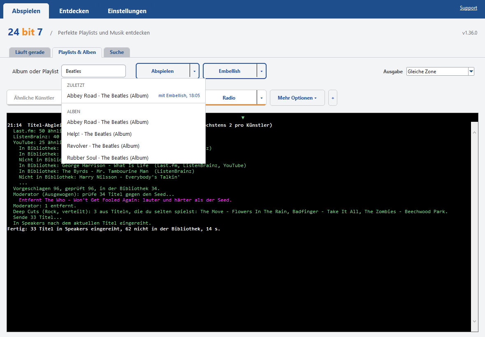

Klick im Tab **JRiver-Playlists** in das Feld **Playlist**, und es öffnet sich eine Liste deiner JRiver-Playlists und Smartlists: oben die fünf, die du hier zuletzt gespielt hast, dann der Rest von A bis Z, jede mit ihrem Ordner. Tippen grenzt sie ein. Dann:

- **Abspielen** spielt die Playlist so, wie sie ist. Sein Pfeil wählt **Gemischt abspielen** oder **Der Reihe nach abspielen** und merkt sich die Wahl.
- **Abspielen & Embellish** spielt die Playlist mit neuen Titeln dazwischen. Die neuen Titel werden so gefunden, wie [Consensus](#consensus) sie findet, mit den eigenen Künstlern der Playlist als Kreis: Ein Künstler, den mehrere von ihnen auf ihren Listen ähnlicher Künstler haben, ist einer, auf den sie sich einigen, und er bringt seine Top-Titel mit, die du besitzt. Die Schaltfläche fügt die Standardmenge hinzu, und der Pfeil wählt für dieses eine Mal eine andere: **+10 %**, **+20 %** und **+50 %** fügen einen neuen Titel für je zehn, fünf oder zwei der Playlist hinzu; **Verdoppeln** fügt so viele hinzu, wie sie hat, und **Verdreifachen** doppelt so viele; **Ganz ausbauen** fügt die Top-Titel jedes übereinstimmenden Künstlers hinzu, die du besitzt, zehn Künstler auf einmal, sagt, was jede Stufe gebracht hat, und **Abbrechen** behält, was schon drin ist. Welche Mengen der Pfeil anbietet und welche der Standard ist (zu Beginn +50 %), stellst du unter [Einstellungen > JRiver-Playlists](#jriver-playlists) ein. Der erste Titel der Playlist kommt zuerst, und in einer gestoppten Zone startet er sofort, während der Rest gefunden wird. **Mischen**, **Deep Cuts** und der **Moderator** für Embellish werden dort ebenfalls eingestellt, für alle Mengen gemeinsam oder für jede einzeln: Ohne Haken bei Mischen bleibt deine Reihenfolge, die neuen Titel dazwischen. Die Konsole nennt jeden übereinstimmenden Künstler und jeden seiner Top-Titel, In Bibliothek oder Nicht in Bibliothek, und der Entdecken-Tab listet sie.

Beide folgen Abspielmodus oder Review-Modus, Ausgabe und Top-Up wie jede andere Playlist. Die Konsole sagt offen, was sie gefunden hat: Sind alle übereinstimmenden Künstler schon auf der Playlist, sagt sie das, kommen weniger dazu als gewünscht, sagt sie warum, und eine Playlist mit nur einem Künstler hört auf, weil es nichts gibt, worauf sich Künstler einigen könnten (Ähnliche Künstler von einem ihrer Titel würde sie wachsen lassen). Von einer großen Playlist werden die Künstler stichprobenartig genommen, zehn auf einmal, so wie Seed: Playing Now aus der Aktuellen Wiedergabe zieht.

### Review

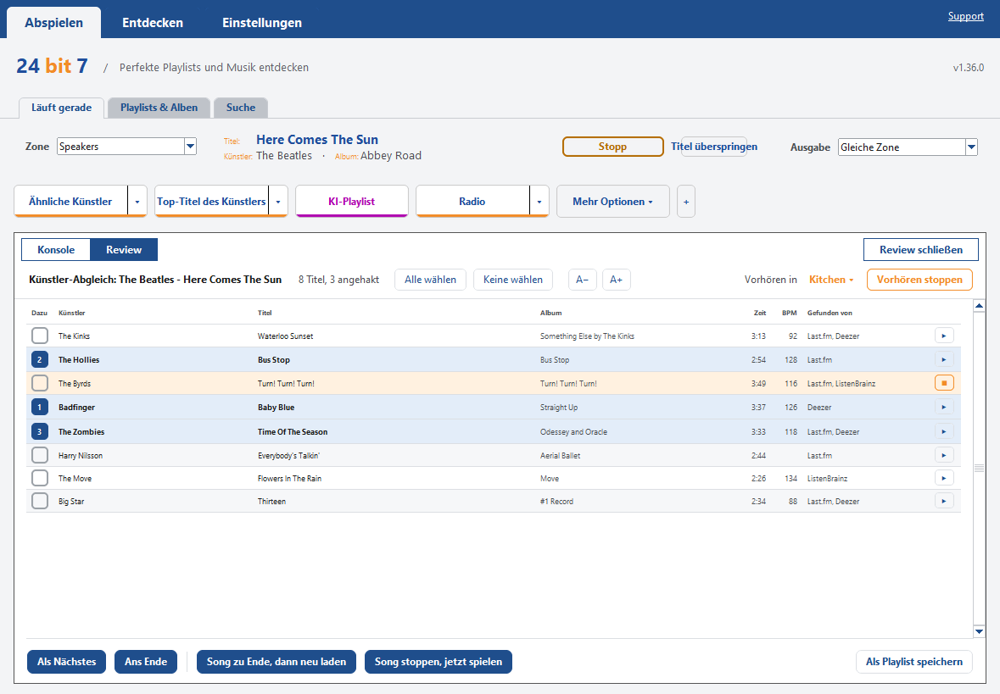

Hake die Titel an, die du willst, in der gewünschten Reihenfolge (jeder Haken zeigt seine Nummer), mit **Alle wählen** und **Keine wählen** für alle auf einmal, und wähl dann, was mit ihnen passiert:

- **Als Nächstes**: nach dem aktuellen Song, in der Reihenfolge der Haken.
- **Ans Ende**: ans Ende der Aktuellen Wiedergabe.
- **Song zu Ende, dann neu laden**: Die Aktuelle Wiedergabe besteht aus deinen angehakten Titeln, sobald der aktuelle Song endet.
- **Song stoppen, jetzt spielen**: Der aktuelle Song stoppt, und deine angehakten Titel laufen sofort.
- **Als Playlist speichern**: eine neue JRiver-Playlist aus den angehakten Titeln, es wird nichts gespielt. Neuere JRiver-Versionen lassen 24bit7 die Titel womöglich nur mit einer Anmeldung beim Mediennetzwerk hinzufügen: Wenn eine gespeicherte Playlist leer bleibt, leg in JRiver einen Benutzernamen und ein Passwort fest (Extras > Optionen > Mediennetzwerk > Authentication) und trag sie unter Einstellungen > Schlüssel ein.

**Review schließen** oben rechts über Vorhören stoppen verwirft die Liste und holt die Konsole zurück, geleert.

Die Aktionen gehen dorthin, wo **Ausgabe** gerade hinzeigt, wenn du sie drückst (eine Zone, oder bei Gleiche Zone die Zone von Läuft gerade). Mit Ausgabe auf **YouTube** werden die vier Abspiel-Aktionen zu einer, **Auf YouTube abspielen**, die die angehakten Titel als YouTube-Playlist in deinem Browser öffnet. Mit Ausgabe auf **Tidal** werden sie zu **An Tidal senden**, das die angehakten Titel in deine Tidal-Playlist namens 24bit7 legt.

**Vorhören in** wählt eine Zone mit eigenen Lautsprechern oder Kopfhörern, damit du einen Titel hören kannst, bevor du ihn hinzufügst. Wähl eine Zone, und in jeder Zeile erscheint ein Abspielzeichen: Klick eins an, und nur dieser Titel spielt dort, ohne angehakt zu werden, während der Hauptraum weiterläuft; die vorgehörte Zeile wird orange, und **Vorhören stoppen** beendet es. Die Zone, an die Ausgabe schickt, wird nie angeboten. Die Vorhör-Zone braucht ein eigenes Ausgabegerät; eine, die sich im exklusiven WASAPI-Modus eine Soundkarte mit dem Hauptraum teilt, spielt nicht. **A-** und **A+** stellen die Schriftgröße der Liste ein. Die Spalte BPM kommt aus den Tags deiner Dateien; JRiver kann sie für die ganze Bibliothek mit **Extras > Erweiterte Werkzeuge > Audioanalyse** ausfüllen (wähl nur noch nicht analysierte Dateien), womit auch Schneller und Langsamer bei Steer etwas zum Abgleichen haben.

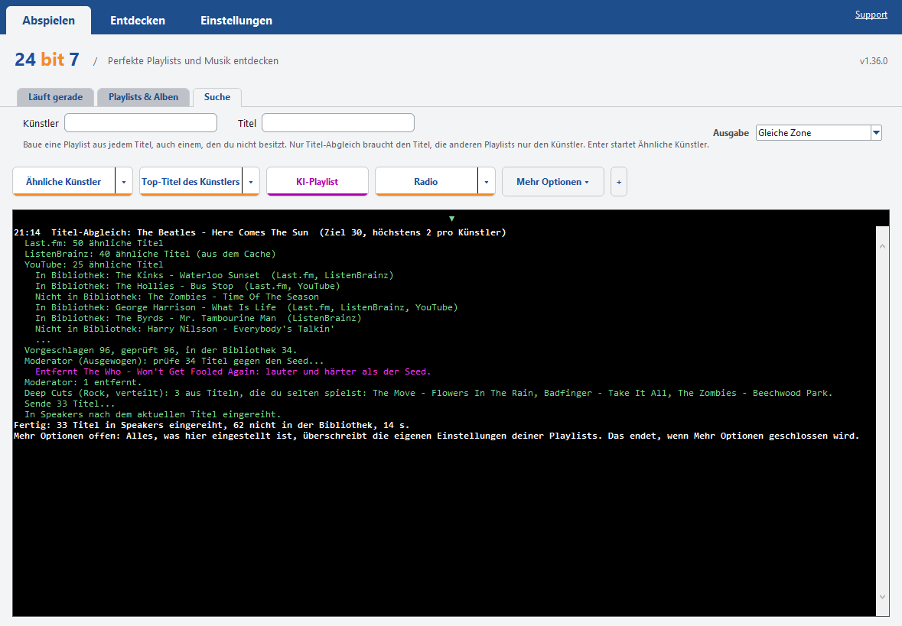

### Die Playlists

Die Reihe im Abspielen-Tab ist eine Liste von Playlists, die dir gehört. Drei Knöpfe sind von Anfang an da, und zwei davon haben rechts einen kleinen Pfeil: Ein Druck auf den Knopf erstellt, der Pfeil öffnet ein Menü mit weiteren Playlists, die darunter eingeordnet sind. Acht Playlists insgesamt:

| Playlist | Was du bekommst |
|---|---|
| **Ähnliche Künstler** | Eine Playlist aus Künstlern, die dem Seed ähneln. Jeder Künstler, der Seed eingeschlossen, steuert eine zufällige Auswahl seiner Top-Titel bei, derselbe Seed ergibt also jedes Mal eine andere Playlist. Sein Menü nennt den Knopf selbst Künstler-Abgleich, dann die drei darunter. |
| **Titel-Abgleich** | Im Menü von Ähnliche Künstler. Titel wie der Seed-Titel, Song für Song vorgeschlagen, sodass die Playlist dem Song folgt und nicht dem Ruf des Künstlers. |
| **Consensus** | Im Menü von Ähnliche Künstler. Die drei nächsten Künstler des Seeds, dann nur die Künstler, auf die sich deren eigene Listen einigen: der gemeinsame Nenner dessen, was du gerade hörst. Eng, und manchmal knapp, was die Konsole dann sagt; Drift füllt auf, wenn es an ist. Es ist Künstler-Abgleich mit eingeschaltetem [Consensus](#consensus). |
| **Artist + Guests** | Im Menü von Ähnliche Künstler. Zwölf Top-Titel des Künstlers, immer zwei, und dazwischen je ein Titel eines nahen ähnlichen Künstlers, den du besitzt. Es sind zwei Configs, Top-Titel des Künstlers und Künstler-Abgleich, die sich zwei zu eins abwechseln (siehe [Configs und Mix](#configs-und-mix)); kommen weniger Gäste zusammen, machen die Gastgeber allein weiter. Es verbraucht nie KI-Guthaben. |
| **Top-Titel des Künstlers** | Fünfzehn der beliebtesten Titel des Künstlers, die du besitzt, in zufälliger Reihenfolge; sein Menü nennt den Knopf selbst Top 15, zufällig. Seine Seite legt Anzahl und Reihenfolge fest. Aus der Suche braucht es nur den Künstler. |
| **Top 10, beste zuerst** und **Top 10, beste zuletzt** | Im Menü von Top-Titel des Künstlers: die zehn beliebtesten, die besten zuerst, oder dieselben zehn mit den am wenigsten beliebten zuerst. |
| **KI-Playlist** | Öffnet das Fenster KI-Playlist mit zwei Modi. **Erstellen**: Beschreib eine Stimmung oder Szene oder klick auf eine Idee (Mehr Titel wie der laufende Song, dann die Vorschläge der KI), und die KI wählt eine Playlist aus deiner Bibliothek. **Steer**: Lenk die laufende Musik in eine Richtung. Die KI muss unter Einstellungen > Schlüssel eingerichtet sein. Siehe unten. |

**Einordnen.** Jede Playlist kann unter einer anderen stehen, eine Ebene tief. Halt eine Playlist beim Ziehen einen Moment über einem anderen Knopf, und sie ordnet sich dort ein: Ihr eigener Knopf verlässt die Reihe, und sie erscheint im Menü des anderen. Der Knopf des Elternteils startet seinen **Standard**, zu Beginn er selbst; klick mit rechts auf eine Zeile im Menü und wähl **Als Standard festlegen**, dann trägt der Knopf diesen Namen. Eine Zeile im Menü erstellt einmal. Der Rechtsklick bietet auch **Zurück in die Reihe** und **Einstellungen**, und jede Zeile außer dem Standard lässt sich aus dem Menü ziehen: in die Reihe, ins Menü eines anderen Knopfs oder auf das Feld Einstellungen. Die eigene Zeile des Elternteils heißt wie er selbst oder wie sein **Titel im Menü**, wenn du auf seiner Seite unter Einstellungen > Playlist-Einstellungen einen setzt (etwa "Top 15, zufällig"), damit sich das Menü wie eine Liste von Möglichkeiten liest. Lass den Mauszeiger auf einem Elternteil ruhen, und er sagt, was sein Standard eingeschaltet hat und wie viele weitere der Pfeil auflistet.

Jede Playlist ist ein ganzes Rezept: eine oder mehrere Configs (eine Art, Titel zu finden: Künstler-Abgleich, Titel-Abgleich, Top-Titel des Künstlers oder KI-Playlist, mit ihren Quellen, Anzahlen und ihrem Moderator), die Einstellungen für die ganze Playlist (Drift, Deep Cuts, Non-stop und der Rest), die Filter, unter denen sie läuft, und ein Tastenkürzel. Ähnliche Künstler, Titel-Abgleich, Top-Titel des Künstlers und KI-Playlist sind die Standard-Playlists ihrer Art: Das starten die Sprachbefehle eines Geräts, sofern [Einstellungen > Geräte](#geräte) dem Gerät nichts anderes gibt.

**+** am Ende der Reihe öffnet das Fenster **Playlist hinzufügen** mit drei Tabs. **Aus vorhandenen** listet jede Playlist mit dem, was sie eingeschaltet hat, die eigenen der Geräte eingeschlossen, und setzt eine Kopie in die Reihe: **Hinzufügen** bei der Playlist eines Geräts, **Kopie erstellen** bei einer, die schon in der Reihe ist, als "Name 2" direkt dahinter. **Aus Vorlage** listet die vier Arten, wie 24bit7 sie ausliefert, dann Artist + Guests, Consensus, Top 10, beste zuerst, Top 10, beste zuletzt und Radio; Hinzufügen setzt die gewählte sofort in die Reihe, unter ihrem eigenen Namen und mit ihren Voreinstellungen. **Neu** ist ein leeres Blatt: eine Playlist, die noch keine Config hat. Ihre Seite öffnet unter [Einstellungen > Playlist-Einstellungen](#playlist-einstellungen) mit dem Namensfeld bereit zum Tippen, und **+ Config hinzufügen** sagt, was sie baut. Bis sie eine hat, steht sie grau in der Reihe, und ein Druck öffnet ihre Seite. Mit einem Rechtsklick auf eine Playlist kannst du sie umbenennen, duplizieren, ihre Einstellungen öffnen, sie nach links oder rechts schieben oder löschen. Halt eine Playlist gedrückt, und sie lässt sich ziehen: entlang der Reihe, wo die anderen beim Ziehen zur Seite rücken, damit die Lücke zeigt, wo sie landet, auf die Felder, die über der Konsole erscheinen, **Einstellungen**, **Löschen** (fragt erst nach) und, solange Mehr Optionen offen ist, **Seine Einstellungen übernehmen**, oder einen Moment über eine andere Playlist, um sie darunter einzuordnen. Lass den Mauszeiger auf einer Playlist ruhen, und sie sagt, was sie eingeschaltet hat.

Jede Playlist außer Top-Titel des Künstlers wird so verteilt, dass derselbe Künstler nie zweimal hintereinander läuft, und die Titel werden dabei so wenig wie möglich verschoben. Bleibt gegen Ende nur ein Künstler übrig, laufen seine Titel direkt nacheinander.

**Playlist speichern** erscheint oben rechts in der Reihe nach einer Playlist, die in eine JRiver-Zone ging. Es speichert die Aktuelle Wiedergabe dieser Zone als JRiver-Playlist und fragt vorher nach einem Namen ("Road Trip (Embellished)", "Downtempo Radio" oder "Agnes Obel Mix" etwa), damit eine Kette von Top-Ups, eine Playlist mit Embellish oder ein Abend mit Radio erhalten bleibt.

### Radio

**Radio** braucht keinen Seed. Es spielt einen Sender aus dem, was du hörst. Es ist eine Playlist eigener Art, zu Beginn am Ende der Reihe: Zieh es, wohin du willst, lösch es, füg im Fenster Playlist hinzufügen unter Aus Vorlage ein weiteres hinzu, und Standard-Playlists wiederherstellen bringt es zurück. 24bit7 nimmt die Künstler, die du zehnmal oder öfter gespielt hast, gibt jedem seine Genres, wie die Quellen sie vergeben (zuerst Last.fm, dein eigenes Genre-Tag nur bei einem Künstler, den keine Quelle kennt), und fasst sie zu Sendern zusammen, etwa Classic Rock oder Downtempo. Jeder Sender hat Säulen-Künstler: zuerst deine eigenen meistgespielten im Sender, etwa zwölf, dann die Künstler, die die Quellen zu den besten des Genres zählen und die du besitzt, etwa acht. Compilations sind nie Säulen.

Jede Runde nimmt drei Säulen zufällig und baut mit [Consensus](#consensus) über sie, nimmt bis zu sechs Säulen dazu, bis etwa eine Stunde zusammen ist, und beginnt mit einem Song einer Säule. Jede Säule bringt zwei Songs, zufällig aus ihren fünf bekanntesten gewählt; jeder Künstler, bei dem sich die Säulen einig sind, bringt ein paar seiner Top-Titel, die du hast, zufällig gewählt, sodass ein Sender in jeder Runde anders klingt. Ein übereinstimmender Künstler, zu dem ein anderer Sender nach seinen Genres mehr als doppelt so gut passt, bleibt weg, und die Konsole nennt ihn ("2 übereinstimmende Künstler weggelassen, deren Genres nicht zu Electronic / Ambient passen: Coldplay, Radiohead."), sodass eine Runde mit oder ohne Moderator in ihrem Sender bleibt. Radio läuft immer weiter: Beim letzten Titel kommt die nächste Runde wieder von den Säulen, sodass ein Sender den ganzen Abend seinen Klang behält, egal, wie Non-stop eingestellt ist. Die Konsole nennt jede Säule und jeden übereinstimmenden Künstler und jeden Top-Titel, den sie nachschlägt, In Bibliothek oder Nicht in Bibliothek, und der Entdecken-Tab listet sie.

Der erste Druck legt die Sender an und spielt den größten. Das dauert beim ersten Mal eine Weile, weil Last.fm zu jedem Künstler gefragt wird; später fragt es nur nach Künstlern, die es noch nicht kennt. Danach spielt ein Radio-Button den Sender, den du zuletzt gespielt hast, oder den, der auf seiner Seite steht. Der Pfeil listet jeden Sender mit seinem Anteil an deinen Wiedergaben. Ein Sender mit kleinem Pfeil teilt sich in die engeren Sender, aus denen er entstand (Rock etwa in Blues, Grunge, Classic Rock und Hard Rock). Ein engerer Sender, der fast so klingen würde wie der, aus dem er kommt, macht seinen eigenen engeren Sendern Platz, sodass Teilen immer etwas Neues zeigt. Klick auf einen Sender, um ihn zu spielen. Ein Rechtsklick bietet **Teilen** oder **Wieder zusammenführen** und **Als Schaltfläche hinzufügen**, das einen Radio-Button für diesen Sender nach diesem in die Reihe setzt. **Neu auswerten** am Ende der Liste legt die Sender neu an, aus dem, was du seitdem gespielt hast. Dazwischen kommen Künstler, die du neu zu spielen beginnst, von selbst zu den Säulen des nächstliegenden Senders.

Die Seite von Radio unter [Einstellungen > Playlist-Einstellungen](#playlist-einstellungen) hat zwei Kästen. **Diese Schaltfläche** hat, was nur diesem Button gehört: seinen **Sender** (Zuletzt gespielt oder immer ein Sender) und, unter Erweitert, sein **Tastenkürzel**. **Alle Radio-Schaltflächen** hat, was alle Radio-Buttons teilen, sodass eine Änderung auf der Seite eines Radios alle ändert: **Senderliste**, **Quellen** mit Müssen einig sein, **Playlist-Auswahl** (so viele der Top-Titel jedes Künstlers, und Titel auslassen, die in den letzten Tagen gespielt wurden) und **Filter**, unter Erweitert dazu der **Moderator**, der die anderen Künstler jeder Runde an den Songs der Säulen prüft, und **Deep Cuts**, das Titel selten gespielter Künstler im häufigsten Genre der Runde ergänzt. Die **Senderliste** legt fest, wie viele Sender es gibt (Zeigen [13] Sender): weniger legt die nächstverwandten zusammen, mehr teilt die größten, und das dauert nur Sekunden, weil die Genres von der letzten Auswertung aufgehoben sind. Reicht deine Musik nicht für so viele, sagt die Konsole, wie viele es geworden sind. Daneben stehen **Neu auswerten** und wann es zuletzt lief, darunter eine Zeile pro Sender mit seinem Anteil an deinen Wiedergaben, seinen Künstlern und seinen ersten Säulen. Klick auf den Namen eines Senders, um ihn umzubenennen; der Genre-Name bleibt grau daneben, der Name kommt nach Neu auswerten mit dem Sender zurück, und ein Radio-Button, der diesen Sender spielt, folgt dem neuen Namen. **Bearbeiten** am Ende einer Zeile öffnet die Säulen des Senders: Durchsuche sie und **Entfernen** eine (sie verschwindet auch aus den engeren Sendern und kommt nicht von selbst zurück), oder durchsuche rechts alle Künstler deiner Bibliothek, mit der Zahl der Titel, die du besitzt, und **+ Hinzufügen** einen. Was du hinzugefügt hast, steht mit "von dir hinzugefügt" da, ein Sender behält mindestens drei Säulen, da jede Runde mit drei beginnt, und **Säulen zurücksetzen** holt die zurück, die die Auswertung gewählt hat. Änderungen werden sofort gespeichert und bleiben bei Neu auswerten erhalten. Der Pfeil neben einem Sender ist Teilen, wie auf dem Tab Abspielen. Radio beginnt mit den Quellen und der Auswahl der Standard-Playlist Ähnliche Künstler, Moderator und Deep Cuts aus. Es hat keine Configs, kein Mix, Drift, Consensus oder Wenn gar nichts klappt, nichts lässt sich darunter verschachteln (sein Pfeil listet die Sender), und kein Sprachbefehl startet es.

### Das Fenster KI-Playlist

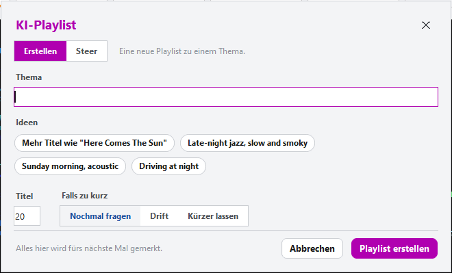

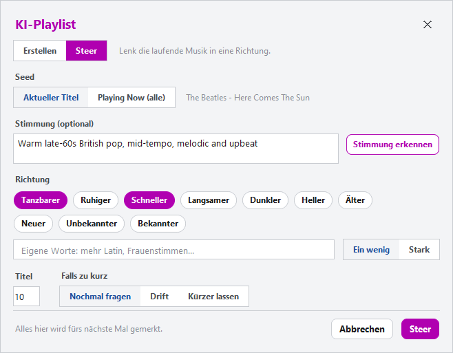

**Erstellen** nimmt ein Thema, **Titel** (wie viele angefragt werden) und **Falls zu kurz**. **Steer** geht von einem **Seed** aus, dem aktuellen Titel oder Playing Now (alle, bis zu 50 Titel rund um den aktuellen), mit einer optionalen **Stimmung**: **Stimmung erkennen** bittet die KI, die Stimmung des Seeds zu beschreiben, und trägt die Beschreibung ins Feld ein, wo du sie ändern kannst; leer gelassen arbeitet die KI nur mit Seed und Richtung. **Richtung** ist eine Reihe kombinierbarer Chips (Tanzbarer, Ruhiger, Schneller, Langsamer, Dunkler, Heller, Älter, Neuer, Unbekannter, Bekannter), ein Feld für eigene Worte und **Ein wenig** oder **Stark** dafür, wie weit es gehen soll. Schneller und Langsamer werden mit BPM-Tags abgeglichen, wo Seed und Vorschlag beide eins haben, und ein Vorschlag in die falsche Richtung wird mit einer Zeile in der Konsole weggelassen.

Beide Modi bitten die KI um etwa doppelt so viele Titel, da manche Vorschläge nicht in deiner Bibliothek sein werden, und behalten die ersten Treffer. **Falls zu kurz** legt fest, was passiert, wenn weniger passen als gewünscht: **Nochmal fragen** bittet die KI um mehr, bis zu zwei weitere Runden, und sagt ihr, was sie schon vorgeschlagen hat; **Drift** füllt mit deinen Drift-Einstellungen aus deinen Musikquellen auf; **Kürzer lassen** hört mit dem auf, was gepasst hat. Alles im Fenster wird fürs nächste Mal gemerkt, auch der Modus, und gehört zu den Profilen. Eine Playlist aus dem Fenster folgt Abspielmodus / Review-Modus und Ausgabe wie jede andere.

### Ausgabe

**Ausgabe**, rechts in der Zeile mit Zone (und neben den Feldern Künstler und Titel in der Suche), legt fest, wohin die fertige Playlist geht:

- **Gleiche Zone**, die Voreinstellung: die Zone, aus der der Seed kommt.
- **Jede JRiver-Zone** mit Namen.
- **YouTube**: Die Playlist öffnet sich in deinem Browser als YouTube-Sofort-Playlist. JRiver bleibt unberührt. Siehe [Ausgabe auf YouTube](#ausgabe-auf-youtube).
- **Tidal**: Die Playlist kommt in deine Tidal-Playlist namens 24bit7, und die Konsole bietet **In der Tidal-App öffnen** und **Im Tidal-Web öffnen** an. JRiver bleibt unberührt. Siehe [Ausgabe auf Tidal](#ausgabe-auf-tidal).
- **Multiroom**: Die Playlist geht an die Zone, die auf deinen Sonos spielt, und deine Hauptanlage spielt dieselbe Musik im Gleichtakt. Siehe [Multiroom](#multiroom).

YouTube und Tidal erscheinen hier nur, solange sie unter Einstellungen > Sonstiges > Weitere Ausgaben angehakt sind; Multiroom, solange es unter Einstellungen > Sonstiges > Multiroom eingeschaltet ist.

### Stopp und Titel überspringen

Zwei Knöpfe sitzen zwischen dem Titel und Ausgabe in der Zeile Läuft gerade, für die Zone, die die Zeile gerade zeigt. **Stopp**, in Bernstein, stoppt die Zone; bei Multiroom stoppen beide Räume. Sobald die Zone gestoppt ist, heißt derselbe Knopf **Aktuelle Wiedergabe leeren**, in Rot, und ein Klick leert die Aktuelle Wiedergabe der Zone, ohne Nachfrage, deshalb das Rot. Er heißt wieder Stopp, sobald die Zone spielt. **Titel überspringen** geht zum nächsten Titel in der Liste der Zone und ist ausgegraut, solange die Zone gestoppt ist oder nichts folgt. Ein Überspringen zählt für den Filter [Übersprungene Titel](#filter-bearbeiten), wie ein Überspringen per Sprache. Jeder Klick schreibt eine Zeile in die Konsole.

Die Liste **Zone** bekommt einen Eintrag **Multiroom**, solange Multiroom eingeschaltet ist. Er zeigt den Titel der Leitzone, Seeds gehen an die Leitzone, und er wird von selbst gewählt, sobald die Speakers zu folgen beginnen.

### Mehr Optionen

**Mehr Optionen** öffnet eine zweite Zeile unter einer dünnen Linie. Es merkt sich, ob sie offen war, und das zählt: Solange die Zeile offen ist, überschreiben ihre Schalter **Moderator**, **Deep Cuts** und **Non-stop** die eigenen Einstellungen jeder Playlist, bei jedem Durchlauf, ob aus dem Abspielen-Tab, per Sprachbefehl, Tastenkürzel oder Non-stop-Ergänzung; geschlossen entscheidet die Seite jeder Playlist. Beim Öffnen sagt es die Konsole, und beim ersten Mal erklärt es ein kleines Fenster. Jeder Schalter in der Zeile zeigt seine Einstellung und geht mit einem Klick durch die Möglichkeiten; ein Rechtsklick geht zurück. Bei den drei Überschreibungen schaltet Aus die Sache für jede Playlist aus, und jede andere Einstellung läuft für jede Playlist, wobei das, was sie offen lässt (der Anteil von Deep Cuts, womit Non-stop spielt), von der Seite der Playlist kommt. Jeder Durchlauf sagt, was die Zeile angewendet hat. Solange die Zeile offen ist, erscheint beim Ziehen einer Playlist ein drittes Feld über der Konsole, **Seine Einstellungen übernehmen**: Lass sie dort fallen, und die Schalter übernehmen die Einstellungen dieser Playlist. Moderator, Drift, Deep Cuts und Non-stop einer Playlist stehen auf ihrer Seite unter [Einstellungen > Playlist-Einstellungen](#playlist-einstellungen): Zieh die Playlist auf das Feld Einstellungen, um dorthin zu kommen.

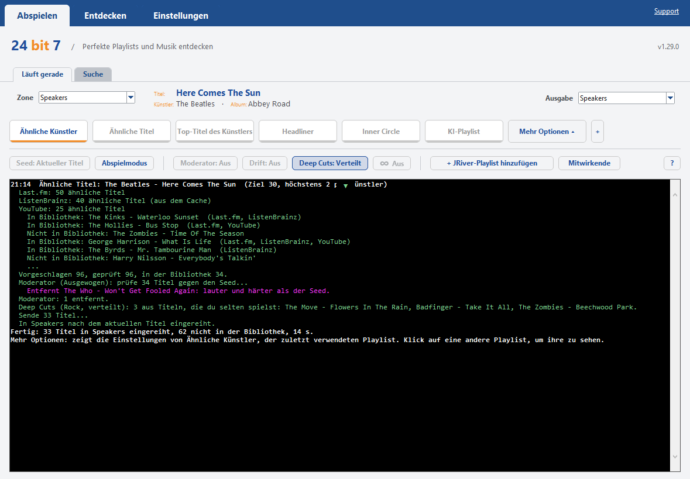

- **Seed: Aktueller Titel** oder **Seed: Playing Now** (türkis). Siehe [Der Seed](#der-seed).
- **Abspielmodus** oder **Review-Modus** (orange). Siehe [Der Seed](#der-seed) und [Review](#review).
- **Top-Up** (türkis, solange es wartet): Klick darauf, dann auf eine Playlist oder Radio, und die neue Playlist kommt zu dem, was von der Aktuellen Wiedergabe übrig ist, statt sie zu ersetzen. Der laufende Titel spielt weiter, schon gespielte Titel bleiben unberührt, und der Rest wird mit den neuen gemischt, ohne dass etwas doppelt kommt und ohne denselben Künstler zweimal hintereinander. Es gilt für eine Playlist; ein zweiter Klick bricht es ab, und Mehr Optionen zu schließen lässt es ebenfalls los. Im Review-Modus zeigt die Liste nur die neuen Titel, mit der Aktion **Top-Up** vorneweg, die die angehakten hineinmischt. Grau, solange die Ausgabe YouTube oder Tidal ist.
- **Mitwirkende** zeigt Produzent, Toningenieur, Musiker und weitere Mitwirkende des laufenden Titels von Discogs, in zwei Listen: die eigenen Mitwirkenden des laufenden Titels (oder aller Titel, unter Nummer und Titel) und die des Albums. Mitwirkende, die Discogs nur für einige Titel vermerkt, etwa ein Schlagzeuger auf den Titeln 2 bis 4, kommen zu diesen Titeln. Einstellungen > Sonstiges > Mitwirkende zeigen wählt den aktuellen Titel oder alle Titel und welche Liste zuerst kommt. Es braucht ein Discogs-Token.
- **+ JRiver-Playlist hinzufügen** nimmt eine deiner JRiver-Playlists in die nächste Playlist auf. Siehe [Eigene Playlists hinzufügen](#eigene-playlists-hinzufügen).
- **?** am rechten Ende der Zeile schaltet die Hinweise des Abspielen-Tabs an und aus. An erklärt alles im Abspielen-Tab, wenn du den Mauszeiger darauf ruhen lässt; aus, die Voreinstellung, zeigt nichts. Hinweise, warum etwas ausgegraut ist (zum Beispiel kein KI-Schlüssel), erscheinen immer. Es merkt sich seine Einstellung.

### Die Konsole

Das schwarze Feld zeigt, was jede Playlist gemacht hat: welche Quellen geantwortet haben, was in deiner Bibliothek gepasst hat und wohin es ging. Jede Playlist wird gleich aufgeschrieben, damit man sie auf einen Blick lesen kann:

- Die erste Zeile hat die Uhrzeit und was erstellt wurde, etwa `21:14  Titel-Abgleich: The Beatles - Here Comes The Sun`.
- Die Schritte stehen eingerückt darunter, in Grün.
- Zeilen mit `Hinweis:`, in Bernstein, sind etwas, das man wissen sollte. Zeilen mit `Problem:`, in Rot, sind etwas, das schiefgegangen ist. Wo eine Einstellung helfen würde, steht sie am Ende, etwa `die Seite der Playlist`.
- KI-Zeilen, etwa die des Moderators, sind magenta.
- Jede Playlist endet mit einer Zeile: `Fertig: 30 Titel in Speakers eingereiht, 62 nicht in der Bibliothek, 14 s.`

Klick in die Konsole, um eine Leiste mit Knöpfen zu bekommen:

- **Kopieren** kopiert, was zu sehen ist, oder nur das Markierte.
- **Leeren** leert die Anzeige. Nichts, was im Log liegt, wird gelöscht.
- **Als Log speichern** speichert einen Bericht für den Fall, dass etwas schiefgeht. Siehe [Ein Problem melden](#ein-problem-melden).
- **Fragen** fragt die KI, warum eine Playlist so geworden ist. Erscheint nur, wenn Konsolen-Frage eingeschaltet ist. Siehe [Konsolen-Frage](#konsolen-frage).
- **Einfach** oder **Erweitert**: Einfach blendet die Debug-Zeilen aus, die schwach grau sind und mit `[debug]` beginnen, und den laufenden Kommentar von Multiroom; Erweitert zeigt sie. Ein Problem von Multiroom oder ein Hinweis auf etwas, das du hören kannst, steht in beiden. Sie werden immer aufgezeichnet, ein Wechsel wirkt also auch auf die schon angezeigte Playlist, und Als Log speichern nimmt sie immer mit. Deine Wahl wird gemerkt. Debug-Zeilen bleiben auf Englisch.

Während eine Playlist erstellt wird, zeigt die Leiste nur **Abbrechen**. Das stoppt beim nächsten Schritt, meist innerhalb von ein, zwei Sekunden (eine schon laufende Anfrage an die KI läuft erst zu Ende, und die Konsole sagt es), und die letzte Zeile sagt, was schon rausgegangen war: nichts, der erste Titel, den der Schnellstart begonnen hat, oder Titel, die eine Drift-Runde geschickt hatte. Bei einer abgebrochenen Review-Playlist wird die Liste verworfen, und das Log zeigt die Playlist als Abgebrochen.

#### Die Tabs der Konsole

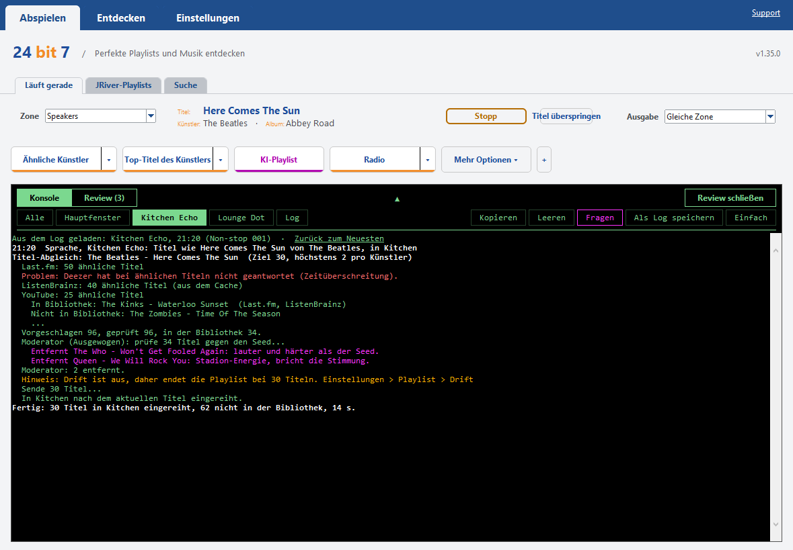

Der kleine grüne Pfeil oben in der Mitte der Konsole öffnet eine Reihe von Tabs:

- **Alle**: die neueste Playlist, egal woher.
- **Hauptfenster**: die neueste Playlist aus dem Abspielen-Tab oder von einem Tastenkürzel.
- **Einer pro Alexa-Gerät**: die neueste Playlist dieses Geräts, auch Befehle, aus denen nichts wurde. Ein Gerät bekommt seinen Tab nach seiner ersten Playlist.
- **Log**: jede behaltene Playlist, siehe unten.

Eine Playlist leert die Anzeige nur, wenn ihr eigener Tab oder Alle zu sehen ist, ein Sprachbefehl in der Küche löscht also keine Playlist, die du gerade am PC liest. Bei offenen Tabs sitzt die Leiste oben rechts. Neue Zeilen ziehen dich nicht nach unten, solange du nach oben gescrollt hast. Ob offen oder zu, wird gemerkt.

#### Das Log

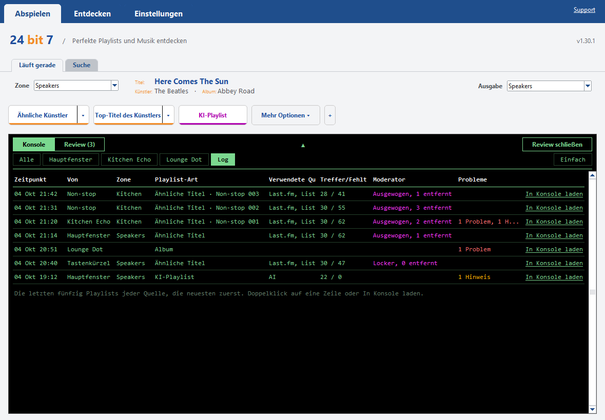

Das Log listet die letzten 50 Playlists jeder Quelle, die neuesten zuerst: wann, wer gefragt hat (Hauptfenster, Tastenkürzel, ein Alexa-Gerät oder Non-stop), die Zone, die Playlist, die verwendeten Quellen (mit der Maus darüber für die ganze Liste), eingereihte Titel und solche, die nicht in der Bibliothek sind, was der Moderator gemacht hat und wie viele Probleme und Hinweise es gab.

Eine Non-stop-Playlist erscheint als Kette. Die Playlist, die sie begonnen hat, wird zu Non-stop 001, und jeder Nachschub bekommt die nächste Nummer, sodass du siehst, wie lange ein Abend lief, und erkennst, welcher Nachschub danebenging.

Doppelklick auf eine Zeile oder **In Konsole laden** öffnet diese Playlist in ihrem Tab. Eine Zeile oben sagt, dass sie aus dem Log kommt, mit **Zurück zum Neuesten**, um zurückzukehren. Kopieren, Fragen und Als Log speichern wirken dann auf diese Playlist.

Ältere Playlists, die vor dem Wechsel der Sprache erstellt wurden, bleiben auf Englisch.

### Eigene Playlists hinzufügen

Öffne **Mehr Optionen** und drück **+ JRiver-Playlist hinzufügen**, um eine JRiver-Playlist oder Smartlist in die nächste Playlist aus dem Abspielen-Tab aufzunehmen. Jede Zeile hat einen Griff, um sie nach oben oder unten zu ziehen, die Playlist und die Art, wie sie dazukommt:

- **Davor**: Ihre Titel laufen zuerst, in der Reihenfolge der Playlist.
- **Danach**: Ihre Titel folgen denen von 24bit7, in ihrer eigenen Reihenfolge.
- **Mischen**: Ihre Titel werden zwischen die von 24bit7 gewoben. **Gleichmäßig verteilt** verteilt beide Listen über die ganze Playlist, sodass sie zusammen enden. **Zufällig gemischt** verstreut sie.

Die Zeilen laufen in der Reihenfolge, in der sie stehen. Die Auswahl zeigt zuerst die Playlists, die du am meisten verwendest, dann den Rest von A bis Z, mit einem Suchfeld; das x rechts neben einer meistgenutzten Playlist nimmt sie aus dieser Liste, mehr nicht. Jede Änderung wird in der Konsole vermerkt, mit dem, was die nächste Playlist tun wird.

Hinzugefügte Playlists kommen genau so durch, wie JRiver sie liefert, die Regeln einer Smartlist entscheiden also selbst, was darin ist. Die Filter von 24bit7, das Auslassen kürzlich gespielter Titel und die Prüfung auf versteckte Titel lassen sie in Ruhe; weggelassen wird nur ein Song, der schon unter den Vorschlägen von 24bit7 ist. Passt in der Playlist nichts zu deiner Bibliothek, laufen die hinzugefügten Playlists trotzdem, es bleibt also nie still.

Sie gelten nur für den Abspielen-Tab, mit Ausgabe an JRiver. Sprache, Tastenkürzel und Non-stop verwenden sie nicht, und bei Ausgabe auf YouTube bleiben sie mit einem Hinweis in der Konsole draußen.

---

## Der Entdecken-Tab

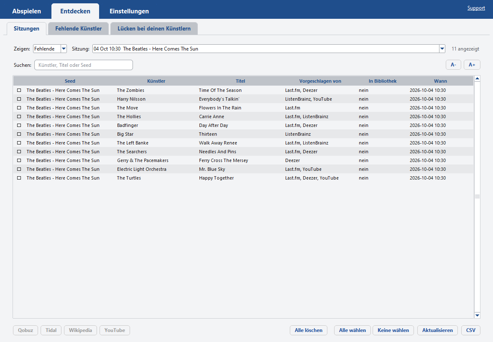

Entdecken hat zwei Tabs. **Sitzungen** listet jeden Titel, nach dem eine Playlist gesucht hat, und ob du ihn besitzt, eine Playlist nach der anderen. **Statistik** zählt sie über alle Playlists zusammen.

### Sitzungen

Radio und Abspielen & Embellish stehen hier wie jede andere Playlist, mit Radio oder Embellish als Quelle.

- **Zeigen** wählt Fehlende (Titel, die du nicht besitzt), Vorhandene oder Alle.
- **Sitzung** beschränkt auf eine Playlist. Es öffnet mit der neuesten, bis du selbst eine wählst, mit **Alle Sitzungen** zuerst in der Liste und dem Rest, neueste zuerst. **Suchen** sucht in allen Spalten. Eine Playlist mit Playing Now als Seed heißt **Playing Now (Multiple Tracks)**, und jede ihrer Zeilen zeigt den Titel aus der Aktuellen Wiedergabe, von dem sie kam, als Seed.
- Wähl eine Zeile, und jede Seite, die du unter Einstellungen > Entdecken angehakt hast, hat unten einen Knopf. Shops, YouTube und Tidal suchen nach Künstler und Titel; Nachschlage-Seiten wie Wikipedia und Discogs suchen den Künstler, für die Diskografie.
- **Label** findet heraus, wer den gewählten Titel veröffentlicht hat, und öffnet das Label auf Bandcamp, damit du bei denen kaufen kannst, die die Platte herausgebracht haben. Es fragt zuerst MusicBrainz, dann Discogs, wenn du ein Token hast. Ein selbst veröffentlichter Titel öffnet den Künstler auf Bandcamp. Jede Antwort wird gemerkt, ein zweiter Klick geht also sofort. Nimm den Haken bei Plattenlabel unter Einstellungen > Entdecken > Nachschlagen weg, wenn du es nicht willst.
- Hake Zeilen an oder nimm **Alle wählen**, und **YouTube-Playlist erstellen** öffnet sie in deinem Browser als eine Playlist, sodass du die Fehlenden vor dem Kauf hören kannst. **Tidal-Playlist erstellen** legt sie stattdessen in deine Tidal-Playlist namens 24bit7, anstelle dessen, was dort war, mit **In der Tidal-App öffnen** und **Im Tidal-Web öffnen** neben der Zeile, die sagt, wie es gelaufen ist. Welche dieser Knöpfe erscheinen, stellst du unter Einstellungen > Entdecken > Playlist erstellen ein.
- **Alle löschen** leert den Verlauf, und **Auswahl löschen** entfernt nur die angehakten Zeilen. Beide fragen vorher.
- **CSV** speichert die Liste als Tabellendatei. **A-** und **A+** oben rechts stellen die Schriftgröße der Tabelle ein.

### Statistik

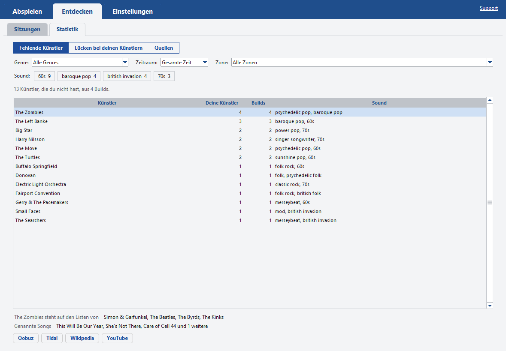

Statistik liest denselben Verlauf über alle Playlists hinweg. Die Leiste oben wählt eine von drei Ansichten:

- **Fehlende Künstler**: Künstler, die die Quellen genannt haben und die nicht in deiner Bibliothek sind, geprüft gegen die Bibliothek selbst. Ein Künstler, den du hast, dem aber ein Song fehlt, ist also eine Lücke, kein fehlender Künstler. Zuerst stehen die, auf die die meisten deiner Künstler zeigen. **Deine Künstler** sagt, wie viele deiner Künstler zu ihm geführt haben, und **Builds**, in wie vielen Playlists er auftauchte. Wähl eine Zeile, um zu sehen, auf wessen Listen er steht und welche Songs die Quellen genannt haben, darunter Label und deine Shop- und Nachschlage-Knöpfe.
- **Lücken bei deinen Künstlern**: Künstler, die du hast und die die Quellen genannt haben, mit den Songs, die gefunden wurden, und denen, die dir fehlen.
- **Quellen**: jede Quelle mit den Songs, die sie genannt hat, wie viele davon in deiner Bibliothek sind und wie viele sie in deiner Bibliothek gefunden hat, die keine andere Quelle genannt hat.

Jede Ansicht lässt sich eingrenzen mit:

- **Genre**: die Sender von Radio, jeder mit einer Zahl. Ein fehlender Künstler zählt unter den Sendern deiner Künstler, die auf ihn zeigen, und Deine Künstler wird innerhalb des Senders neu gezählt. Eine Playlist ohne Seed-Künstler, etwa eine AI Playlist oder Radio, zählt nur unter Alle Genres. Ausgegraut, solange Radio ruht.
- **Zeitraum**: Gesamte Zeit, die letzten sechs oder die letzten zwölf Monate.
- **Zone**: wo die Playlist lief, daneben, wer sie angefordert hat: das Hauptfenster, ein Tastenkürzel, ein Echo oder Non-stop. Playlists von vor 1.34.0 nehmen das aus dem Log der Konsole, das am 5. Oktober 2026 begann; was sich nicht zuordnen lässt, steht unter Unbekannt.
- **Sound**: die eigenen Last.fm-Tags der Künstler, die drei oder mehr von ihnen teilen, die häufigsten zuerst. Verschiedene Schreibweisen zählen als eine (synthpop und synth pop), Jahrzehnte bleiben, und ein Tag, der nur den Sender wiederholt (metal in einem Metal-Sender), ist ausgegraut. Klick einen an, um nur diese Künstler zu zeigen, und noch einmal, um ihn wegzunehmen. Beim ersten Öffnen von Statistik fragt 24bit7 im Hintergrund Last.fm nach den Tags aller Künstler, die es noch nicht kennt, bei einem langen Verlauf ein, zwei Minuten, und behält sie bei denen von Radio, sodass keiner zweimal fragt. Sound gilt nicht für Quellen.

Weder Genre noch Sound lesen die Genre-Tags deiner Bibliothek, die von ordentlich bis leer alles sein können.

---

## Einstellungen

Die Einstellungen sind in Seiten gegliedert, jede aus umrandeten Abschnitten. Lass den Mauszeiger auf dem Titel einer Einstellung ruhen, um die Erklärung zu sehen (wo es eine gibt, wird der Zeiger zum Fragezeichen). Alles wird gespeichert, sobald du es änderst, und die laufende App übernimmt es ohne Neustart.

### Playlist-Einstellungen

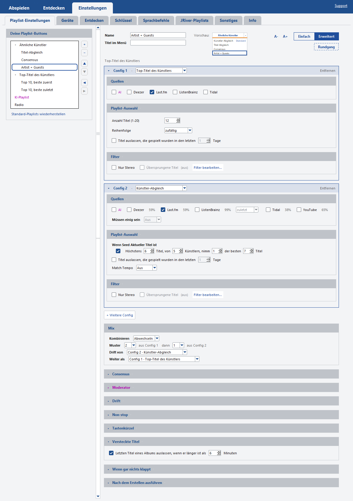

Links deine Playlists, rechts die Seite der gewählten Playlist.

**Deine Playlist-Buttons** listet jede Playlist im Abspielen-Tab, in der Reihenfolge der Reihe. Eine Playlist, die unter einer anderen eingeordnet ist, steht eingerückt darunter, mit einem kleinen Pfeil am Elternteil, der seine Kinder einklappt, und der Markierung **Standard** an der, die der Knopf des Elternteils startet. Die gewählte hat einen grünen Rahmen. Neben der Liste: **+** öffnet das Fenster Playlist hinzufügen (Aus vorhandenen, Aus Vorlage oder Neu, wie im Abspielen-Tab), **Löschen** entfernt die gewählte Playlist nach einer Rückfrage, **▲** und **▼** verschieben sie zwischen ihren Nachbarn, **▶** ordnet sie unter der Playlist darüber ein, und **◀** holt sie wieder in die Reihe. Ein Rechtsklick auf eine eingeordnete Playlist bietet Als Standard festlegen und Zurück in die Reihe. **Standard-Playlists wiederherstellen** unter der Liste setzt alles zurück, was 24bit7 mitliefert und fehlt (eine Standard-Playlist, Artist + Guests, Consensus, eine Top 10 oder Radio), unter die Playlist, zu der es gehörte; was schon da ist, wird nicht bewegt. Haken gibt es keine: Eine Playlist ist entweder ein Button im Abspielen-Tab oder gehört einem Gerät (siehe [Geräte](#geräte)).

Klick eine Playlist an, und ihre Seite steht rechts. Oben ist **Name** der Name der Playlist überall (ihr Button, die Liste, die Konsole und was Alexa sagt), **Titel im Menü**, wie ihre Zeile heißt, wenn sie im Menü eines Buttons steht (auch die eigene Zeile eines Elternteils), und daneben zeigt **Vorschau:** den Button mit offenem Menü und der Zeile dieser Playlist umrandet. Oben rechts stehen **A-** und **A+**, die die Schriftgröße jeder Einstellungen-Seite setzen, und der Schalter **Einfach / Erweitert**, eine Einstellung für dich statt für jede Playlist; in Erweitert sitzt darunter ein gestricheltes Feld **Rundgang**.

**Einfach** ist ein Modus, nicht nur eine aufgeräumtere Ansicht. Jede Playlist zeigt eine Config mit ihren **Quellen**, ihrer **Playlist-Auswahl** und ihren **Filtern** (eingeklappt; klick auf die Kopfzeile, um sie zu öffnen), und nur das läuft: Die erweiterten Abschnitte sind für jede Playlist aus, solange Einfach an ist. Beim Wechsel zu Einfach wird gesagt, was ausgeschaltet wird ("Einfach schaltet Drift und Non-stop auf drei Playlists aus"), und beim Wechsel zurück zu Erweitert kommt jede Einstellung so wieder, wie sie war. Artist + Guests und Consensus brauchen Erweitert, in Einfach sind sie im Abspielen-Tab grau mit dem Hinweis Braucht Erweitert. Die Schalter unter Mehr Optionen im Abspielen-Tab überschreiben in beiden Modi. 24bit7 startet in Erweitert, wenn irgendeine Playlist schon etwas über Quellen und Playlist-Auswahl hinaus eingeschaltet hat, sonst in Einfach.

**Erweitert** zeigt alles. Jeder Abschnitt ist offen, wenn seine Sache an ist, und geschlossen, wenn sie aus ist; ein eigenes Zuklappen gibt es nicht. Klick auf die Kopfzeile eines geschlossenen Abschnitts, und er öffnet sich, damit du ihn einschalten kannst; lässt du ihn aus, ist er beim nächsten Mal wieder zu. Lass den Mauszeiger auf dem Titel eines Abschnitts ruhen, und zwei Sätze sagen, was er tut und warum du ihn wollen könntest. **Rundgang** öffnet Artist + Guests, dunkelt die Seite ab und beleuchtet einen Abschnitt nach dem anderen mit diesem Hinweis in einem Fenster (Zurück, Weiter, Schließen, und welcher von vierzehn Schritten es ist), damit du jede Einstellung an einer Playlist siehst, die zwei davon nutzt.

#### Configs und Mix

Eine **Config** ist eine Art, Titel zu finden: **Künstler-Abgleich** (was Ähnliche Künstler tut), **Titel-Abgleich**, **Top-Titel des Künstlers** oder **KI-Playlist**. Jede Config ist ein Kasten mit der Kopfzeile **Config 1 · Künstler-Abgleich** und so weiter; klick auf die Kopfzeile, um den Kasten einzuklappen. Eine mit Neu angelegte Playlist beginnt ohne: **+ Config hinzufügen** fragt nach der Art, und die Config beginnt mit der Standard-Playlist dieser Art. Auf jeder Playlist außer einer Standard-Playlist ist die Art in der Kopfzeile ein Dropdown (ändere sie, und die Config beginnt neu mit der Standard-Playlist der neuen Art), und **Entfernen** in der Kopfzeile nimmt die Config heraus; nimm die letzte heraus, und die Playlist ist wieder ein leeres Blatt. Im Kasten, von oben nach unten:

- **Quellen**, nebeneinander in einer Zeile: hak eine beliebige Kombination an. Eine reicht; mehrere sind besser. Eine Quelle, deren Schlüssel fehlt, sagt "(noch kein Schlüssel)", und in Erweitert zeigt jede Quelle, sobald du Meine Quellen testen (unter Einstellungen > Sonstiges) laufen hattest, ihre Punktzahl für deine Bibliothek als kleine Zahl. Das Dropdown bei **ListenBrainz** wählt alle Zeiten oder kürzlich Gehörtes. **Tidal** braucht seine zwei kostenlosen Schlüssel (Einstellungen > Schlüssel). Unter der Zeile steht **Müssen einig sein**: Wie viele angehakte Quellen einen Künstler oder Titel vorschlagen müssen, bevor er verwendet wird; mehr heißt eine glattere Playlist mit weniger Überraschungen. Siehe [Mischen](#mischen).
- **Playlist-Auswahl**, als Sätze mit den Zahlen darin. Für Künstler-Abgleich: **Wenn Seed Aktueller Titel ist**, dann "Höchstens [30] Titel, von [20] Künstlern, [3] aus den Top [5] jedes Künstlers". Ein ähnlicher Künstler zählt erst, wenn er einen Titel aus deiner Bibliothek liefert; einer, der keinen liefert, wird übersprungen, und der nächste wird gelesen. Hak Höchstens ab, um jeden gefundenen Titel zu behalten; sind dazu die letzten beiden Zahlen gleich (etwa 5 aus 5), gibt es gar keine Zufallsauswahl. Auf der Standard-Playlist liest sich eine zweite Zeile in Türkis, **Wenn Seed Playing Now ist**, als "Höchstens [30] Titel, [5] Künstler aus der Aktuellen Wiedergabe ziehen, je [4] ähnliche Künstler nehmen, [3] aus den Top [5] jedes Künstlers", und die Voreinstellungen geben etwa dieselbe Playlist-Größe wie Aktueller Titel. Titel-Abgleich liest sich "[30] Titel finden, höchstens [3] pro Künstler" und für Playing Now "[5] Titel aus der Aktuellen Wiedergabe ziehen, je [6] ähnliche Titel nehmen, höchstens [3] pro Künstler". Top-Titel des Künstlers legt die Anzahl und die Reihenfolge fest (beliebteste zuerst, unbeliebteste zuerst oder zufällig); KI-Playlist legt fest, wie viele Titel und wie viele höchstens von einem Künstler, damit eine Stimmung, die die KI mit einer Band verbindet, nicht nur aus ihr besteht. Künstler-Abgleich und Titel-Abgleich haben außerdem **Match Tempo**, das die BPM-Tags deiner Dateien nutzt, um nah am Tempo des Seed-Titels zu bleiben; halbes und doppeltes Tempo zählen als Treffer. In Erweitert gibt es **Aus**, **Bevorzugen** und **Streng**. Bevorzugen stellt die nächstliegenden Tempi nach vorn, wo es eine Wahl gibt, etwa welche Top-Titel eines Künstlers genommen werden, und lässt nichts weg. Streng nimmt nur Titel innerhalb von zehn Prozent der BPM des Seeds und lässt Titel ohne BPM-Tag weg, sodass die Playlist kürzer werden kann, und die Konsole sagt, wie viele weggefallen sind. In Einfach ist es ein Haken, für Bevorzugen. Hat der Seed kein BPM-Tag, sagt ein Hinweis in der Konsole, dass Match Tempo nicht greift; JRiver kann die BPM-Tags für die ganze Bibliothek ausfüllen, mit Extras > Erweiterte Werkzeuge > Audioanalyse. Dann lässt **Titel auslassen, die gespielt wurden in den letzten [1] Tagen** alles weg, was JRiver kürzlich gespielt hat, damit ein Lieblingstitel nicht am selben Abend noch einmal kommt; der Seed-Titel wird nie ausgelassen. Standardmäßig aus. In Erweitert hat eine Standard-Playlist, die reviewt (Künstler-Abgleich, Titel-Abgleich und Top-Titel des Künstlers), in der Zeile darunter **Review-Modus nutzt dieselben Einstellungen**, zu Beginn angehakt. Nimm den Haken weg, und ein orangefarbener Kasten mit eigenen Zeilen für den Review-Modus öffnet sich, damit der Review-Modus eine kurze Auswahl bieten kann, während der Abspielmodus die ganze Playlist erstellt.
- **Filter**: hak beliebige deiner benannten Filter an, und jeder Titel, den diese Config findet, muss sie bestehen, Drift und Non-stop-Ergänzungen eingeschlossen. Jede Config hat ihre eigenen, so kann eine aus der ganzen Bibliothek schöpfen, während eine andere bei Stereo bleibt. **Filter bearbeiten...** öffnet den Editor, siehe unten.

**+ Weitere Config** setzt eine zweite Config unter die erste, beginnend mit der Standard-Playlist ihrer Art, und **Entfernen** rechts in der Kopfzeile einer Config nimmt sie wieder heraus. Mit zwei oder mehr Configs erscheint ein Abschnitt **Mix**:

- **Kombinieren**: **Mischen** mischt die Titel aller Configs zusammen (keine zwei vom selben Künstler nacheinander, wo es sich einrichten lässt); **Anhängen** spielt die Titel einer Config, dann die der nächsten; **Abwechseln** wechselt nach dem **Muster** ("2 aus Config 1, dann 1 aus Config 2"). Jede Config findet ihre eigene Zahl an Titeln, in ihrem Kasten eingestellt, die Playlist ist also so lang, wie sie zusammen ergeben.
- **Drift ab**: die Config, von der Drift weitermacht; der Abschnitt Drift darunter zeigt die Drift-Einstellungen dieser Config. Top-Titel des Künstlers hat kein Drift und wird daher nicht angeboten.
- **Weiter als**: die Config, als die Non-stop weitermacht, wenn die Playlist ihren letzten Titel erreicht; der Abschnitt Non-stop darunter zeigt die Einstellungen dieser Config.

Artist + Guests ist das mitgelieferte Beispiel: Config 1 ist Top-Titel des Künstlers, Config 2 ist Künstler-Abgleich mit fünf Künstlern und je einem Titel, und der Mix wechselt zwei zu eins. Die Konsole zeigt den Durchlauf jeder Config nacheinander ("Config 1 von 2: Top-Titel des Künstlers"), dann die Mix-Zeile. In JRiver beginnen die Titel der ersten Config zu spielen, sobald sie gefunden sind, und der Rest wird hinter dem aktuellen Titel eingewoben; an YouTube oder Tidal geht die fertige Liste einmal.

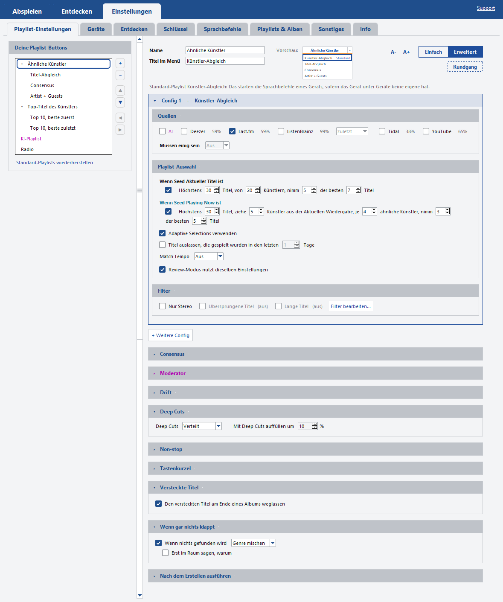

Die Abschnitte für die ganze Playlist folgen auf die Configs, jeder offen, wenn er an ist:

- **Consensus**, für Künstler-Abgleich und Titel-Abgleich: siehe [Consensus](#consensus). **Kreis** (3 bis 5) ist, wie viele der nächsten Künstler oder Titel des Seeds den Kreis bilden, und **Müssen einig sein** (2 bis zur Größe des Kreises), auf wie vielen ihrer Listen ein Nachbar stehen muss. **Findet Consensus weniger als [10] Titel, wird die Playlist mit einfachem Künstler-Abgleich aufgefüllt** (zu Beginn aus) sorgt dafür, dass ein enger Kreis dich nicht knapp lässt: Der Rest der Playlist kommt aus der eigenen Liste des Seeds, und die Konsole sagt, wie viele von wo kamen.
- **Moderator**, für Künstler-Abgleich und Titel-Abgleich: Aus, Locker, Ausgewogen oder Streng (magenta, weil er die KI nutzt). Siehe [Moderator](#moderator).
- **Drift** (Aus, Keep It Tight oder Spread) sucht noch einmal, wenn deine Bibliothek die Ziellänge nicht erreicht. Künstler-Abgleich und Titel-Abgleich haben außerdem **Moderator für Drift-Titel**. Siehe [Drift](#drift).
- **Deep Cuts**: Aus, **Verteilt** oder **Gemischt**, und **Mit Deep Cuts auffüllen um**, 10% bis 100%, für jede Art außer Top-Titel des Künstlers. Siehe [Deep Cuts](#deep-cuts).
- **Non-stop** (Aus, Keep It Tight oder Wander) lässt eine Playlist weiterlaufen, wenn sie ihren letzten Titel erreicht. Siehe [Non-stop](#non-stop).
- **Tastenkürzel**: Tasten, die diese Playlist von überall in Windows erstellen, auch mit 24bit7 im Infobereich. Klick ins Feld und drück die Tasten; Esc bricht ab. Die Zone, in der sie spielen, steht unter Einstellungen > Sonstiges > Tastenkürzel. Siehe [Tastenkürzel](#tastenkürzel).
- **Versteckte Titel** überspringt den letzten Titel eines Albums, wenn er länger als eine gesetzte Zahl Minuten ist (6 zu Beginn). Das ist oft eine lange Stille und ein versteckter Bonustitel, die in einer Playlist fehl am Platz wirken. Alben, Songs und Playlists, die du beim Namen nennst, laufen immer ganz.
- **Wenn gar nichts klappt**, zu Beginn aus: hak **Wenn nichts gefunden wird** an und wähl, was passiert, wenn ein Durchlauf nichts findet, oder nichts über den Seed-Titel hinaus. **Genre mischen** mischt Songs aus deiner Bibliothek im Genre des Seeds: das Genre-Tag des Seed-Titels oder das häufigste Genre des Künstlers in deiner Bibliothek, bei ähnlichem Tempo, wenn der Seed ein BPM-Tag hat und genug Titel innerhalb von 10% davon liegen. Es spielt die übliche Titelzahl dieser Art, mit Kürzlich gespielte auslassen, Filtern und der Grenze pro Künstler, und ohne den Seed-Künstler. **Datei ausführen** startet eine eigene Datei, etwa eine .bat, und Nach dem Erstellen ausführen entfällt für diesen Durchlauf. **JRiver-Playlist abspielen** spielt eine deiner JRiver-Playlists oder Smartlists, gewählt mit **Wählen...**, so wie JRiver sie liefert. Hak **Vorher im Raum sagen, warum** an (zu Beginn aus, eine Einstellung für jede Art), und bei einem Sprachbefehl oder Tastenkürzel hörst du vor der Musik, warum: die Stimme von Windows, als kurze WAV-Datei gespeichert und in dieser Zone abgespielt, damit sie in der Aktuellen Wiedergabe steht. Dafür muss JRiver auf demselben PC laufen. Ohne Haken bei Wenn gar nichts klappt sagt die Konsole "Ich konnte keinen Treffer finden. Bitte versuch einen anderen Seed.", und ein Durchlauf aus der App zeigt dasselbe als Meldung. Es läuft nicht, wenn eine hinzugefügte JRiver-Playlist schon gespielt hat.
- **Nach dem Erstellen ausführen** führt eine Datei deiner Wahl aus, sobald eine Playlist in JRiver ist: eine .bat, eine .exe oder ein PowerShell- oder Python-Skript. Sie erfährt nichts über die Playlist und kann also tun, was du willst. Non-stop-Ergänzungen führen sie nicht aus.

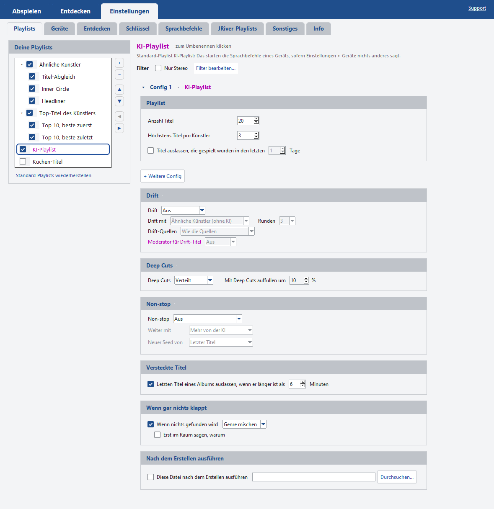

Eine Config KI-Playlist hat keine Quellen zu wählen, und der Abschnitt Drift ihrer Playlist hat eigene Möglichkeiten, darunter Drift mit der KI, und **Moderator für Drift-Titel** für das, was Drift aus deinen Musikquellen ergänzt.

#### Filter bearbeiten

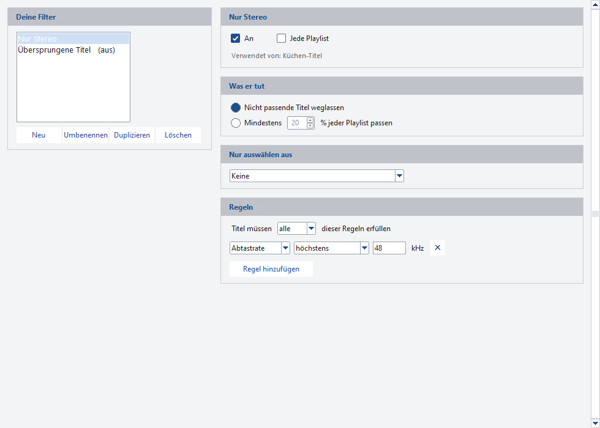

Ein Fenster mit benannten Filtern, die eingrenzen, was 24bit7 wählt, Drift-Runden und Non-stop-Ergänzungen eingeschlossen. Wo ein Filter gilt, entscheidest du, indem du ihn in einer Config anhakst, für jede Playlist, die diese Config erstellt, wohin sie auch geht. **Verwendet von** an jedem Filter sagt, welche Playlists ihn angehakt haben, und bei mehreren Configs welche. Jeder Filter hat:

- **Was er tut**: **Nicht passende Titel weglassen** oder **Mindestens [20] % jeder Playlist passen** (unten).
- **Nur wählen aus**: eine JRiver-Playlist oder Smartlist, sodass nur ihre Titel verwendet werden können. Alles, was du im Smartlist-Editor von JRiver einrichten kannst, hält 24bit7 ein.
- **Regeln**, alle oder eine erfüllt: Bewertung, Jahr, Zuletzt gespielt, Wiedergabezähler, Importdatum, Genre, Künstler, Album, Dauer, Dateityp, Bittiefe, Abtastrate, Dateipfad und **Anderes Feld**. "Abtastrate höchstens 48 kHz" erspart JRiver zum Beispiel das Umwandeln für einen Sonos. Anderes Feld liest jedes JRiver-Feld über seinen Namen, auch deine eigenen: Gib den Namen ein, und seine Werte aus deiner Bibliothek stehen zur Auswahl, dazu wie viele Titel und Künstler einen haben. Einen Namen, den JRiver nicht kennt, zeigt die Seite an.

**Mindestens.** Ein Filter auf Mindestens lässt nichts weg. Die Playlist wird wie immer erstellt, dann sorgt 24bit7 dafür, dass mindestens dieser Anteil passt: Ein Filter "Kiwi Music, mindestens 20 %, Country ist New Zealand" macht sechs von dreißig Titeln neuseeländisch. Passende Titel ersetzen die letzten nicht passenden, von Künstlern aus deiner Bibliothek, die tiefer in den schon geholten Listen ähnlicher Künstler stehen, und sie werden über die Playlist verteilt statt ans Ende gehängt. Reicht es nicht, füllen die üblichen Titel den Rest, und die Konsole sagt, wie viel gefehlt hat: "Kiwi Music: 3 von 30 Titeln (10 %), weniger als die gewünschten 20 %". Ein Titel ohne Wert für das Feld einer Regel zählt nicht zum Anteil. Auf der Seite einer Playlist heißt der Haken "Kiwi Music (mindestens 20 %)". Drift-Runden und was Non-stop ergänzt, zielen auf denselben Anteil; Top-Titel des Künstlers, alles ein Künstler, sagt, dass der Anteil dort nicht gilt.

Hak bei einem Filter **Jede Playlist** an, und er gilt für jede Playlist, die 24bit7 erstellt, ob er auf ihrer Seite angehakt ist oder nicht.

**Übersprungene Titel** ist schon angelegt, zu Beginn aus und mit Jede Playlist angehakt. Der Filter lässt jeden Titel weg, den du zweimal oder öfter per Sprache übersprungen hast, und jeden Titel eines Künstlers mit drei solchen Titeln. Beide Zahlen stellst du unter **Was er weglässt** ein, von eins bis neun: "Einen Titel weglassen, der per Sprache [2] Mal oder öfter übersprungen wurde" und "Jeden Titel eines Künstlers weglassen, von dem [3] Titel weggelassen sind". Nur weggelassene Titel zählen für einen Künstler, eine Band, die du an einem schlechten Tag ein- oder zweimal übersprungen hast, bleibt also. Jedes Überspringen, um das du den Skill bittest, wird in einem eigenen Feld von 24bit7 in JRiver gezählt, **24bit7 Voice Skips**, das du dort auch sehen kannst. Seine Seite listet unter **Jetzt weggelassen**, was er gerade weglässt, jeweils mit **Wieder zulassen**, das die Zählung löscht.

Ein Titel ohne Wert für ein Feld besteht diese Regel. Der Seed-Titel wird nie herausgefiltert. Die Konsole jedes Durchlaufs sagt, welche Filter galten und wie viele Titel sie ausgelassen haben. Gelten mehrere, muss ein Titel alle bestehen. Alben, Songs, Shuffles und JRiver-Playlists, die per Sprache angefordert werden, spielen wie gewünscht.

### Geräte

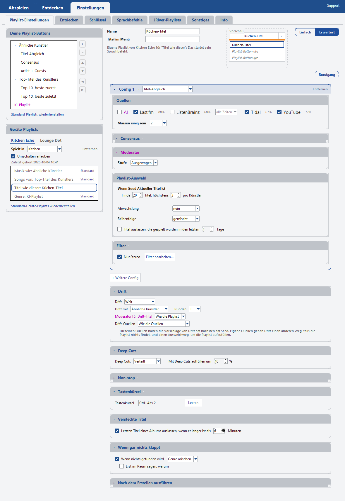

Der Kasten **Geräte** links hat einen Tab pro Alexa-Gerät; ein Gerät erscheint, sobald es zum ersten Mal mit 24bit7 spricht. Klick auf einen Tab, um das Gerät zu sehen, doppelklick, um es umzubenennen. Unter den Tabs steht **Spielt in**, die JRiver-Zone, in der seine Befehle spielen, mit **Entfernen**, das das Gerät vergisst (es kommt leer zurück, sobald es wieder spricht), dann **Umschalten erlauben**, ob "switch" die Musik in diese Zone bringen darf. Darunter vier Zeilen, eine pro Satz, wie du ihn sagst: **Musik wie**, **Songs von**, **Titel wie dieser** und **Genre** ("play something jazz", und auch "only <Künstler> <Stimmung>"). Jede Zeile nennt die Playlist, die dieser Satz startet. Grau startet der Satz eine deiner Playlists unverändert, mit der Markierung **Standard**, wenn es die Standard-Playlist ihrer Art ist; in voller Farbe hat das Gerät eine eigene. Klick auf eine Zeile, und ihre Seite öffnet rechts, mit **Einstellungen übernehmen von:** und einer Liste deiner Playlists in der ersten Reihe. Angehakt, wie zu Beginn, startet der Satz die Playlist, die in der Liste gewählt ist, jede Art, und mehr steht nicht auf der Seite: Wähl eine andere, und der Satz startet stattdessen die. Nimm den Haken weg, und das Gerät bekommt eine eigene Kopie der gewählten Playlist, nach ihm benannt, mit ihren Einstellungen darunter zum Ändern; die Liste wird grau und zeigt, wovon kopiert wurde. Hak es wieder an, um wieder zu übernehmen; nach einer Rückfrage wird die eigene des Geräts gelöscht. **Standard-Geräte-Playlists wiederherstellen** unter dem Kasten setzt jedes Gerät auf die Standard-Playlists zurück. Welche Zonen gezeigt werden, die Standardzone und Folgen stehen unter [Einstellungen > Sonstiges](#sonstiges). Die Seite rechts ist dieselbe wie unter Playlist-Einstellungen.

### Entdecken

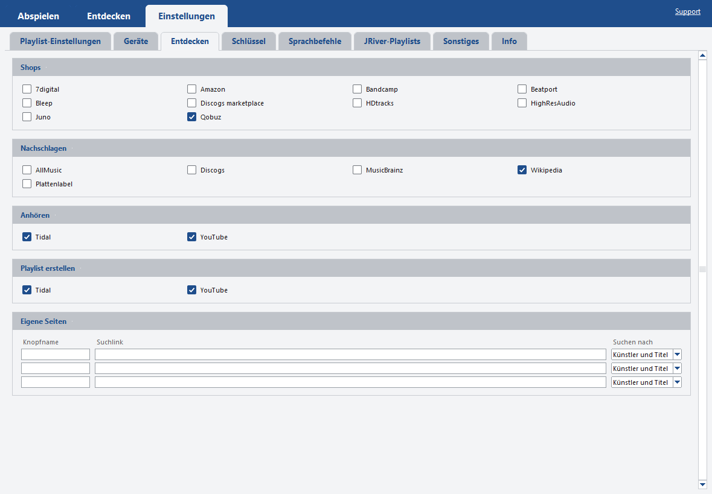

Die Seiten, die im Entdecken-Tab einen Knopf bekommen: **Shops** (mindestens einer bleibt angehakt), **Nachschlagen**-Seiten für Diskografien, darunter **Plattenlabel** (der Label-Knopf, anfangs angehakt), und **Anhören**-Seiten (YouTube und Tidal). **Playlist erstellen** wählt, welche Knöpfe erscheinen, wenn du Zeilen anhakst: YouTube öffnet sie als eine Playlist in deinem Browser, und Tidal legt sie in deine Tidal-Playlist namens 24bit7 (vorher unter Schlüssel anmelden). **Eigene Seiten** fügt bis zu drei eigene hinzu: Such auf der Seite nach irgendetwas, kopier die Adresse aus deinem Browser und ersetz deine Suchwörter durch `{query}`.

### Schlüssel

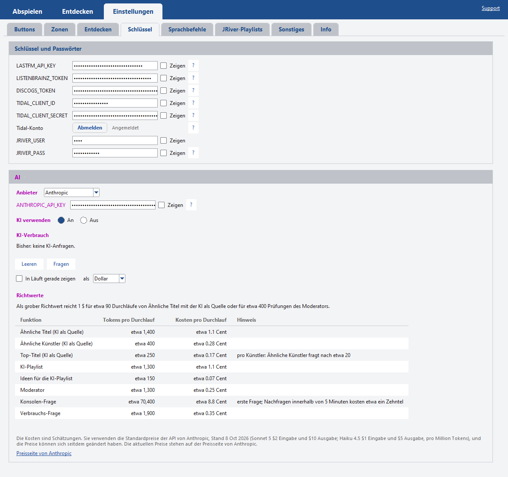

Schlüssel und Passwörter für jeden Dienst, versteckt, bis du **Zeigen** anhakst. Jedes **?** erklärt, wo du den Schlüssel bekommst:

- **Last.fm**: eingebaut, du kannst das Feld also leer lassen. Ein eigener kostenloser Schlüssel wird stattdessen verwendet, wenn du ihn einträgst.
- **ListenBrainz**: kostenlos und sehr lohnend.
- **Discogs**: kostenlos, für die Mitwirkenden eines Albums und als zweite Quelle für Label.
- **Tidal**: kostenlos. Melde dich auf developer.tidal.com mit einem Tidal-Konto an, öffne Dashboard, wähl Create App und kopier dann Client ID und Client Secret in die beiden Tidal-Felder. Tidal braucht beide. Um auch Playlists an Tidal zu senden, drück in der Zeile Tidal-Konto auf **Bei Tidal anmelden**, nachdem du die Weiterleitungsadresse und die Playlist-Berechtigungen, die sein **?** beschreibt, deiner App auf developer.tidal.com hinzugefügt hast. Die eigene Anmeldeseite von Tidal öffnet sich in deinem Browser; 24bit7 sieht dein Passwort nie und merkt sich die Anmeldung, bis du **Abmelden** drückst.
- **KI**: nötig für KI-Playlist, KI als Quelle, den Moderator und Konsolen-Frage. Sie steht zuletzt, in einem eigenen Kasten, beginnend mit **Anbieter**: **Anthropic** (Claude), **OpenAI**, **Google Gemini** oder **Ollama (Local)**. Nur die Felder des gewählten Anbieters erscheinen, und jeder Schlüssel bleibt gespeichert, beim Zurückwechseln geht also nichts verloren. Die Cloud-Anbieter kosten Geld, höchstens ein paar Cent pro Playlist, und jeder braucht seinen eigenen Schlüssel (das **?** sagt, wo du ihn bekommst). **Ollama** lässt ein Modell kostenlos auf deinem eigenen PC laufen: Installier es von ollama.com, lade ein Modell (zum Beispiel `ollama pull gemma3:4b`) und wähl es dann unter **OLLAMA_MODEL**, wo **Aktualisieren** zeigt, was Ollama installiert hat. Die Adresse ist schon eingetragen. Kleinere lokale Modelle liefern gröbere Ergebnisse und kennen sich weniger mit Musik aus, und Konsolen-Frage ist mit Ollama nicht verfügbar, da sie mehr schickt, als ein lokales Modell fassen kann. Läuft Ollama nicht oder ist das Modell nicht installiert, sagt es die Konsole. Bisher ist nur Anthropic vollständig getestet: OpenAI, Google Gemini und Ollama sollten funktionieren, und Rückmeldungen dazu sind im JRiver-Forum oder auf GitHub sehr willkommen. **KI verwenden** unter dem Anbieter, An oder Aus, pausiert alles, was KI-Guthaben verbraucht, ohne den Schlüssel zu entfernen: KI-Playlist und die Auswahl des Moderators werden grau, die KI als Quelle wird übersprungen, Drift mit KI weicht auf die Quellen aus, und Konsolen-Frage und Stimmung erkennen ruhen, mit einer Zeile pro Playlist in der Konsole. Schalt wieder An, und jede Einstellung ist, wie du sie gelassen hast. **KI-Verbrauch** steht darunter: die Tokens, die jede KI-Funktion seit dem letzten Zurücksetzen verbraucht hat, mit geschätzten Kosten, und **Richtwerte** dazu, was 1 $ bringt und was jede Funktion pro Durchlauf kostet (dein eigener Durchschnitt, sobald du sie dreimal verwendet hast). **Fragen** fragt die KI, wohin die Tokens gehen und mit welchen Einstellungen es weniger würden, und antwortet in der Konsole. **In Läuft gerade zeigen** setzt die Summe rechts in die Zeile mit den Reitern Läuft gerade und Suche, in Dollar oder Tokens; ein Klick darauf wechselt. Die Kosten sind Schätzungen nach den Standardpreisen des gewählten Anbieters zum angezeigten Datum, die sich seitdem geändert haben können; deine tatsächliche Rechnung steht in der Konsole deines Anbieters. Mit Ollama zeigen die Richtwerte Kostenlos.
- **JRiver** Benutzername und Passwort: nur, wenn du sie in JRiver unter Extras > Optionen > Mediennetzwerk > Authentication festgelegt hast. Neuere JRiver-Versionen brauchen sie womöglich für **Als Playlist speichern** in Review.

Schlüssel verlassen deinen PC nie, außer zu dem Dienst, zu dem sie gehören, und sie stehen nie in einem Log.

### Die Seite Sprachbefehle


Schaltet Sprache ein, enthält den Schlüssel, den der Alexa-Skill schickt, und legt **Neue Playlists** fest; die Zonen und Playlists der Geräte stehen unter [Einstellungen > Geräte](#geräte). **Zeitausgleich beim Umschalten** stimmt das Umschalten auf einen Sonos oder anderen DLNA-Lautsprecher fein ab: Wiederholt er den letzten Moment, den du im anderen Raum gehört hast, stell es Richtung Minus; springt er ein wenig, Richtung Plus. **Neue Playlists** legt fest, was eine per Sprache angeforderte Playlist tut, wenn in der Zone schon etwas läuft: **Nach diesem Titel** (Standard) lässt den Song zu Ende spielen, entfernt, was danach eingereiht war, und spielt die neue Playlist als Nächstes; **Sofort abspielen** übernimmt sofort. Eine gestoppte oder pausierte Zone startet in beiden Fällen sofort, und Alben, Songs, deine JRiver-Playlists und Shuffles spielen immer sofort. **Test** schickt einen gespielten Befehl, als hätte ein Gerät ihn gehört. Siehe [Sprachbefehle](#sprachbefehle) und [Den Alexa-Skill einrichten](#den-alexa-skill-einrichten).

### JRiver-Playlists

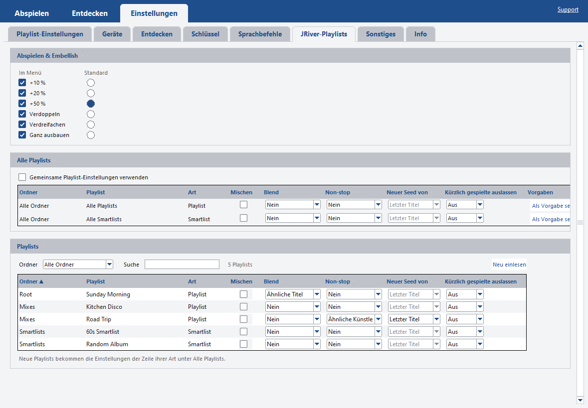

**Abspielen & Embellish** ist eine Tabelle mit einer Zeile für jede Menge. **Im Menü** hakt die Mengen an, die der Pfeil neben Abspielen & Embellish im Tab Abspielen anbietet, und **Standard** ist die, die die Schaltfläche selbst hinzufügt. Mindestens eine bleibt angehakt; bleibt nur eine, verschwindet der Pfeil. Die übrigen Spalten sagen, wie eine Menge gebaut wird. **Mischen** spielt das Ergebnis gemischt ab; ohne Haken behält deine Playlist ihre Reihenfolge, die neuen Titel eingewoben. **Deep Cuts** (Aus, Verteilt oder Gemischt) fügt Titel hinzu, die du am wenigsten gespielt hast, aus dem Genre, das der größte Teil der Playlist teilt, und der Prozentwert daneben sagt, wie viele, als Anteil dessen, was Embellish hinzugefügt hat. Der **Moderator** (Aus, Locker, Ausgewogen oder Streng) prüft die neuen Titel gegen die Playlist und entfernt, was nicht passt; er verbraucht KI-Guthaben und ruht, bis die KI eingerichtet ist. **Dieselben Einstellungen für jede Menge** ist zu Beginn angehakt: Die Zeile **Alle Mengen** gilt für alle sechs, und die eigenen Zeilen der Mengen sind ausgegraut und zeigen sie. Nimm den Haken weg, und jede Menge hat ihre eigene Zeile, eine Kopie der Zeile Alle Mengen, bis du sie änderst. Solange die Zeile [Mehr Optionen](#mehr-optionen) offen ist, gehen ihre Schalter vor, wie bei jeder Playlist. Mischen ist zu Beginn an; hattest du vor 1.33.0 Der Reihe nach abspielen gewählt, beginnt Embellish ohne den Haken, es ändert sich beim Upgrade also nichts. Lass den Mauszeiger auf dem Titel ruhen, um zu sehen, was jede Menge hinzufügt.

Wie deine eigenen JRiver-Playlists und Smartlists laufen, wenn du sie per Sprache anforderst: **Mischen**, **Blend**, **Non-stop**, **Neuer Seed von** (Letzter Titel, 2. Titel oder **Ganze Playlist**, also Keep It Tight: Jeder Nachschub nimmt einen Titel der Playlist selbst als Seed) und **Kürzlich gespielte auslassen**. Mischen ist bei einer neuen Installation angehakt; Zeilen, die vor 1.33.0 gespeichert wurden, behalten, was in ihnen steht. **Als Vorgabe setzen** in den Zeilen Alle Playlists und Alle Smartlists kopiert diese Zeile in die Playlists ihrer Art, die in der Tabelle angezeigt werden (filtere vorher nach Ordner, um nur einen Ordner einzustellen), und neue Playlists beginnen damit. **Blend** webt neue Musik in die Playlist ein, einer von deinen, dann ein neuer, aus ähnlichen Künstlern oder ähnlichen Titeln, bis zu 50 neue Songs: Die Playlist startet sofort, und die neuen Songs kommen ein paar Sekunden später dazu. Lass den Mauszeiger auf Blend oder Non-stop ruhen für eine Erklärung. Hake **Gemeinsame Playlist-Einstellungen verwenden** an, um alle auf einmal einzustellen, oder nimm den Haken weg und gib jeder Playlist ihre eigene Zeile. Die Tabelle zeigt Ordner und Art jeder Playlist, sortiert nach Ordner oder Name und kann einen Ordner allein zeigen. Eine Playlist, an der nichts geändert ist, läuft genau so, wie JRiver sie hat.

### Sonstiges


- **Profile**: Speicher deine Einstellungen mit **Speichern unter...** als Profil (DJ, Entdecken, Ohne KI...) und wechsle mit **Laden** zwischen ihnen, was 24bit7 neu startet, um das Profil anzuwenden; JRiver spielt weiter. Hake **Umschalten erlauben** neben den Profilen an, die das Tastenkürzel **Profil wechseln** durchgehen soll (neue Profile sind anfangs angehakt). Ein Profil enthält deine Playlists mit ihren Configs, Einstellungen und Filtern, die Playlist-Auswahl jedes Geräts, die Filter, JRiver-Playlists, die Optionen im Abspielen-Tab und die Zeilen unter JRiver-Playlist hinzufügen, die Vorhör-Zone, Standardzone und Folgen, die Zone der Tastenkürzel, die Wahl im Fenster KI-Playlist, KI verwenden sowie Cache- und Konsolen-Einstellungen. Schlüssel, die JRiver-Verbindung, welche Zonen angezeigt werden, die Namen und Zonen der Geräte, Tastenkürzel (auch die der Playlists), Sprache und Aussehen bleiben, wie sie sind. Ein Profil, das vor 1.29.0 gespeichert wurde, lädt in die Standard-Playlists und lässt deine eigenen, wie sie sind. **Aktuell** nennt das verwendete Profil, mit "(geändert)", sobald etwas davon abweicht. Profile sind kleine Dateien in einem Ordner `profiles` neben 24bit7, sie überstehen also Updates und lassen sich auf einen anderen PC kopieren.
- **Allgemein**: **Cache behalten für** (1 Monat, 1 Jahr oder Dauerhaft) mit **Cache leeren...** (älter als ein Monat, älter als ein Jahr oder alles), der JRiver-Host, falls JRiver auf einem anderen PC läuft, **Sprache** (Englisch oder Deutsch, mit Neustart; darunter, wo du nach einer anderen Sprache fragen kannst), das **Design** (Hell oder Dunkel, beim Neustart angewendet), **Akzentfarbe** (die Farbe der Reiter, Schaltflächen und Überschriften im dunklen Design und die der Konsole in beiden Designs: **Farbe wählen** öffnet die Farbauswahl von Windows, **Standard verwenden** kehrt zum Grün zurück, und eine Vorschau darunter zeigt Logo, zwei Schaltflächen und die Konsole in deiner Farbe, bevor du neu startest; eine Farbe, die zu dunkel zum Lesen ist, wird heller gemacht, eine Farbe nahe Magenta wird davon weggerückt, denn Magenta kennzeichnet alles, was KI-Guthaben verbraucht, und sie wird in Profilen gespeichert), **Titelleiste von Windows verwenden** (ohne Haken reichen die Tabs bis oben ins Fenster, mit eigenem Minimieren, Maximieren und Schließen), **Mitwirkende zeigen** (Album/Aktueller Titel oder Album/Alle Titel, mit **Zuerst zeigen** auf Titel oder Album) und **Konsolen-Frage einschalten**.
- **Weitere Ausgaben**: die Dienste, die die Ausgabe-Liste im Abspielen-Tab neben deinen Zonen anbietet. **YouTube**, anfangs angehakt, hat darunter seine **Länge der YouTube-Playlist** (bis zu 50) und **Offizielle Musikvideos bevorzugen**. **Tidal** sagt, ob du angemeldet bist, und **Öffnen in** wählt, wo eine gefüllte Playlist öffnet: in der Tidal-App (Voreinstellung) oder auf der Tidal-Website. Nimmst du den Haken bei dem weg, auf das Ausgabe gerade steht, geht Ausgabe zurück auf Gleiche Zone. Die Playlist-Knöpfe von Entdecken stellst du separat ein, unter Einstellungen > Entdecken.
- **Multiroom**: der experimentelle Abschnitt aus [Multiroom](#multiroom): Multiroom einschalten, Leitzone und Folgezone, was im Netzwerk gefunden wurde, Uhr prüfen, der DLNA-Server und die Feineinstellungen mit Nudge. Bleibt auf diesem PC, nicht in Profilen.
- **Zonen**: welche JRiver-Zonen die Listen Zone und Ausgabe zeigen (nimm den Haken weg, um eine zu verstecken; **Neu einlesen** fragt JRiver erneut nach seinen Zonen, und ein DLNA-Lautsprecher wie Sonos erscheint erst, wenn in JRiver DLNA Controller angehakt ist, unter Extras > Optionen > Mediennetzwerk > Advanced), die **Standard**-Zone, mit der Läuft gerade beim Start von 24bit7 öffnet (eine von Hand gewählte Zone gewinnt immer), und **Der aktiven Zone von JRiver folgen**, was Läuft gerade der Zone folgen lässt, die JRiver gerade aktiv hat, sodass keine Zone die Standardzone ist. Bleibt auf diesem PC, nicht in Profilen.
- **Quellen**: **Quellen testen** fragt jede Quelle, was einer festen Auswahl von Seed-Titeln aus 17 Genres ähnelt, und zählt, wie viele Antworten in deiner Bibliothek sind. Wähl **Vollständig** oder **Schnell** (das Fenster sagt ungefähr, wie lange jedes dauert), und hake **KI einbeziehen** an, um auch die KI zu testen, was ein paar Cent kostet. Es läuft im Hintergrund und pausiert, während eine Playlist erstellt wird, du kannst 24bit7 also weiter benutzen, und die Konsole sagt, wann es fertig ist. Die zwei Tabellen zeigen dann für jede Quelle **Wertung** (wie viele ihrer Vorschläge in deiner Bibliothek sind, verglichen mit der besten Quelle in jedem Genre; gemessen wird die Reichweite, nicht der Geschmack), **Am besten bei** und **Am schwächsten bei** (ihre drei besten und schwächsten Genres), für Künstler-Quellen und Titel-Quellen, und **Alle Ergebnisse** zeigt jedes Genre gegen jede Quelle. Die Quellen jeder Config zeigen dieselbe Wertung neben sich. Bis du es laufen lässt, stammen die Werte aus der Bibliothek des Entwicklers, mit dem Hinweis, dass deine abweichen werden. Das Genre ist nur die Beschriftung jedes Test-Seeds: Nichts wird nach deinen Genre-Tags beurteilt.
- **Windows**: **Mit Windows starten** startet 24bit7 bei der Anmeldung. **Im Infobereich starten** hält es versteckt, wenn Windows es startet. **Ins Infobereich schließen** lässt den Schließen-Knopf des Fensters 24bit7 verstecken statt beenden, sodass Sprache weiter zuhört; beenden über das Symbol im Infobereich.
- **Tastenkürzel**: je eine Taste für Songs des Künstlers mischen, **Zone wechseln** (bringt das Laufende in die nächste unter Umschalten erlauben angehakte Zone), **Profil wechseln** (lädt das nächste unter Umschalten erlauben in Profile angehakte Profil, von A bis Z, und startet 24bit7 neu, während JRiver weiterspielt; während des Erstellens gedrückt, sagt die Konsole, dass gewechselt wird, sobald die Playlist fertig ist), **Weiterlaufen lassen** (Non-stop, einmalig, für das, was in der Kürzel-Zone läuft) und ein Feld **Laden** für jedes gespeicherte Profil, das dieses Profil genauso lädt oder nichts tut, wenn es schon geladen ist, sodass eine Fernbedienung oder Automatisierung immer beim gemeinten Profil landet. Das eigene Kürzel einer Playlist stellst du im Feld **Tastenkürzel** auf ihrer Seite unter Playlists ein. Sie funktionieren überall in Windows, auch mit 24bit7 im Infobereich, sodass eine Fernbedienung, die Tastendrücke sendet (ein Flirc, eine Harmony, eine Handy-App), vom Sofa aus eine Playlist starten kann. Klick in ein Feld und drück die Tasten; Esc bricht ab. Buchstaben und Zahlen brauchen Strg, Alt, Umschalt oder Win; F-Tasten und Medientasten gehen auch allein. Gehört eine Kombination schon einem anderen Programm, sagt 24bit7 es.

### Info

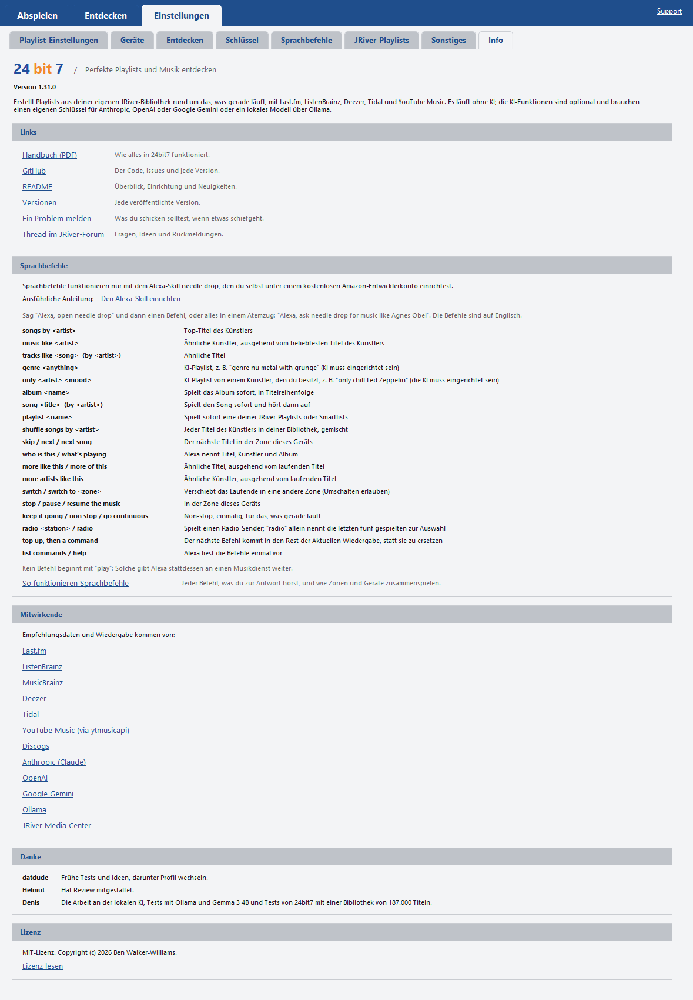

Die Version, die du verwendest, Links zu diesem Handbuch, GitHub und den Versionshinweisen, die Sprachbefehle auf einen Blick, Dank an die Dienste, die 24bit7 verwendet, und an die Menschen, die geholfen haben, es zu gestalten.

---

## Wie Playlists entstehen

### Mischen der Quellen

Jede angehakte Quelle liefert eine Rangliste. 24bit7 führt sie mit Gewichtung nach Position zusammen: Weit oben in einer Liste bringt viel, in mehreren Listen zu stehen bringt mehr. Es holt mehr, als es braucht, und kürzt dann, sodass das Ergebnis die Übereinstimmung der Quellen widerspiegelt und nicht die Eigenheiten einer einzelnen.

**Müssen einig sein** legt fest, wie viele Quellen einen Künstler oder Titel vorschlagen müssen, bevor er verwendet wird. Schaffen zu wenige diese Hürde, lockert 24bit7 sie Schritt für Schritt, nie unter 2, und sagt es in der Konsole. Das hält das Rauschen fern, das manche Dienste mitbringen, etwa was ihre Hörer an diesem Tag sonst noch gespielt haben.

Ist die KI eine Quelle und ist keiner ihrer Vorschläge in deiner Bibliothek, fragt 24bit7 sie noch einmal, nennt, was danebenlag, und bittet um andere. Das gilt für Ähnliche Künstler, Titel-Abgleich und die KI-Runden von Drift, und die Konsole sagt, wenn es passiert.

### Titel-Abgleich

Ähnliche Künstler fragt: "Wer klingt wie dieser Künstler?" Titel-Abgleich fragt: "Was klingt wie dieser Song?" Das folgt der Stimmung des Seeds viel genauer: Zwei Songs desselben Künstlers führen an verschiedene Orte. Seine Quellen sind Last.fm, ListenBrainz, Tidal, YouTube Music und, wenn angehakt, die KI. Ein Titel, auf den sich zwei oder drei Quellen einigen, steht über einem, den nur eine Quelle vorschlägt. Standardmäßig nimmt es die ähnlichsten Treffer der Reihe nach, derselbe Seed ergibt also dieselbe Playlist. Mit **Abwechslung** sammelt es bis zu doppelt so viele Treffer wie nötig und wählt zufällig, die ähnlichsten am wahrscheinlichsten, derselbe Seed ergibt also jedes Mal eine andere Playlist.

### YouTube Music als Quelle

YouTube Music wird gefragt: "Wenn jemand diesen Titel hört, was würdest du als Nächstes spielen?" Die Antwort ist eine Liste von etwa fünfzig Titeln, passend zur Stimmung des Titels.

- **Mit anderen Quellen angehakt** wird die Liste auf ihre Künstler eingedampft, und diese Liste stimmt beim Mischen ab wie jede andere.
- **Allein angehakt** spielt Ähnliche Künstler die Liste so, wie sie kommt: Jeder Titel wird in deiner Bibliothek gesucht, und die Treffer werden in der Reihenfolge von YouTube eingereiht. Der Seed-Künstler wird auf etwa ein Viertel der Playlist begrenzt.

Es braucht keinen Schlüssel und keine Anmeldung. Es stützt sich auf eine inoffizielle Bibliothek, ytmusicapi, und kann daher ausfallen, wenn YouTube etwas ändert, bis diese Bibliothek nachzieht.

### Consensus

Ein Modus einer Config Künstler-Abgleich oder Titel-Abgleich. Statt die eigene Liste ähnlicher Künstler (oder Titel) des Seeds von oben zu lesen, nimmt er die paar nächsten des Seeds, den **Kreis** (3 bis 5), holt zu jedem seine eigene Liste ähnlicher und behält nur, was **Müssen einig sein** oder mehr dieser Listen gemeinsam haben, die größte Einigkeit zuerst, nach dem Kreis selbst. Es ist eine engere Vorstellung von "ähnlich": nicht, was dem Seed nahe ist, sondern was allem nahe ist, was dem Seed nahe ist. Steht **Seed** auf Playing Now, bilden die zufällig gewählten Künstler oder Titel den Kreis, es findet also, was deine ganze Aktuelle Wiedergabe gemeinsam hat. Ein Nachbar, der in Wahrheit ein Mitglied des Kreises unter anderem Namen ist (Nick Cave & The Bad Seeds neben Nick Cave), wird übersprungen. Ein kleinerer Kreis und mehr Einigkeit ist enger und kann knapp ausfallen; die Konsole sagt, worauf sich der Kreis geeinigt hat und wie viele es waren, und Drift füllt auf, wenn es an ist. Hak in seinem Abschnitt **Findet Consensus weniger als** an, und ein enger Kreis lässt dich nicht knapp: Der Rest der Playlist ist einfacher Abgleich aus der eigenen Liste des Seeds, und die Konsole sagt, wie viele von wo kamen. Die mitgelieferte Playlist **Consensus** ist Künstler-Abgleich mit einem Kreis von drei, einig ab zwei.

### Schnellstart

Läuft in der Ausgabe-Zone nichts, startet der erste gefundene Titel sofort, und der Rest folgt in der Aktuellen Wiedergabe, während er gefunden wird, die Musik beginnt also innerhalb von ein, zwei Sekunden. Läuft schon etwas, läuft es weiter, und die neue Playlist reiht sich dahinter ein. Ausgabe auf YouTube wartet auf die ganze Liste, da der Link nur einmal erstellt wird. Im Review-Modus wird gar nichts geschickt: Die Titel kommen in die Review-Liste, damit du auswählen kannst.

Keine Playlist wartet in Stille. Abspielen & Embellish startet den ersten Titel der Playlist selbst, Radio einen Song einer Säule, und die KI-Playlist stellt zuerst eine schnelle Anfrage nach einem Eröffnungstitel, der läuft, während die ganze Liste gefunden wird ("Spielt zuerst, während die KI den Rest sucht"). Die schnelle Anfrage entfällt, wenn schon Musik läuft, bei Steer und mit Ollama, wo zwei Anfragen zugleich einander ausbremsen würden.

### Einreihen

Neue Titel werden rund um den aktuellen eingereiht: Der Rest der Aktuellen Wiedergabe wird geleert, der aktuelle Titel spielt ohne Lücke weiter, und die neue Playlist folgt ihm. Die Aktuelle Wiedergabe enthält dann genau "was ich gehört habe, plus was 24bit7 gewählt hat", was sich sauber als JRiver-Playlist speichern lässt. Eine gestoppte Zone startet die Playlist sofort. Kommt der Seed aus einer Zone und geht die Playlist in eine andere, eröffnet der Seed-Titel die Playlist in der neuen Zone.

### Überblenden

24bit7 ändert nicht, wie JRiver von einem Titel zum nächsten wechselt, aber Überblenden lässt eine Mischung schön fließen. Setz in JRiver unter Extras > Optionen > Audio > Track Change **Switch tracks** auf **S-Curve** mit etwa sechs Sekunden und lass **Use gapless for sequential album tracks** angehakt. Dann blenden Mischungen von einem Song in den nächsten über, während Alben, die der Reihe nach laufen, nahtlos bleiben. **S-Curve (aggressive)** holt den nächsten Titel kräftiger herein, eher wie ein DJ. Die Einstellung gilt pro Zone, setz sie also in jeder Zone, in der du sie haben willst. Ein Sonos- oder anderer DLNA-Lautsprecher bekommt davon nichts mit, da er jeden Titel selbst abspielt.

### Drift

Eine Bibliothek hat nicht immer genug, um die angestrebte Länge zu erreichen. Mit **Drift** sucht 24bit7 ausgehend vom bereits Gefundenen weiter, drei Seeds pro Runde, und schaut nach ihren ähnlichen Titeln oder ähnlichen Künstlern, je nachdem, was **Drift mit** sagt.

- **Keep It Tight** nimmt nur Titel der ersten Runde als Seeds, sodass sich nichts mehr als zwei Schritte von deinem Seed entfernt. War die erste Runde kurz, gehen womöglich die Seeds aus, und die Playlist bleibt kurz; die Konsole sagt es dann.
- **Weit** nimmt Seeds aus der ganzen Playlist, auch aus dem, was Drift selbst gefunden hat, kann also weiter wandern und sich dabei in mehrere Richtungen verzweigen. **Runden** legt fest, wie oft es versucht, von 1 bis 6. Mehr Runden füllen mehr Lücken, wandern aber weiter vom Seed weg. Mit Ausgabe an JRiver wird der erste Durchgang sofort eingereiht, und jede Runde kommt dazu, sobald sie gefunden ist.

**Drift-Quellen** können den eigenen Quellen der Config folgen oder **Eigene Quellen** mit eigenem **Quellen, die übereinstimmen müssen** verwenden, sodass der erste Durchgang beständig bleibt und das Auffüllen abenteuerlicher wird. Dieselben Quellen halten die Vorschläge von Drift am nächsten am Seed; Eigene Quellen geben Drift einen anderen Weg.

Findet die erste Runde gar nichts, beginnt Drift mit **Eigene Quellen** noch einmal beim Seed selbst, mit seinen eigenen Quellen, und macht mit dem weiter, was das findet. Mit denselben Quellen wie die Playlist würde es nur die gerade gescheiterte Suche wiederholen, daher sagt die Konsole das stattdessen.

In einer KI-Playlist kann Drift aus deinen Musikquellen auffüllen, was kein Guthaben verbraucht, oder die KI erneut fragen und ihr sagen, was schon versucht wurde.

### Deep Cuts

So gut die Quellen auch sind, sie neigen zum Bekannten: Last.fm und ListenBrainz beruhen auf dem, was Millionen Menschen hören, und die Top-Titel eines Künstlers sind seine Hits. In einer großen Sammlung bleiben so Ecken, die nie drankommen. **Deep Cuts** füllt jede Playlist aus diesen Ecken auf, nur mit deiner Bibliothek und ihren eigenen Tags, ohne KI und ohne Daten von außen.

- **Einschalten:** **Deep Cuts** auf der Seite jeder Playlist: **Aus**, **Verteilt** (gleichmäßig über die Playlist, damit der Anfang das Gefühl des Seeds behält) oder **Gemischt** (zufällig dazwischen). Der erste Titel bleibt immer vorn. Es gilt für Ähnliche Künstler, Titel-Abgleich und KI-Playlist und deren Non-stop-Nachschub; Top-Titel des Künstlers und Artist + Guests drehen sich um einen Künstler und bekommen daher nie Deep Cuts.
- **Wie viele:** **Mit Deep Cuts auffüllen um** auf der Seite jeder Playlist: anfangs 10%, bis zu 100%. Sie kommen obendrauf: 10% von 30 Titeln ergibt 3, und 100% verdoppelt die Playlist, eine gleichmäßige Mischung.
- **Das Genre** ist das eigene Genre-Tag des Seed-Titels (ein Tag wie "Dub; Reggae" zählt als beides). Für einen gesuchten Titel, den du nicht besitzt, ist es das häufigste Genre des Künstlers in deiner Bibliothek; für eine KI-Playlist, die keinen Seed-Titel hat, das Genre, das die meisten Vorschläge der KI teilen. Ohne Genre sagt es die Konsole, und es kommt nichts dazu. Am besten funktioniert es, wenn deine Genres gut gepflegt sind: Ein breites Genre wie "Rock/Pop" ergibt lockerere Deep Cuts als ein sauberes "Trip-Hop".
- **Ähnliche Künstler** nimmt die Künstler dieses Genres, deren Titel im letzten Jahr am wenigsten gespielt wurden, über alle ihre Titel betrachtet, sodass ein letzte Woche gespielter Song einen Künstler nicht "aktuell" macht. Aus dem am wenigsten gespielten Fünftel wählt es zufällig und spielt dann einen ihrer bekanntesten Titel, die du besitzt.
- **Titel-Abgleich und KI-Playlist** nehmen die am wenigsten gespielten Titel des Genres: die wenigsten Wiedergaben, dann am längsten nicht gespielt, nie gespielte zuerst. Aus dem am wenigsten gespielten Fünftel wählen sie zufällig.
- **Was draußen bleibt:** alles, was schon in der Playlist ist, Titel unter anderthalb Minuten (Intros und Zwischenspiele), versteckte Albumabschlüsse, wenn Versteckte Titel an ist, alles, was deine Filter oder das Auslassen kürzlich gespielter Titel weglassen, und mehr als ein Titel pro Künstler. Ein Titel auf einem Sampler mit dem Namen "Künstler - Titel" zählt als dieser Künstler.
- **Der Moderator** prüft Deep Cuts, wenn er an ist, wie jeden anderen Titel und ersetzt alle, die er herausnimmt.
- **YouTube und Tidal:** Steht Ausgabe auf einem davon, wird jeder Deep Cut auch dort gesucht; was es dort nicht gibt, bleibt draußen.
- **In der Konsole:** *Deep Cuts (Trip-Hop, verteilt): 6 aus Titeln, die du selten hörst: Tosca - Chocolate Elvis, …*, oder der Grund, warum keine dazukamen. Entdecken listet sie mit "Deep Cuts" als Quelle.

### Moderator

Die meisten Playlists stimmen bis auf einen Titel: die Stadionhymne mitten in einer Reihe akustischer Songs. Der Moderator schickt jede Playlist einmal an die KI (das schnelle Modell des gewählten Anbieters), mit dem Seed, und entfernt Titel, die einen Hörer aus der Stimmung reißen würden. Er beurteilt Stimmung, Energie und Atmosphäre, nie das Genre allein. Titel, die er nicht gut genug kennt, werden behalten, und jede Entfernung wird mit Grund protokolliert.

- **Locker** entfernt nur klare Ausreißer, höchstens ein Fünftel der Titel.
- **Ausgewogen** entfernt alles, was Stimmung, Energie oder Atmosphäre merklich verschiebt, höchstens zwei Fünftel.
- **Streng** behält nur Titel nah am Seed, egal wie viele übrig bleiben. Drift kann eine zu kurze Playlist auffüllen.

Vorab werden ein paar Titel mehr gefunden, damit Entfernte ersetzt werden. Das kostet einen Bruchteil eines Cents pro Playlist (mit Ollama nichts). Scheitert die Prüfung, wird die Playlist ganz normal erstellt, und die Konsole sagt, warum. Auch ein einzelner Titel wird bei Ausgewogen und Streng geprüft; Locker überspringt ihn und sagt es, da höchstens ein Fünftel eines Titels keiner ist. Wann immer der Moderator eingestellt ist, aber nicht laufen kann (keine KI eingerichtet oder KI verwenden aus), sagt die Konsole einmal pro Playlist, warum.

Drift-Runden werden gegen die bisherige Playlist und den Seed geprüft, was einen Ausreißer viel leichter erkennbar macht. **Moderator für Drift-Titel** (Ähnliche Künstler und Titel-Abgleich) kann Drift strenger prüfen als die erste Runde oder gar nicht; Wie die Playlist folgt der Stufe der Playlist selbst. Liegt die Hälfte oder mehr von dem, was ein Seed gebracht hat, daneben, fliegt auch der Rest raus (die Konsole nennt jeden Titel), und Drift nimmt diese Kette nicht mehr als Seed, innerhalb der Grenze der Stufe. Das passiert nie, wenn die Runde dann leer wäre: Dann gehen nur die markierten Titel. Der Moderator bittet die KI um ihre beständigste Antwort, sodass dieselben Titel dasselbe Urteil bekommen, soweit es jeder Anbieter zulässt, und Streng behält einen Titel, der nur knapp danebenliegt.

### Non-stop

Mit **Non-stop** beobachtet 24bit7 die Zone, und wenn der letzte Titel einer Playlist, die es erstellt hat, zu spielen beginnt, fügt es weitere hinzu. **Keep It Tight** nimmt für jeden Nachschub einen Titel der ursprünglichen Playlist als neuen Seed, jedes Mal einen anderen, sodass der Abend nah am Anfang bleibt; wenn alle verwendet sind, geht es als **Wander** weiter, und die Konsole sagt es. Wander folgt der Musik:

- **Ähnliche Künstler und Titel-Abgleich** machen mit ähnlichen Künstlern oder ähnlichen Titeln weiter, ausgehend vom **letzten Titel** (sodass die Musik im Lauf des Abends weiterwandert) oder vom **2. Titel** (sodass sie näher am Anfang bleibt).
- **Top-Titel des Künstlers** kann zuerst die übrigen Songs des Künstlers aus deiner Bibliothek spielen, gemischt, und dann bei seinem beliebtesten Titel weitermachen. Artist + Guests macht genauso weiter.
- **KI-Playlist** kann die KI um mehr bitten oder mit ähnlichen Künstlern oder ähnlichen Titeln weitermachen, was kein Guthaben verbraucht.

Eine Playlist folgt den ganzen Abend den Non-stop-Einstellungen der Playlist, die sie erstellt hat; eine Playlist aus mehreren Configs macht als die Config weiter, die **Weiter als** in ihrem Mix nennt. Ein Nachschub einer anderen Art (eine Playlist Ähnliche Künstler, die mit ähnlichen Titeln weitermacht) startet die Standard-Playlist dieser Art, unter den Filtern der ursprünglichen Playlist. Jeder Nachschub geht durch diese Filter und überspringt alles, was die Zone schon hatte. Nur Playlists, die 24bit7 geschickt hat, werden aufgefüllt: Ein Album, das du selbst in JRiver startest, endet ganz normal. Hast du die Wiedergabe gestoppt oder pausiert, kommt nichts dazu; drück wieder auf Play, und Non-stop macht weiter.

### Abgleich mit der Bibliothek

Empfehlungen kommen als Namen, und Namen sind unordentlich. 24bit7 kommt zurecht mit Akzenten (JAŸ-Z und JAY-Z), ähnlich aussehenden Satzzeichen, Versionsangaben wie "(Remastered)", "&" und "+" gegenüber "and", "$" für "s" (Travi$ Scott), Wörtern in Klammern in beiden Richtungen, Initialen mit Punkten (UNKLE und U.N.K.L.E.), Sortiernamen ("XX, The"), Künstlerfeldern von JRiver mit mehreren Werten, Bandnamen ("The Jimi Hendrix Experience" findet "Jimi Hendrix") und einem weggelassenen "g" ("Smokestack Lightnin'" findet "Smokestack Lightning"). Die ganze Bibliothek liegt ab dem Start von 24bit7 im Speicher, der Abgleich geht also sofort.

### Ausgabe auf YouTube

Mit Ausgabe auf YouTube wird die Playlist wie üblich erstellt, dann wird zu jedem Titel das Video gesucht, und die Liste öffnet sich in deinem Browser als Sofort-Playlist: keine Anmeldung, nichts wird in einem Konto gespeichert. Ein Video wird nur genommen, wenn der Künstler passt, denn eine Coverversion ist schlimmer als eine Lücke. Der Ton auf YouTube ist verlustbehaftet, das ist also zum Reinhören vor dem Kauf gedacht oder für jemanden, der die Musik nicht besitzt.

### Ausgabe auf Tidal

Mit Ausgabe auf Tidal wird die Playlist wie üblich erstellt, dann wird jeder Titel auf Tidal nach Künstler und Titel gesucht, die Studioversion zuerst, und die Liste kommt in deine Tidal-Playlist namens **24bit7**, anstelle dessen, was dort war, die sich dann in der Tidal-App öffnet (oder auf der Tidal-Website, wie es **Öffnen in** unter Einstellungen > Sonstiges sagt; auch dort, wenn die App nicht installiert ist). Sie wird beim ersten Mal angelegt, und 24bit7 füllt immer nur die eine mit genau diesem Namen, benenne sie also in Tidal um, um eine Playlist zu behalten, die dir gefällt. Titel, die Tidal nicht hat, bleiben draußen, und die Zeile Fertig zählt sie. Tidal beantwortet etwa zwei Anfragen pro Sekunde, eine erste Playlist mit 30 neuen Titeln dauert also etwa eine halbe Minute; schon gefundene Titel kommen aus dem Cache. Nimmt Tidal deine Anmeldung nicht mehr an, sagt die Konsole, dass du dich unter Einstellungen > Schlüssel neu anmelden sollst.

### Cache und Verlauf

Jede Antwort jedes Dienstes wird in einer lokalen Datenbank aufbewahrt, standardmäßig einen Monat (Cache behalten für, unter Einstellungen > Sonstiges: 1 Monat, 1 Jahr oder Dauerhaft), sodass eine wiederholte Playlist mit demselben Seed nichts kostet, auch kein KI-Guthaben. **Cache leeren...** entfernt Antworten, die älter als ein Monat oder ein Jahr sind, oder alle. Eine Antwort, dass MusicBrainz einen Künstler nicht kennt, wird immer nach einem Monat neu geprüft. Dieselbe Datenbank hält jede Playlist und jeden Treffer und jedes Fehlende fest, und das zeigt Entdecken.

---

## Multiroom

Multiroom spielt das, was dein Sonos spielt, auch auf deiner Hauptanlage, im Gleichtakt, sodass Küche und Wohnzimmer wie ein Raum klingen. Es ist experimentell: getestet mit einem Sonos One und einem Chord Hugo TT über ASIO, und es braucht vorerst einen Sonos. Wer es aus lässt, merkt nichts davon.

### Wie es funktioniert

JRiver spielt auf den Sonos genau wie heute. 24bit7 startet ein kleines eigenes Programm, den Folger, der die Uhr des Sonos etwa hundertmal pro Sekunde liest, jeden Titel von einem zweiten JRiver-DLNA-Server mit deinem DSP holt, in der Abtastrate der Datei und mit 24 Bit, und ihn auf deinen DAC spielt, auf diese Uhr gesetzt. Nichts wird neu abgetastet; die Drift wird auf eine Millisekunde gehalten, indem hin und wieder ein einzelnes Sample weggelassen oder wiederholt wird, dazwischen sind die Samples bitgenau. JRivers eigene Zone für diesen DAC ist gestoppt, solange er folgt, damit der DAC frei ist.

Was du hörst: Die beiden Räume starten wenige Millisekunden auseinander und bleiben so, ein ganzes Album lang. Lückenlose Alben bleiben lückenlos. Ein Sprung innerhalb eines Titels wird mitgemacht. Eine Pause, egal wo, in JRiver, aus der Sonos-App oder mit der Taste am Sonos, stoppt beide Räume, und Abspielen startet den Titel in beiden von vorn, weil ein fortgesetzter Titel sich nicht so sicher setzen lässt. Ein Build, der nur an den Sonos geht, während Multiroom spielt, lässt die Hauptanlage ihren Titel zu Ende spielen und aussteigen; ein neuer Build mit Ausgabe auf Multiroom lässt sie wieder folgen, mitten im Titel, wenn einer läuft.

### Einrichten

Zwei Schritte in JRiver, einmalig:

1. Extras > Optionen > Mediennetzwerk > DLNA-Server hinzufügen oder konfigurieren: einen Server namens **Multiroom** anlegen, Format PCM 24-Bit.
2. Die DSP-Studio-Einstellungen deiner Hauptanlage als Voreinstellung speichern und diese Voreinstellung im DSP Studio des Multiroom-Servers laden. JRiver hält die beiden getrennt, also heißt eine spätere Änderung am DSP der Hauptanlage: die Voreinstellung noch einmal laden.

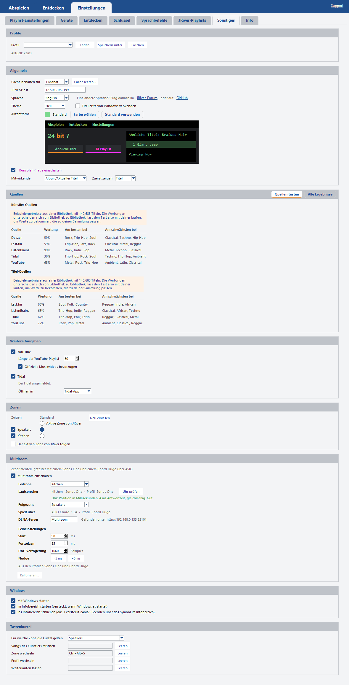

Dann in 24bit7 unter Einstellungen > Sonstiges > Multiroom: **Multiroom einschalten** anhaken, die **Leitzone** (die Zone, die auf den Sonos spielt) und die **Folgezone** (die Zone, deren DAC folgt) wählen. Die Zeile **Lautsprecher** zeigt den im Netzwerk gefundenen Sonos und sein Profil, daneben **Uhr prüfen**; **Spielt über** zeigt den DAC, passend zu JRivers Gerät für die Folgezone, ASIO bevorzugt (WASAPI ist ungetestet); **DLNA-Server** sagt, ob der Multiroom-Server gefunden wurde. Unter **Feineinstellungen** kommen **Start**, **Resume** und **DAC-Verzögerung** aus den Profilen für deine Geräte und lassen sich überschreiben; **Nudge** verschiebt Start um fünf Millisekunden, während Musik spielt, sodass sich die Räume nach Gehör ausrichten lassen, und die Zeile darunter sagt, woher die Zahlen stammen. **Kalibrieren...** misst sie aus einer Handy-Aufnahme: siehe [Kalibrieren](#kalibrieren).

**Uhr prüfen** liest die Uhr des Lautsprechers zehn Sekunden lang, während etwas spielt, und sagt, ob man ihm folgen kann: Grün für eine Millisekunden-Uhr, die Schritt hält; Bernstein für eine, die ganze Sekunden zählt (einen Versuch wert, aber die Räume liegen vielleicht ein paar Hundertstelsekunden auseinander); Rot, wenn sie nicht antwortet oder nicht mit deinem PC Schritt hält.

### Kalibrieren

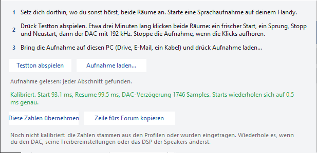

**Kalibrieren...** unter den Feineinstellungen misst die drei Zahlen für deine Geräte aus einer Handy-Aufnahme von etwa drei Minuten, dort gemacht, wo du hörst. Setz dich dorthin, beide Räume an, und starte eine Sprachaufnahme auf deinem Handy. Drück **Testton abspielen**: In beiden Räumen klickt es, der Sonos in einer Tonhöhe, die Hauptanlage in einer anderen, durch einen frischen Start, einen Sprung, Stopp und Neustart und einen Wechsel des DAC auf 192 kHz, sodass jeder Abschnitt eine Sache misst. Die Klickspur kommt für den Lauf in JRivers Bibliothek und am Ende wieder heraus. Stoppe die Aufnahme, wenn die Klicks aufhören, bring sie auf den PC (Drive, E-Mail, ein Kabel) und drück **Aufnahme laden...**: Eine einfache WAV wird so gelesen, wie sie ist, und das m4a, mp3 oder FLAC eines Handys decodiert Windows selbst, nichts zu installieren.

Das Ergebnis lautet etwa "Kalibriert. Start 93 ms, Resume 100 ms, DAC-Verzögerung 1.746 Samples. Starts wiederholen sich auf 1 ms genau." Nichts ändert sich, bis du **Diese Zahlen übernehmen** drückst. **Zeile fürs Forum kopieren** legt eine einzeilige Zusammenfassung in die Zwischenablage, für den Thread oder ein Issue, damit die Zahlen anderer Geräte zu Profilen werden können. Einer Aufnahme, der nicht zu trauen ist (ein Raum zu leise, zu wenige Klicks gefunden, zu viel Streuung), wird mit dem Grund und einem Tipp abgelehnt, und nichts ändert sich. Die Zahlen enthalten, wo das Handy lag, und genau das ist der Sinn: Dort treffen sich die Räume. Wiederhole es, wenn du den DAC, seine Treibereinstellungen oder das DSP der Hauptanlage änderst; ein Neustart oder ein neuer Tag braucht es nicht. Bei der Anlage des Entwicklers stimmten zwei Aufnahmen bei Start und Resume auf eine Millisekunde und bei der DAC-Verzögerung auf dreißig Samples überein, eine davon aus einem Lauf, dem absichtlich falsche Zahlen gegeben wurden.

### Benutzen

Stell Ausgabe im Abspielen-Tab auf **Multiroom** und baue wie gewohnt: Die Playlist geht an den Sonos, die Konsole meldet, in Erweitert, "Multiroom: Speakers following Sonos", und die Hauptanlage setzt innerhalb einer halben Sekunde nach dem ersten Ton ein. Der Eintrag **Multiroom** unter Zone zeigt, was der Sonos spielt. Stopp in der Zeile Läuft gerade stoppt beide Räume; Titel überspringen schaltet beide weiter. Per Sprache lässt "ask needle drop multiroom" die Hauptanlage bei dem einsteigen, was der Sonos gerade spielt, und "single room" behält die Musik im Raum des Echo, der es gehört hat. Per Sprache angeforderte Musik läuft im Raum des Echo, der sie gehört hat, egal, was unter Ausgabe steht: Im Raum des Sonos angefordert, während die Hauptanlage folgt, spielt die Hauptanlage ihren Titel zu Ende und steigt aus, und "multiroom" holt sie zurück. "more like this" und Top-Up fügen dem Laufenden etwas hinzu und lassen die Räume, wie sie sind.

### Gut zu wissen

- Der Sonos bekommt, was JRivers DLNA ihm schickt (44,1 kHz, 16 Bit in der getesteten Anlage); die Hauptanlage bekommt die Datei in ihrer eigenen Rate und mit 24 Bit. Beide spielen verschiedene Wiedergaben desselben Titels.
- Der Folger endet, wenn 24bit7 beendet wird. Der Sonos spielt weiter, wenn JRiver noch auf ihn spielt.
- Eine in der Sonos-App gebildete Sonos-Gruppe, andere Sonos-Modelle, andere DACs und WASAPI sind ungetestet. Uhr prüfen und deine Ohren sind der Test; sag gern, wie es gelaufen ist.
- Die Profilzahlen wurden mit einem Mikrofon an einem Sonos One und einem Hugo TT gemessen. Jeder Chord Hugo passt auf dieses Profil, ein anderes Hugo-Modell sollte also kalibrieren; ein anderer DAC beginnt mit einer Verzögerung von null, bis du nudgest oder eine einträgst.

## Sprachbefehle

Mit Sprachbefehlen bittest du laut um Musik. Sag in der Küche "Alexa, ask needle drop for music like Agnes Obel", und ein, zwei Sekunden später startet auf dem Küchenlautsprecher eine Playlist aus deiner eigenen Bibliothek.

Das läuft über einen eigenen Alexa-Skill, den du einmal einrichtest. Das geht nicht mit einem Klick: [Den Alexa-Skill einrichten](#den-alexa-skill-einrichten) führt dich hindurch. 24bit7 funktioniert auch vollständig ohne.

**Der Skill ist englisch.** Die Befehle sagst du auf Englisch, und Alexa antwortet auf Englisch. Dein Alexa-Gerät muss dafür auf Englisch eingestellt sein; die Sprache eines Geräts stellst du in der Alexa-App ein. Die Konsole von 24bit7 zeigt trotzdem alles auf Deutsch.

### Wie alles zusammenspielt

1. Du sprichst mit einem **Alexa-Gerät**.
2. **Dein Alexa-Skill**, den Amazon betreibt, hört den Befehl und schickt ihn mit einem geheimen Schlüssel und der ID des Geräts an die Adresse deines PCs im Internet.
3. **Tailscale Funnel** gibt deinem PC diese Adresse und reicht die Anfrage an 24bit7 weiter. An deinem Router musst du nichts ändern.
4. **24bit7** prüft den Schlüssel, schaut nach, in welcher Zone das Gerät spielt und welche Playlist es für den Satz startet, und erstellt oder spielt dann die Musik dort.

### Was du sagen kannst

Öffne zuerst den Skill ("Alexa, open needle drop") und sag dann den Befehl, oder sag alles in einem Atemzug: "Alexa, ask needle drop for music like Agnes Obel".

| Sag | Du bekommst |
|---|---|
| "songs by *artist*" | Top-Titel des Künstlers |
| "music like *artist*" | Ähnliche Künstler, ausgehend vom beliebtesten Titel des Künstlers |
| "tracks like *song*" oder "tracks like *song* by *artist*" | Titel-Abgleich |
| "genre *anything*", etwa "genre nu metal with grunge" | KI-Playlist (KI muss eingerichtet sein) |
| "only *Künstler und Stimmung*", etwa "only chill Led Zeppelin" oder "only Queen anthems" | Eine KI-Playlist nur dieses Künstlers: Die KI wählt aus seinen Titeln in deiner Bibliothek, also kommt niemand anderes dazu. Der Künstler muss in deiner Bibliothek sein. Ohne Stimmung ("only Led Zeppelin") seine bekanntesten Songs (KI muss eingerichtet sein) |
| "album *name*" | Spielt das Album sofort, in Titelreihenfolge |
| "song *title*" | Spielt den Song sofort und hört dann auf |
| "playlist *name*" | Spielt sofort eine deiner JRiver-Playlists oder Smartlists, mit ihren Einstellungen aus Einstellungen > JRiver-Playlists |
| "shuffle songs by *artist*" | Jeder Titel des Künstlers in deiner Bibliothek, gemischt, beginnend mit einem seiner bekanntesten Songs |
| "skip", "next" oder "next song" | Der nächste Titel in der Zone dieses Geräts. Das Überspringen wird für den Filter [Übersprungene Titel](#filter-bearbeiten) gezählt |
| "who is this" oder "what's playing" | Alexa nennt Titel, Künstler und Album, die in der Zone dieses Geräts laufen |
| "more like this" oder "more of this" | Titel-Abgleich zum Laufenden. Der aktuelle Titel läuft weiter, und die neue Playlist ersetzt, was danach eingereiht war |
| "more artists like this" oder "music like this" | Ähnliche Künstler zum Laufenden, ebenso nach dem aktuellen Titel |
| "switch" oder "switch to *zone*" | Bringt das Laufende in eine andere Zone, beim selben Song und an derselben Stelle; die verlassene Zone stoppt |
| "multiroom" | Deine Hauptanlage steigt bei dem ein, was der Sonos spielt, im Gleichtakt. Siehe [Multiroom](#multiroom) |
| "single room" | Die Musik bleibt im Raum des Echo, der es gehört hat: im Raum der Hauptanlage gesagt, zieht die Musik dorthin und der Sonos stoppt; im Raum des Sonos gesagt, steigt die Hauptanlage aus |
| "stop the music", "pause the music" oder "resume the music" | Stoppt, pausiert oder setzt die Zone dieses Geräts fort |
| "keep it going", "non stop" oder "go continuous" | Schaltet Non-stop einmalig für das ein, was in der Zone dieses Geräts läuft |
| "radio *Sender*", "*Sender* radio" oder nur "radio" | Spielt einen deiner [Radio](#radio)-Sender, mit den Radio-Einstellungen und Non-stop. "Radio" allein nennt die letzten fünf gespielten Sender, nummeriert, und du antwortest mit einem Namen oder "the second one" |
| "top up", dann ein beliebiger Befehl | Alexa fragt "Top up with what?", und was du danach sagst ("music like Radiohead", "radio jazz", "album Abbey Road"), kommt in den Rest der Aktuellen Wiedergabe, statt sie zu ersetzen, wie Top-Up im Tab Abspielen |
| "list commands" oder "help" | Alexa liest die Befehle einmal vor |

**Radio** findet einen Sender über den Namen, den du ihm gegeben hast, seinen Genre-Namen oder einen Teil davon: "radio folk" findet Folk / Singer-Songwriter. Passen mehrere, nimmt es den zuletzt gespielten, dann den größten. Passt keiner, sagt Alexa das und liest die Liste vor. Der Schrägstrich wird als "and" gesprochen, Folk / Singer-Songwriter also als "Folk and Singer-Songwriter"; benenn einen Sender auf der Seite von Radio um, wenn du einen Namen willst, der sich leichter sagen lässt.

**Top up** funktioniert mit jedem Befehl, der Musik spielt. Läuft in der Zone nichts, spielt der Befehl einfach.

**Switch** bringt die Musik aus der laufenden Zone (der des fragenden Geräts, wenn sie läuft) in eine andere Zone, die unter **Umschalten erlauben** angehakt ist. Bei zwei Zonen geht sie direkt in die andere; bei drei oder mehr fragt Alexa, in welche, und du antwortest "to the kitchen", oder du sagst es gleich: "switch to the kitchen". Es geht beim selben Song und an derselben Stelle weiter, eine pausierte Zone kommt pausiert an, und Non-stop folgt der Musik. Eine Sonos- oder andere DLNA-Zone macht ebenfalls an derselben Stelle weiter: Sie startet leise, springt an die richtige Stelle, sobald sie spielt, und der verlassene Raum stoppt einen Moment später. Feinabstimmen kannst du das mit Zeitausgleich beim Umschalten unter Einstellungen > Sprachbefehle. Ein einfaches "Alexa, stop" geht an den Lautsprecher selbst, um eine JRiver-Zone zu stoppen, brauchst du also "ask needle drop to stop the music".

Haben mehrere Alben oder Songs denselben Titel, fragt Alexa nach dem Künstler, und du antwortest "by *artist*". Haben zwei Playlists denselben Namen, fragt sie, welche, und du antwortest "by smartlist", "by playlist" oder "by" und den Ordner. Um die Frage zu überspringen, sag es gleich: "playlist vocal jazz smartlist".

Kein Befehl beginnt mit "play". Alexa gibt alles, was mit "play" beginnt, gern an einen Musikdienst statt an den Skill.

Skip, who is this und die "more like this"-Befehle brauchen immer den Namen des Skills: "Alexa, ask needle drop to skip". Ein einfaches "Alexa, skip" geht an den Lautsprecher selbst, der keine eigene Warteschlange hat, während er eine JRiver-Zone spielt. Eine Alexa-Routine kann dir einen kürzeren Satz geben: Lass "next song" die eigene Aktion "ask needle drop to skip" ausführen.

Den Namen des Skills wählst du selbst. Dieser heißt "needle drop", weil Alexa die erste Wahl ständig falsch verstanden hat.

### Was du hörst

- **"Ready."**, wenn der Skill geöffnet ist und wartet.
- **"Sorry, I didn't catch that. Say list commands to hear them."** einmal, wenn ein Befehl nicht erkannt wird. Die ganze Liste wird nur vorgelesen, wenn du danach fragst.
- **"Which zone?"** nach "switch", wenn drei oder mehr Zonen angehakt sind.
- **Ein kurzer Ton**, wenn ein Befehl angenommen ist. Die Musik folgt fast sofort.
- **"Please wait, request pending."**, wenn noch eine andere Playlist erstellt wird. Deine kommt dran, sobald sie fertig ist.
- **"That's *track* by *artist*, from *album*."** nach "who is this".
- **"Nothing's playing on *zone*."** nach skip, who is this oder einem "more like this"-Befehl, wenn die Zone gestoppt ist, und **"Nothing to skip to."** beim letzten Titel.
- **Eine gesprochene Erklärung**, wenn etwas nicht stimmt, etwa ein Gerät ohne Zone. [Probleme mit Sprache](#probleme-mit-sprache) nennt jede einzelne.

Alben, Songs, Playlists und gemischte Wiedergabe müssen nicht erstellt werden und ersetzen das Laufende daher sofort. Playlists, die erstellt werden, nutzen den [Schnellstart](#schnellstart) und reihen sich hinter das Laufende ein.

### Was du siehst

Während ein Sprachbefehl eine Playlist erstellt, sitzt oben rechts auf dem Hauptbildschirm ein kleines 24bit7-Abzeichen, über allem anderen, auch über JRivers Theater View. Es zeigt, was du dir gewünscht hast, und die Zone, mit einem Punkt in deiner Akzentfarbe, der wandert, solange es arbeitet. Es bleibt stehen, solange [Drift](#drift) noch Titel sucht, damit du weißt, dass noch mehr kommen. Ist die Playlist fertig, sagt es, wie viele Titel hinzugefügt wurden oder warum keine, und blendet sich nach ein paar Sekunden aus. Ein Befehl, aus dem nichts wird, erscheint dort auch, mit dem, was Alexa gesagt hat.

Das Abzeichen nimmt nie den Fokus, und Klicks gehen einfach hindurch, sodass Fernbedienung und JRiver wie gewohnt weiterlaufen. Es gibt es nur für Sprachbefehle: Am Schreibtisch zeigt die Konsole dasselbe. Seine Farben folgen deiner Akzentfarbe (Einstellungen > Sonstiges).

### Weiterlaufen lassen

Ist **Non-stop** bei der Playlist an, die sie erstellt hat, läuft eine per Sprachbefehl erstellte Playlist weiter, wenn sie ihren letzten Titel erreicht. "Shuffle songs by" läuft genauso weiter, wenn die gemischte Liste zu Ende ist, so wie es die Playlist des Geräts für Songs von sagt. Auch deine eigenen JRiver-Playlists können weiterlaufen, eingestellt pro Playlist unter Einstellungen > JRiver-Playlists. Alben und Songs enden ganz normal, außer du sagst **"keep it going"**: Das schaltet Non-stop einmalig für das ein, was in der Zone läuft, auch für ein Album, das du in JRiver gestartet hast, mit den Non-stop-Einstellungen der Playlist des Geräts für Titel wie dieser: Wander, wenn Non-stop dort aus ist, sonst der dort gewählte Modus. Es endet, wenn etwas anderes die Musik ersetzt.

Eine JRiver-Playlist mit **Blend** wartet nicht auf ihr Ende: Neue Songs werden von Anfang an eingewoben, einer von deinen, dann ein neuer, bis zu 50 neue Songs ausgehen.

### Geräte und Zonen

Jedes Alexa-Gerät, das mit 24bit7 spricht, erscheint beim ersten Mal unter **Einstellungen > Geräte**. Gib ihm einen Namen (Doppelklick auf seinen Tab) und wähl die JRiver-Zone, in der es spielt, und von da an spielen seine Befehle dort. Seine vier Zeilen sagen, welche Playlist jeder Satz startet (Musik wie, Songs von, Titel wie dieser, Genre): zu Beginn die Standard-Playlist dieser Art, grau, bis du eine andere wählst oder dem Gerät eine eigene gibst. Der Abspielen-Tab und die Tastenkürzel schicken in die Zone, die Ausgabe oder die Kürzel-Einstellung nennt, und Non-stop folgt der Playlist, die die Musik erstellt hat, wo auch immer sie läuft.

Um der Küche einen eigenen Klang zu geben, klickst du also die Zeile **Titel wie dieser** des Küchen-Echos an, wählst unter **Einstellungen übernehmen von:** Titel-Abgleich oder eine andere Playlist und nimmst den Haken weg. Die Kopie gehört der Küche, abseits des Abspielen-Tabs; gib ihr auf ihrer Seite einen eigenen Moderator und einen eigenen Filter. Mit zwei Räumen lassen sich leicht zwei Einstellungen vergleichen: derselbe Befehl in Küche und Wohnzimmer, einmal mit Moderator und einmal ohne. Schlüssel, Suchseiten und JRiver-Playlists bleiben gemeinsam.

### Gut zu wissen

- Sprache funktioniert nur, solange 24bit7 und JRiver laufen. **Einstellungen > Sonstiges > Windows** kann 24bit7 mit Windows starten, versteckt im Infobereich.
- Playlists werden nacheinander erstellt, aus der App oder per Sprache.
- Jede per Sprachbefehl erstellte Playlist erscheint in der Konsole, unter dem eigenen Tab des Geräts und in Alle. Ein Befehl, aus dem nichts wurde, erscheint dort auch, mit dem, was Alexa gesagt hat.

---

## Den Alexa-Skill einrichten

Hier richtest du den Alexa-Skill ein, der gesprochene Befehle an 24bit7 schickt. Beim ersten Mal dauert es etwa eine Stunde und kostet nichts, geht aber nicht mit einem Klick: Du legst auf der Entwicklerseite von Amazon deinen eigenen Skill an und öffnest einen sicheren Weg aus dem Internet zu 24bit7 auf deinem PC.

Amazon baut seine Entwicklerkonsole ab und zu um, daher beschreiben diese Schritte, was zu tun ist, und nicht den genauen Namen jedes Knopfes. Passt eine Beschriftung nicht, such nach dem nächstliegenden.

### Was du brauchst

- Einen Windows-PC mit 24bit7 und JRiver Media Center oder Media Server auf demselben PC.
- Ein Amazon-Entwicklerkonto (kostenlos), angemeldet mit **demselben Amazon-Konto wie deine Alexa-Geräte**. Ein Skill in Entwicklung funktioniert nur auf Geräten, die auf das Konto registriert sind, mit dem er angelegt wurde.
- Ein Tailscale-Konto (für private Nutzung kostenlos).
- Mindestens ein Alexa-Gerät, auf Englisch eingestellt. Alles mit eingebautem Alexa funktioniert, auch ein Sonos-Lautsprecher mit Alexa.

### Schritt 1: Sprachbefehle in 24bit7 einschalten

1. Geh zu **Einstellungen > Sprachbefehle**.
2. Hake **Sprachbefehle** an. Ein Schlüssel wird für dich erstellt, und die Statuszeile sollte sagen, dass es auf 127.0.0.1:52180 zuhört.
3. Gib unter **Test** einen Künstler ein, wähl eine Zone und drück **Test senden**. Die Playlist sollte in dieser Zone entstehen. Das beweist, dass der Empfang funktioniert, bevor irgendetwas anderes beteiligt ist.

Der Schlüssel ist versteckt. Hake **Zeigen** daneben an oder nimm **Kopieren**, wenn du ihn in Schritt 5 brauchst.

### Schritt 2: deinem PC mit Tailscale Funnel eine Adresse geben

1. Installier Tailscale von tailscale.com auf dem PC und melde dich an.
2. Schalt in der Admin-Konsole von Tailscale auf der Seite DNS **MagicDNS** und **HTTPS certificates** ein.
3. Öffne PowerShell und führ aus:

   ```
   tailscale funnel --bg 52180
   ```

   Beim ersten Mal bittet Tailscale dich, Funnel für dein Netzwerk zu erlauben, mit einem Link dazu. Erlaube es und führ den Befehl dann noch einmal aus.
4. Prüf es und notier dir deine Adresse:

   ```
   tailscale funnel status
   ```

   Es zeigt eine Adresse wie `https://your-pc.your-tailnet.ts.net`, weitergeleitet an `http://127.0.0.1:52180`.
5. Teste es von außerhalb deines Heimnetzes. Öffne auf deinem Handy, mit ausgeschaltetem WLAN, deine Adresse gefolgt von `/ping`. Eine Antwort **wrong key** ist genau richtig: Die Anfrage hat 24bit7 erreicht, und 24bit7 hat sie abgelehnt, weil der Browser den Schlüssel nicht mitgeschickt hat.

`--bg` lässt Funnel im Hintergrund laufen, und nach einem Neustart kommt es von selbst wieder.

### Schritt 3: den Skill anlegen

1. Geh zur Alexa-Entwicklerkonsole auf developer.amazon.com und melde dich mit demselben Amazon-Konto an wie deine Geräte.
2. Leg einen neuen Skill an:
   - **Name:** was du willst. Nur du siehst ihn.
   - **Sprache:** Englisch, etwa English (UK), da die Befehle englisch sind; deine Geräte müssen dieselbe Sprache verwenden.
   - **Art:** ein eigener Skill (custom).
   - **Hosting:** **Alexa-hosted (Python)**, damit Amazon den Code kostenlos betreibt und du kein AWS-Konto brauchst. Wähl die Region, die dir am nächsten ist.
   - **Vorlage:** ohne Vorlage beginnen (start from scratch).
3. Warte etwa eine Minute, während Amazon ihn einrichtet.

### Schritt 4: das Interaktionsmodell hinzufügen

Das Interaktionsmodell ist die Liste der Sätze, die der Skill versteht.

1. Öffne [alexa/interaction_model.json](https://github.com/24bit7/24bit7/blob/main/alexa/interaction_model.json) auf GitHub und kopier alles.
2. Geh in der Konsole zu **Build**, dann **Interaction Model**, dann **JSON Editor**. Füg es über alles dort ein, dann **Save** und **Build**.
3. Die Datei setzt den Aufrufnamen, die Wörter, die den Skill öffnen, auf **needle drop**. Du kannst ihn vor dem Build in der Zeile `invocationName` ändern. Nimm nur einfache Wörter in Kleinbuchstaben.

Wähl Wörter, die Alexa nicht mit etwas anderem verwechseln kann. Dieses Projekt hat zuerst "bit seven" verwendet, und Alexa hat jedes Mal "bet seven" gehört. Öffnet sich der Skill nicht, zeigt der Sprachverlauf in der Alexa-App genau, was Alexa gehört hat.

### Schritt 5: den Code hinzufügen

1. Geh zum Tab **Code**. Links ist ein Ordner `lambda` mit `lambda_function.py`.
2. **Leg zuerst die Einstellungsdatei an.** Leg im Ordner `lambda` eine Datei `skill_settings.py` an. Kopier [alexa/skill_settings.py](https://github.com/24bit7/24bit7/blob/main/alexa/skill_settings.py) von GitHub hinein und trag dann zwei Werte ein:
   - `BIT7_URL`: deine Adresse aus Schritt 2, beginnend mit `https://`, in Anführungszeichen, mit nichts nach `.ts.net`.
   - `BIT7_KEY`: der Schlüssel aus Einstellungen > Sprachbefehle, in Anführungszeichen.

   Lass `CHIME` leer, und Alexa sagt "Ready", wenn sich der Skill öffnet. Für einen anderen Ton bei Annahme wähl einen aus der Alexa Skills Kit Sound Library und setz seine `soundbank://`-Adresse in eine Zeile `ACK_TONE`, wie die Datei zeigt.
3. Öffne `lambda_function.py` und füg [alexa/lambda_function.py](https://github.com/24bit7/24bit7/blob/main/alexa/lambda_function.py) von GitHub darüber ein.
4. **Save**, dann **Deploy**.

Deine Adresse und dein Schlüssel stehen nur in `skill_settings.py`. Der Code in `lambda_function.py` enthält keins von beiden und kann also bedenkenlos geteilt werden.

### Schritt 6: testen

**Zuerst in der Konsole.** Geh zum Tab **Test** und stell das Testen auf **Development**. Tipp `open needle drop`. Es sollte "Ready" antworten. Tipp dann einen Befehl wie `album dummy`. Die Konsole ist noch kein Gerät, das 24bit7 kennt, die Antwort sollte also **"This device isn't set up yet"** sein, was beweist, dass der ganze Weg funktioniert. Die Konsole erscheint dann unter Einstellungen > Sprachbefehle als neues Gerät: Gib ihr eine Zone, um weiter aus der Konsole zu testen, oder drück **Entfernen**.

**Dann auf einem Gerät.**

1. Sag "Alexa, open needle drop". Es sollte "Ready" sagen.
2. Sag einen Befehl, etwa "music like Agnes Obel". Beim ersten Mal hörst du "This device isn't set up yet".
3. Geh in 24bit7 zu **Einstellungen > Sprachbefehle** und drück unter Geräte auf **Aktualisieren**. Das Gerät erscheint als "New device 1". Gib ihm einen Namen und wähl seine Zone.
4. Probier den Befehl noch einmal. Alexa spielt einen kurzen Ton, und die Musik startet ein, zwei Sekunden später in dieser Zone.

Wiederhol das für jedes Gerät.

### Schritt 7: am Laufen halten

Sprache funktioniert nur, solange 24bit7 und JRiver laufen, lass also beide von selbst starten:

- In 24bit7 unter **Einstellungen > Sonstiges > Windows**: Hake **Mit Windows starten** an und lass **Im Infobereich starten** angehakt. **Ins Infobereich schließen** verhindert, dass der Schließen-Knopf des Fensters Sprache versehentlich ausschaltet.
- Lass in JRiver Media Center oder Media Server mit Windows starten. Media Server allein reicht.
- Tailscale Funnel kommt nach einem Neustart schon von selbst wieder.

Starte den PC neu und probier einen Befehl, ohne etwas zu öffnen. Wenn die Musik spielt, bist du fertig.

### Probleme mit Sprache

Jeder Befehl, aus dem nichts wird, erscheint auch in der Konsole, unter dem Tab des Geräts und im Log, mit genau dem, was Alexa geantwortet hat.

| Alexa sagt oder tut | Was es bedeutet | Was du versuchen kannst |
|---|---|---|
| "24bit7 isn't answering. Is it running on the media PC?" | Der Skill hat 24bit7 nicht erreicht. | Prüf, ob 24bit7 läuft und Einstellungen > Sprachbefehle sagt, dass es zuhört. Führ `tailscale funnel status` aus. Prüf `BIT7_URL` in `skill_settings.py` Buchstabe für Buchstabe. |
| "24bit7 didn't accept the key..." | Der Schlüssel im Skill passt nicht zu dem von 24bit7. | Kopier den Schlüssel aus Einstellungen > Sprachbefehle erneut in `skill_settings.py`, dann Save und Deploy. Das musst du nach **Neuer Schlüssel** immer tun. |
| "This device isn't set up yet..." | 24bit7 weiß nicht, in welcher Zone dieses Gerät spielt. | Einstellungen > Sprachbefehle, **Aktualisieren**, eine Zone für das Gerät wählen. |
| "I can't find the ... zone in JRiver." | Die Zone wurde umbenannt, oder JRiver läuft nicht. | Starte JRiver oder wähl die Zone erneut. |
| "Sorry, something went wrong in the skill." | Der Code des Skills ist gescheitert. | Meist fehlt `skill_settings.py`, ist falsch benannt oder hat einen Tippfehler. Sie muss im Ordner `lambda` neben `lambda_function.py` liegen. Der Tab Code verlinkt auf die Logs des Skills, die den Fehler nennen. |
| "Please wait, request pending." | Eine andere Playlist wird noch erstellt. | Nichts: Deine kommt als Nächstes. |
| Der Skill öffnet sich gar nicht | Alexa hat den Aufrufnamen nicht erkannt. | Schau im Sprachverlauf der Alexa-App nach, was sie gehört hat, und wähl einen deutlicheren Namen. |
| Die Musik kommt stattdessen von Amazon Music oder Spotify | Der Befehl begann mit "play", oder der Name des Skills wurde überhört. | Lass "play" weg. Nimm "ask needle drop for ...", wenn der Skill immer wieder überhört wird. |
| Stille nach "Alexa, stop" und einer neuen Anfrage, auf einem Sonos oder anderen DLNA-Lautsprecher | Mit **Neue Playlists** auf Nach diesem Titel wartet die neue Playlist, bis der laufende Titel zu Ende ist. Ein einfaches "Alexa, stop" pausiert den Lautsprecher selbst, aber JRiver kann den Titel noch für laufend halten, also endet er nie. | Sag stattdessen "ask needle drop to stop the music", das stoppt die Zone in JRiver, oder stell **Neue Playlists** unter Einstellungen > Sprachbefehle auf Sofort abspielen. |
| Alexa versteht die Befehle nicht | Das Gerät ist auf Deutsch eingestellt. | Stell das Gerät in der Alexa-App auf Englisch; der Skill ist englisch. |

Um den Weg vom PC selbst aus zu prüfen, schickt das hier dieselbe Anfrage wie der Skill (mit deiner eigenen Adresse und deinem Schlüssel):

```
Invoke-RestMethod https://your-pc.your-tailnet.ts.net/ping -Headers @{'X-24bit7-Key'='your-key'}
```

Eine Antwort mit `ok: True` und der Version von 24bit7 heißt, dass auf der Seite des PCs alles funktioniert.

### Privat halten

- Der Empfang von 24bit7 nimmt nur Verbindungen vom PC selbst an. Der einzige Weg von außen ist die Funnel-Adresse, und jede Anfrage muss deinen Schlüssel mitbringen, sonst wird sie abgelehnt.
- Behandle Schlüssel und Adresse wie ein Passwort. Halt `skill_settings.py` aus Screenshots heraus, und stell deine echten Werte nie in ein öffentliches Repository.
- Wird der Schlüssel je bekannt, drück **Neuer Schlüssel** unter Einstellungen > Sprachbefehle, trag den neuen Schlüssel in `skill_settings.py` ein und führ Deploy aus. Der alte Schlüssel funktioniert sofort nicht mehr.
- Um Sprache auszuschalten, nimm den Haken bei Sprachbefehle weg. Um auch den Weg zu schließen, führ `tailscale funnel reset` aus.

---

## Wenn etwas schiefgeht

### Häufige Probleme

| Was passiert | Was du versuchen kannst |
|---|---|
| Läuft gerade sagt, dass nichts läuft, oder die Liste Zone ist leer | Prüf, ob JRiver mit eingeschaltetem Mediennetzwerk läuft. Läuft JRiver auf einem anderen PC, trag seine Adresse unter Einstellungen > Sonstiges > JRiver-Host ein. Hast du in JRiver Benutzername und Passwort festgelegt, trag sie unter Einstellungen > Schlüssel ein. |
| Eine Quelle wird übersprungen, mit "keinen Schlüssel" in der Konsole | Trag ihren Schlüssel unter Einstellungen > Schlüssel ein oder nimm den Haken in der Config der Playlist weg. |
| KI-Optionen sind ausgegraut | Sie brauchen den gewählten Anbieter, eingerichtet unter Einstellungen > Schlüssel > KI: seinen Schlüssel und Guthaben auf dem Konto oder bei Ollama ein Modell. |
| YouTube Music liefert nichts mehr | YouTube hat wahrscheinlich etwas geändert. Meist geht es mit dem nächsten Update der Bibliothek ytmusicapi wieder; nimm den Haken solange weg. |
| Eine Playlist fällt zu kurz aus | Deine Bibliothek hat womöglich zu wenig von dem, was die Quellen vorschlagen. Senk **Müssen einig sein**, hake mehr Quellen an oder schalt **Drift** ein. |
| "Nichts Passendes gefunden" | Nichts, was die Quellen vorgeschlagen haben, ist in deiner Bibliothek, und es gab kein Genre zum Ausweichen (oder Wenn gar nichts klappt ist aus). Versuch einen anderen Seed, gib den Titeln des Seeds ein Genre-Tag oder hake **Wenn gar nichts klappt** auf der Seite der Playlist an. |
| Ein Titel passt nicht dazu | Probier den **Moderator** auf Locker oder Ausgewogen. |
| **Als Playlist speichern** in Review ergibt eine leere Playlist | JRiver hat die Playlist angelegt, aber die Titel ohne Anmeldung nicht hinzugefügt. Leg in JRiver einen Benutzernamen und ein Passwort fest (Extras > Optionen > Mediennetzwerk > Authentication) und trag sie unter Einstellungen > Schlüssel ein. |
| Ein Lautsprecher wie Sonos fehlt bei den Zonen | Hake in JRiver DLNA Controller an (Extras > Optionen > Mediennetzwerk > Advanced) und drück dann **Neu einlesen** unter Einstellungen > Sonstiges > Zonen. |
| Windows sagt "Der Computer wurde durch Windows geschützt" | Klick auf **Weitere Informationen** und dann auf **Trotzdem ausführen**. Die App ist nicht signiert. |

### Konsolen-Frage

Fällt eine Playlist zu kurz oder seltsam aus, kannst du fragen, warum. Hake **Konsolen-Frage einschalten** unter Einstellungen > Sonstiges an (es fragt vorher, da es KI-Guthaben verbraucht; mit Ollama nicht verfügbar), klick in die Konsole und drück **Fragen**. Tipp eine Frage und drück Enter: "Warum ist dieser Titel dabei?", "Warum ist die Playlist so kurz?", "Was hat der Moderator entfernt?". Die Antwort erscheint in der Konsole in Magenta, auf Deutsch, und das Feld bleibt für Nachfragen offen.

Die KI bekommt die angezeigte Playlist, was gerade läuft, deine Einstellungen so, wie die Playlists sie verwenden (jede Playlist mit ihren Configs und Filtern, Einfach oder Erweitert, die Schalter von Mehr Optionen und die Sender von Radio, ohne jeden Schlüssel und jedes Passwort), und dieses Handbuch in der Sprache, in der 24bit7 läuft, damit sie die Regeln kennt und die Einstellungen so nennt wie die Bildschirme. Sie schlägt bis zu drei Änderungen vor, jeweils mit Ort, Playlist und Config, dem jetzigen Wert und dem neuen. Frag auch nach Ideen: "Welche Einstellungen bringen mehr Abwechslung?" Die angezeigte Playlist kann jede der letzten 50 sein, aus dem Log geöffnet. Stell die Konsole vorher auf **Erweitert**, und sie bekommt auch die Debug-Zeilen. Die erste Frage kostet ein paar Cent; mit Anthropic kosten Nachfragen kurz danach viel weniger.

### Ein Problem melden

1. Mach das, was schiefgegangen ist. Bei einer früheren Playlist öffne sie stattdessen aus dem Log.
2. Klick in die Konsole und drück **Als Log speichern**. Bei offenen Tabs der Konsole steht es oben rechts.

24bit7 schreibt eine Datei mit Datum in den Ordner `logs` daneben, mit der Version, Angaben zu Windows und JRiver, der Größe der Bibliothek, deinen Einstellungen mit versteckten Schlüsseln und Passwörtern und der angezeigten Playlist, Debug-Zeilen eingeschlossen. Der Ordner öffnet sich mit der markierten Datei. Häng sie an, wenn du das Problem auf [GitHub](https://github.com/24bit7/24bit7/issues) meldest. Deutsch ist dort willkommen.

---

## Quellen und deine Daten

| Quelle | Wofür | Schlüssel |
|---|---|---|
| JRiver | Läuft gerade, Suche in der Bibliothek, Einreihen | Nein (standardmäßig auf demselben PC) |
| Last.fm | Ähnliche Künstler, ähnliche Titel, Top-Titel | Eingebaut, oder dein eigener (kostenlos) |
| ListenBrainz und MusicBrainz | Ähnliche Künstler, ähnliche Titel, Top-Aufnahmen, Plattenlabels | Kostenlos, nur für Top-Aufnahmen |
| Deezer | Ähnliche Künstler, Top-Titel, Namen prüfen | Keiner |
| Tidal | Ähnliche Künstler, ähnliche Titel, Top-Titel | Kostenlos |
| YouTube Music | Ähnliche Künstler und Titel, Ausgabe auf YouTube | Keiner |
| Discogs | Mitwirkende auf Alben, Plattenlabels | Kostenlos |
| Deine gewählte KI: Anthropic (Claude), OpenAI, Google Gemini oder Ollama | KI-Vorschläge, KI-Playlist, Moderator, Konsolen-Frage | Kostenpflichtig, Cent-Beträge pro Playlist; Ollama ist kostenlos und läuft auf deinem PC |

Deine Musikdateien verlassen deinen PC nie. Dienste bekommen die Künstler- und Titelnamen, nach denen sie gefragt werden, und Konsolen-Frage schickt die Konsole wie oben beschrieben. Alles, was 24bit7 lernt, liegt in `24bit7.db` neben der App, und deine Schlüssel in `.env`. Keine der beiden Dateien landet je in einem Log oder einer Version.
