# 24bit7 Handbuch

24bit7 erstellt Playlists aus deiner eigenen JRiver-Bibliothek rund um das, was gerade läuft. Drück einen Knopf, und Playing Now wird rund um den aktuellen Titel neu aufgebaut, während die Musik weiterläuft, mit Empfehlungen von Last.fm, ListenBrainz, Deezer, YouTube Music und, wenn du willst, KI. Alles Empfohlene, was du nicht besitzt, wird festgehalten, sodass die Fehlenden zur Einkaufsliste werden.

Dieses Handbuch erklärt jeden Teil der App. Die [README](https://github.com/24bit7/24bit7#readme) auf GitHub hat den Überblick und die Neuigkeiten jeder Version (auf Englisch).

Die Befehle für Alexa und die Menüs von JRiver stehen hier so, wie sie dort heißen, also auf Englisch.

## Inhalt

1. [Erste Schritte](#erste-schritte)
2. [Der Abspielen-Tab](#der-abspielen-tab)
3. [Der Entdecken-Tab](#der-entdecken-tab)
4. [Einstellungen](#einstellungen)
5. [Wie Playlists entstehen](#wie-playlists-entstehen)
6. [Sprachbefehle](#sprachbefehle)
7. [Den Alexa-Skill einrichten](#den-alexa-skill-einrichten)
8. [Wenn etwas schiefgeht](#wenn-etwas-schiefgeht)
9. [Quellen und deine Daten](#quellen-und-deine-daten)

---

## Erste Schritte

### Was du brauchst

- Einen Windows-PC.
- JRiver Media Center oder Media Server mit eingeschaltetem Media Network: in JRiver unter Tools > Options > Media Network > **Use Media Network to share this library**. 24bit7 spricht standardmäßig mit JRiver auf demselben PC, über Port 52199.
- Sonst erst einmal nichts. Deezer und YouTube Music brauchen keine Schlüssel, eine frische Installation erstellt also sofort Playlists.

Du kannst 24bit7 auch ganz ohne JRiver ausprobieren: Der Suche-Tab mit Ausgabe auf YouTube braucht keine Bibliothek.

### Installation

1. Lade die Zip-Datei der neuesten Version von der Seite [Releases](https://github.com/24bit7/24bit7/releases) herunter. Sie steht unter **Assets** unten in der Version, unter den beiden Downloads "Source code", die nur die Python-Dateien enthalten.
2. Entpack sie, wo du willst, und starte `24bit7.exe`.
3. Windows zeigt beim ersten Mal wahrscheinlich einen blauen Kasten **"Der Computer wurde durch Windows geschützt"**, weil die exe nicht signiert ist. Klick auf **Weitere Informationen** und dann auf **Trotzdem ausführen**. Das kommt nur einmal.

Um stattdessen aus dem Quellcode zu starten, brauchst du Python 3.10 oder neuer. Führ `pip install -r requirements.txt` aus und starte dann `gui.pyw`.

### Der erste Start

24bit7 öffnet mit den Einstellungen und sagt einmal Hallo. Es bringt einen Last.fm-Schlüssel mit, daher beginnt Ähnliche Künstler mit Last.fm und Ähnliche Titel mit Last.fm und YouTube Music, ohne dass du etwas einrichten musst. Für mehr Quellen trag unter **Einstellungen > Schlüssel** ein kostenloses ListenBrainz-Token ein und hake es dann unter **Einstellungen > Quellen** an. Jeder Schlüssel hat einen **?**-Knopf mit den Schritten, wie du ihn bekommst.

Die Sprache stellst du unter **Einstellungen > Sonstiges > Sprache** ein. Beim Wechsel startet 24bit7 neu.

### Aktualisieren

Deine Einstellungen und dein Verlauf liegen in zwei Dateien neben der App: `.env` (Einstellungen und Schlüssel) und `24bit7.db` (Cache und Entdecken-Verlauf). Kopier beide in den Ordner der neuen Version, und alles ist wieder da. Einstellungen älterer Versionen werden automatisch umgewandelt. Wenn eine Version den Alexa-Skill ändert, wie 1.12.0, füg die neuen Dateien `alexa\interaction_model.json` und `alexa\lambda_function.py` wie in [Schritt 4 und 5](#schritt-4-das-interaktionsmodell-hinzufügen) in die Alexa-Entwicklerkonsole ein und führ dann Build und Deploy aus.

---

## Der Abspielen-Tab

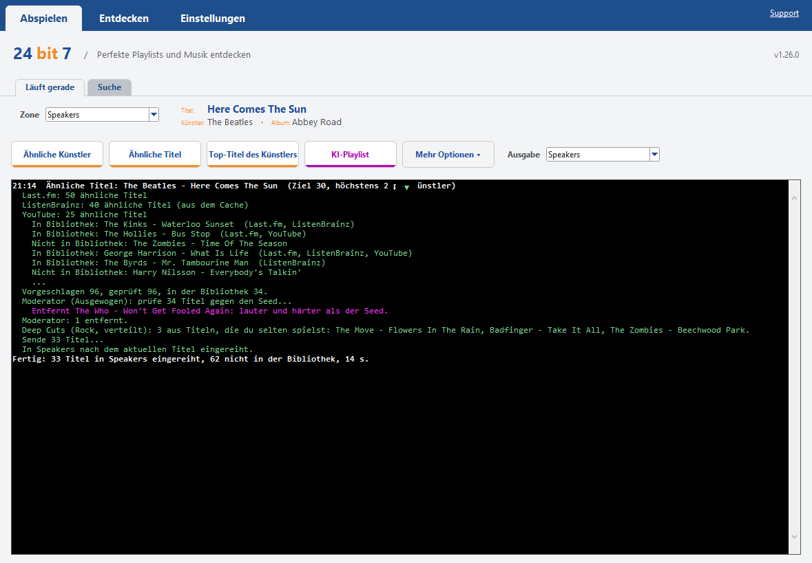

### Der Seed

Jede Playlist beginnt mit einem Seed, dem Ausgangspunkt. Der Seed ist der der beiden kleinen Tabs, der gerade zu sehen ist, wenn du einen Knopf drückst.

- **Läuft gerade** zeigt, was JRiver spielt. **Zone** wählt, aus welcher JRiver-Zone der Seed kommt. Ist Playing Now dieser Zone leer, nehmen die Knöpfe den zuletzt von JRiver gespielten Titel als Seed.
- **Suche** lässt dich jeden Künstler und Titel eintippen, ob du ihn besitzt oder nicht. Ähnliche Künstler und Top-Titel des Künstlers brauchen nur den Künstler. Enter startet Ähnliche Künstler. Ist der eingetippte Künstler nicht in deiner Bibliothek, aber einer, der ihm nahekommt, etwa Finger Eleven für "eleven finger", fragt die Konsole am Ende der Playlist **Meintest du Finger Eleven?**: Ein Klick darauf erstellt die Playlist noch einmal mit diesem Künstler.

**Seed** unter **Mehr Optionen** steht für Ähnliche Künstler und Ähnliche Titel im Tab Läuft gerade auf **Aktueller Titel** oder **Playing Now**. Aktueller Titel geht vom laufenden Titel aus. Playing Now geht von deiner ganzen Playing-Now-Liste aus: Ein paar Künstler (bei Ähnliche Titel: Titel verschiedener Künstler) werden zufällig gewählt, und jeder bringt der Reihe nach seinen Anteil ähnlicher mit, oben aus seiner eigenen Liste gelesen, sodass kein Künstler doppelt vorkommt. Titel, die schon in Playing Now sind, bleiben draußen, und die neue Playlist ersetzt Playing Now wie gewohnt (mit dem Review-Modus kannst du stattdessen hinzufügen). Solange es an ist, werden die Balken unter den beiden Knöpfen türkis. Mit weniger als zwei Titeln in Playing Now ist der aktuelle Titel der Seed. Top-Titel des Künstlers, KI-Playlist, Suche, Sprachbefehle, Tastenkürzel und Non-stop verwenden immer den aktuellen (oder eingetippten) Titel. Die Werte stehen unter Einstellungen > Playlist, in der Spalte Playing Now.

**Abspielmodus** oder **Review-Modus**, ebenfalls unter Mehr Optionen, gilt für jede Playlist aus dem Abspielen-Tab. Der Abspielmodus schickt die Playlist an JRiver, während sie gefunden wird. Der Review-Modus schickt nichts: Die Titel werden stattdessen in 24bit7 aufgelistet, im Bereich der Konsole, mit einem Schalter **Konsole | Review**, um zwischen beiden zu wechseln. Sprachbefehle, Tastenkürzel und Non-stop spielen immer sofort.

### Review

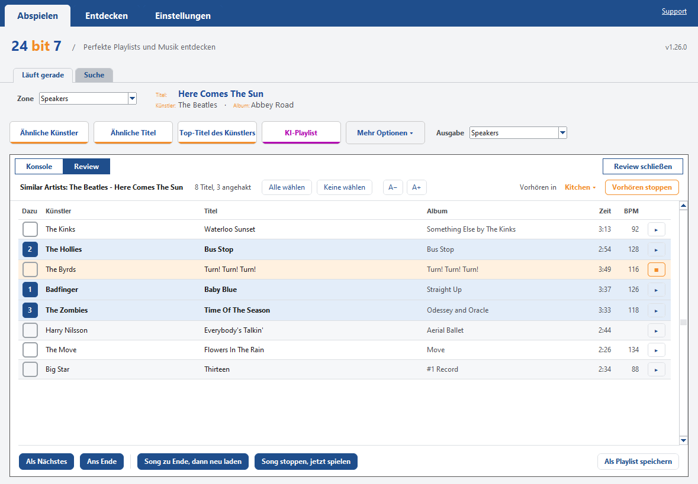

Hake die Titel an, die du willst, in der gewünschten Reihenfolge (jeder Haken zeigt seine Nummer), mit **Alle wählen** und **Keine wählen** für alle auf einmal, und wähl dann, was mit ihnen passiert:

- **Als Nächstes**: nach dem aktuellen Song, in der Reihenfolge der Haken.
- **Ans Ende**: ans Ende von Playing Now.
- **Song zu Ende, dann neu laden**: Playing Now besteht aus deinen angehakten Titeln, sobald der aktuelle Song endet.
- **Song stoppen, jetzt spielen**: Der aktuelle Song stoppt, und deine angehakten Titel laufen sofort.
- **Als Playlist speichern**: eine neue JRiver-Playlist aus den angehakten Titeln, es wird nichts gespielt. Neuere JRiver-Versionen lassen 24bit7 die Titel womöglich nur mit einer Anmeldung bei Media Network hinzufügen: Wenn eine gespeicherte Playlist leer bleibt, leg in JRiver einen Benutzernamen und ein Passwort fest (Tools > Options > Media Network > Authentication) und trag sie unter Einstellungen > Schlüssel ein.

**Review schließen** oben rechts über Vorhören stoppen verwirft die Liste und holt die Konsole zurück, geleert.

Die Aktionen gehen dorthin, wo **Ausgabe** gerade hinzeigt, wenn du sie drückst (eine Zone, oder bei Gleiche Zone die Zone von Läuft gerade). Mit Ausgabe auf **YouTube** werden die vier Abspiel-Aktionen zu einer, **Auf YouTube abspielen**, die die angehakten Titel als YouTube-Playlist in deinem Browser öffnet. Mit Ausgabe auf **Tidal** werden sie zu **An Tidal senden**, das die angehakten Titel in deine Tidal-Playlist namens 24bit7 legt.

**Vorhören in** wählt eine Zone mit eigenen Lautsprechern oder Kopfhörern, damit du einen Titel hören kannst, bevor du ihn hinzufügst. Wähl eine Zone, und in jeder Zeile erscheint ein Abspielzeichen: Klick eins an, und nur dieser Titel spielt dort, ohne angehakt zu werden, während der Hauptraum weiterläuft; die vorgehörte Zeile wird orange, und **Vorhören stoppen** beendet es. Die Zone, an die Ausgabe schickt, wird nie angeboten. Die Vorhör-Zone braucht ein eigenes Ausgabegerät; eine, die sich im exklusiven WASAPI-Modus eine Soundkarte mit dem Hauptraum teilt, spielt nicht. **A-** und **A+** stellen die Schriftgröße der Liste ein. Die Spalte BPM kommt aus den Tags deiner Dateien; JRiver kann sie für die ganze Bibliothek mit **Library Tools > Analyze Audio** ausfüllen (wähl nur noch nicht analysierte Dateien), womit auch Schneller und Langsamer bei Steer etwas zum Abgleichen haben.

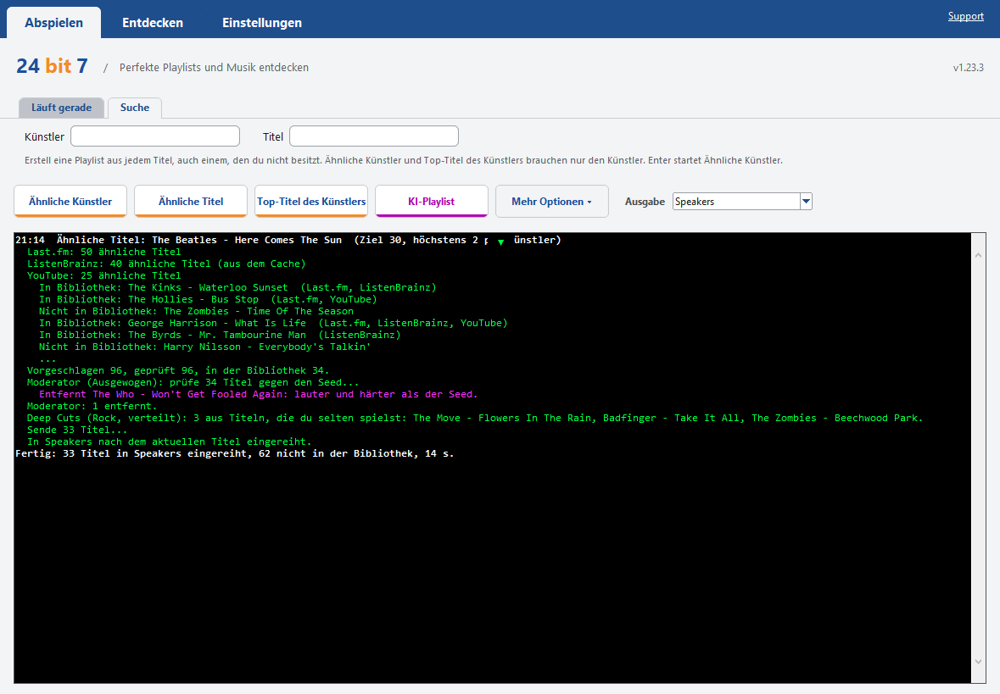

### Die vier Knöpfe

| Knopf | Was du bekommst |
|---|---|
| **Ähnliche Künstler** | Eine Playlist aus Künstlern, die dem Seed ähneln. Jeder Künstler, der Seed eingeschlossen, steuert eine zufällige Auswahl seiner Top-Titel bei, derselbe Seed ergibt also jedes Mal eine andere Playlist. |
| **Ähnliche Titel** | Titel wie der Seed-Titel, Song für Song vorgeschlagen, sodass die Playlist dem Song folgt und nicht dem Ruf des Künstlers. |
| **Top-Titel des Künstlers** | Die beliebtesten Titel des Künstlers, die du besitzt, gemischt oder nach Beliebtheit. Aus der Suche braucht es nur den Künstler. |
| **KI-Playlist** | Öffnet das Fenster KI-Playlist mit zwei Modi. **Erstellen**: Beschreib eine Stimmung oder Szene oder klick auf eine Idee (Mehr Titel wie der laufende Song, dann die Vorschläge der KI), und die KI wählt eine Playlist aus deiner Bibliothek. **Steer**: Lenk die laufende Musik in eine Richtung. Die KI muss unter Einstellungen > Schlüssel eingerichtet sein. Siehe unten. |

Jede Playlist außer Top-Titel des Künstlers wird so verteilt, dass derselbe Künstler nie zweimal hintereinander läuft, und die Titel werden dabei so wenig wie möglich verschoben. Bleibt gegen Ende nur ein Künstler übrig, laufen seine Titel direkt nacheinander.

### Das Fenster KI-Playlist

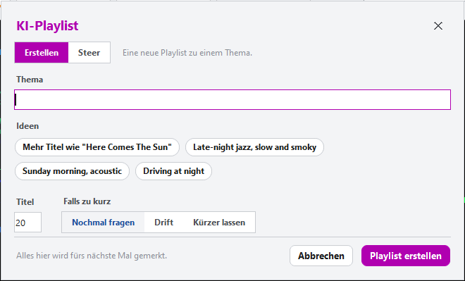

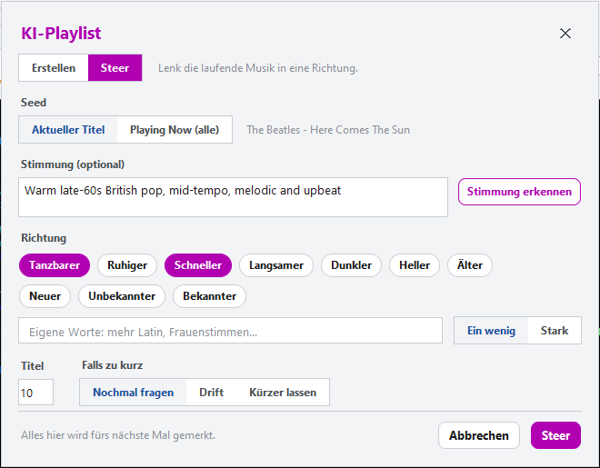

**Erstellen** nimmt ein Thema, **Titel** (wie viele angefragt werden) und **Falls zu kurz**. **Steer** geht von einem **Seed** aus, dem aktuellen Titel oder Playing Now (alle, bis zu 50 Titel rund um den aktuellen), mit einer optionalen **Stimmung**: **Stimmung erkennen** bittet die KI, die Stimmung des Seeds zu beschreiben, und trägt die Beschreibung ins Feld ein, wo du sie ändern kannst; leer gelassen arbeitet die KI nur mit Seed und Richtung. **Richtung** ist eine Reihe kombinierbarer Chips (Tanzbarer, Ruhiger, Schneller, Langsamer, Dunkler, Heller, Älter, Neuer, Unbekannter, Bekannter), ein Feld für eigene Worte und **Ein wenig** oder **Stark** dafür, wie weit es gehen soll. Schneller und Langsamer werden mit BPM-Tags abgeglichen, wo Seed und Vorschlag beide eins haben, und ein Vorschlag in die falsche Richtung wird mit einer Zeile in der Konsole weggelassen.

Beide Modi bitten die KI um etwa doppelt so viele Titel, da manche Vorschläge nicht in deiner Bibliothek sein werden, und behalten die ersten Treffer. **Falls zu kurz** legt fest, was passiert, wenn weniger passen als gewünscht: **Nochmal fragen** bittet die KI um mehr, bis zu zwei weitere Runden, und sagt ihr, was sie schon vorgeschlagen hat; **Drift** füllt mit deinen Drift-Einstellungen aus deinen Musikquellen auf; **Kürzer lassen** hört mit dem auf, was gepasst hat. Alles im Fenster wird fürs nächste Mal gemerkt, auch der Modus, und gehört zu den Profilen. Eine Playlist aus dem Fenster folgt Abspielmodus / Review-Modus und Ausgabe wie jede andere.

### Ausgabe

**Ausgabe** legt fest, wohin die fertige Playlist geht:

- **Gleiche Zone**, die Voreinstellung: die Zone, aus der der Seed kommt.
- **Jede JRiver-Zone** mit Namen.
- **YouTube**: Die Playlist öffnet sich in deinem Browser als YouTube-Sofort-Playlist. JRiver bleibt unberührt. Siehe [Ausgabe auf YouTube](#ausgabe-auf-youtube).
- **Tidal**: Die Playlist kommt in deine Tidal-Playlist namens 24bit7, und die Konsole bietet **In der Tidal-App öffnen** und **Im Tidal-Web öffnen** an. JRiver bleibt unberührt. Siehe [Ausgabe auf Tidal](#ausgabe-auf-tidal).

YouTube und Tidal erscheinen hier nur, solange sie unter Einstellungen > Sonstiges > Weitere Ausgaben angehakt sind.

### Mehr Optionen

**Mehr Optionen** öffnet eine zweite Zeile unter einer dünnen Linie. Es merkt sich, ob sie offen war. Die ersten fünf sind Knöpfe, die ihre Einstellung zeigen und mit einem Klick durch die Möglichkeiten gehen; ein Rechtsklick geht zurück. Aus wirkt schlicht, alles andere ist hervorgehoben.

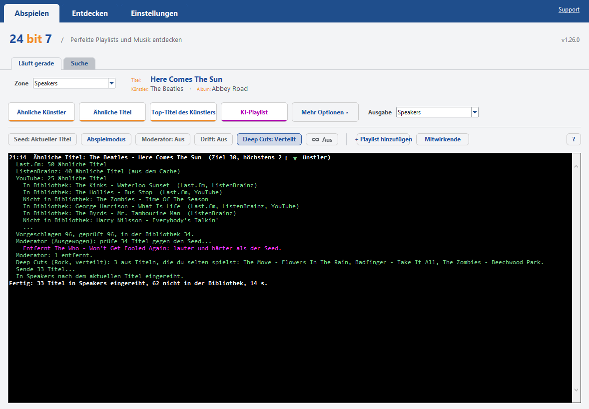

- **Seed: Aktueller Titel** oder **Seed: Playing Now** (türkis). Siehe [Der Seed](#der-seed).
- **Abspielmodus** oder **Review-Modus** (orange). Siehe [Der Seed](#der-seed) und [Review](#review).
- **Moderator: Aus, Locker, Ausgewogen oder Streng** (magenta, solange an, da er die KI nutzt) prüft jede Playlist auf Titel, die nicht zur Stimmung des Seeds passen. Siehe [Moderator](#moderator).
- **Drift** (Aus, Keep It Tight oder Weit), **Deep Cuts** (Aus, Verteilt oder Gemischt) und **∞**, also Non-stop (Aus, Keep It Tight oder Wander), stellen diese Einstellungen für alle Abspieloptionen auf einmal ein. Jeder zeigt nur dann einen Modus, wenn alle Optionen übereinstimmen. Siehe [Drift](#drift), [Deep Cuts](#deep-cuts) und [Non-stop](#non-stop).
- **Mitwirkende** zeigt Produzent, Toningenieur, Musiker und weitere Mitwirkende des laufenden Titels von Discogs, in zwei Listen: die eigenen Mitwirkenden des laufenden Titels (oder aller Titel, unter Nummer und Titel) und die des Albums. Mitwirkende, die Discogs nur für einige Titel vermerkt, etwa ein Schlagzeuger auf den Titeln 2 bis 4, kommen zu diesen Titeln. Einstellungen > Sonstiges > Mitwirkende zeigen wählt den aktuellen Titel oder alle Titel und welche Liste zuerst kommt. Es braucht ein Discogs-Token.
- **+ Playlist hinzufügen** nimmt eine deiner JRiver-Playlists in die nächste Playlist auf. Siehe [Eigene Playlists hinzufügen](#eigene-playlists-hinzufügen).
- **?** am rechten Ende der Zeile schaltet die Hinweise des Abspielen-Tabs an und aus. An erklärt alles im Abspielen-Tab, wenn du den Mauszeiger darauf ruhen lässt; aus, die Voreinstellung, zeigt nichts. Hinweise, warum etwas ausgegraut ist (zum Beispiel kein KI-Schlüssel), erscheinen immer. Es merkt sich seine Einstellung.

### Die Konsole

Das schwarze Feld zeigt, was jede Playlist gemacht hat: welche Quellen geantwortet haben, was in deiner Bibliothek gepasst hat und wohin es ging. Jede Playlist wird gleich aufgeschrieben, damit man sie auf einen Blick lesen kann:

- Die erste Zeile hat die Uhrzeit und was erstellt wurde, etwa `21:14  Ähnliche Titel: The Beatles - Here Comes The Sun`.
- Die Schritte stehen eingerückt darunter, in Grün.
- Zeilen mit `Hinweis:`, in Bernstein, sind etwas, das man wissen sollte. Zeilen mit `Problem:`, in Rot, sind etwas, das schiefgegangen ist. Wo eine Einstellung helfen würde, steht sie am Ende, etwa `Einstellungen > Playlist > Drift`.
- KI-Zeilen, etwa die des Moderators, sind magenta.
- Jede Playlist endet mit einer Zeile: `Fertig: 30 Titel in Speakers eingereiht, 62 nicht in der Bibliothek, 14 s.`

Klick in die Konsole, um eine Leiste mit Knöpfen zu bekommen:

- **Kopieren** kopiert, was zu sehen ist, oder nur das Markierte.
- **Leeren** leert die Anzeige. Nichts, was im Log liegt, wird gelöscht.
- **Als Log speichern** speichert einen Bericht für den Fall, dass etwas schiefgeht. Siehe [Ein Problem melden](#ein-problem-melden).
- **Fragen** fragt die KI, warum eine Playlist so geworden ist. Erscheint nur, wenn Konsolen-Frage eingeschaltet ist. Siehe [Konsolen-Frage](#konsolen-frage).
- **Einfach** oder **Erweitert**: Einfach blendet die Debug-Zeilen aus, die schwach grau sind und mit `[debug]` beginnen; Erweitert zeigt sie. Sie werden immer aufgezeichnet, ein Wechsel wirkt also auch auf die schon angezeigte Playlist, und Als Log speichern nimmt sie immer mit. Deine Wahl wird gemerkt. Debug-Zeilen bleiben auf Englisch.

Während eine Playlist erstellt wird, zeigt die Leiste nur **Abbrechen**. Das stoppt beim nächsten Schritt, meist innerhalb von ein, zwei Sekunden (eine schon laufende Anfrage an die KI läuft erst zu Ende, und die Konsole sagt es), und die letzte Zeile sagt, was schon rausgegangen war: nichts, der erste Titel, den der Schnellstart begonnen hat, oder Titel, die eine Drift-Runde geschickt hatte. Bei einer abgebrochenen Review-Playlist wird die Liste verworfen, und das Log zeigt die Playlist als Abgebrochen.

#### Die Tabs der Konsole

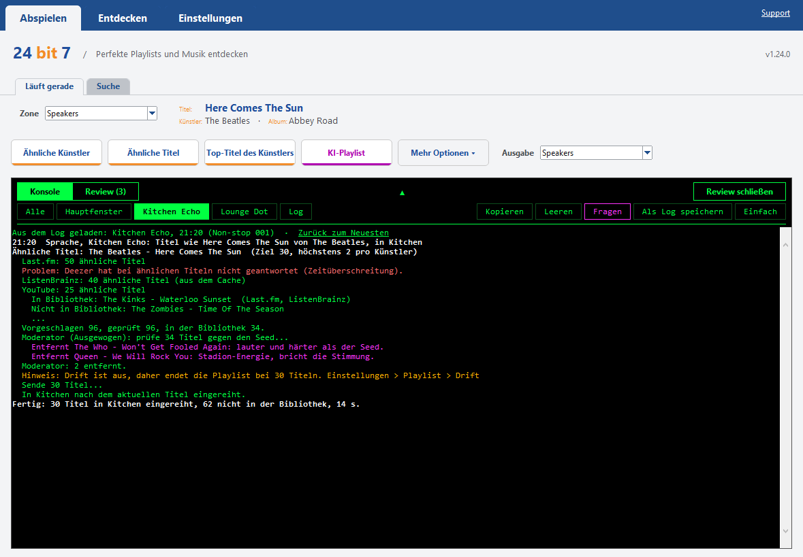

Der kleine grüne Pfeil oben in der Mitte der Konsole öffnet eine Reihe von Tabs:

- **Alle**: die neueste Playlist, egal woher.
- **Hauptfenster**: die neueste Playlist aus dem Abspielen-Tab oder von einem Tastenkürzel.
- **Einer pro Alexa-Gerät**: die neueste Playlist dieses Geräts, auch Befehle, aus denen nichts wurde. Ein Gerät bekommt seinen Tab nach seiner ersten Playlist.
- **Log**: jede behaltene Playlist, siehe unten.

Eine Playlist leert die Anzeige nur, wenn ihr eigener Tab oder Alle zu sehen ist, ein Sprachbefehl in der Küche löscht also keine Playlist, die du gerade am PC liest. Bei offenen Tabs sitzt die Leiste oben rechts. Neue Zeilen ziehen dich nicht nach unten, solange du nach oben gescrollt hast. Ob offen oder zu, wird gemerkt.

#### Das Log

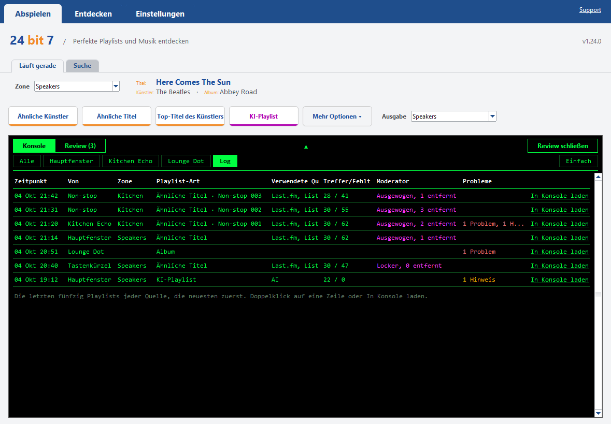

Das Log listet die letzten 50 Playlists jeder Quelle, die neuesten zuerst: wann, wer gefragt hat (Hauptfenster, Tastenkürzel, ein Alexa-Gerät oder Non-stop), die Zone, die Abspieloption, die verwendeten Quellen (mit der Maus darüber für die ganze Liste), eingereihte Titel und solche, die nicht in der Bibliothek sind, was der Moderator gemacht hat und wie viele Probleme und Hinweise es gab.

Eine Non-stop-Playlist erscheint als Kette. Die Playlist, die sie begonnen hat, wird zu Non-stop 001, und jeder Nachschub bekommt die nächste Nummer, sodass du siehst, wie lange ein Abend lief, und erkennst, welcher Nachschub danebenging.

Doppelklick auf eine Zeile oder **In Konsole laden** öffnet diese Playlist in ihrem Tab. Eine Zeile oben sagt, dass sie aus dem Log kommt, mit **Zurück zum Neuesten**, um zurückzukehren. Kopieren, Fragen und Als Log speichern wirken dann auf diese Playlist.

Ältere Playlists, die vor dem Wechsel der Sprache erstellt wurden, bleiben auf Englisch.

### Eigene Playlists hinzufügen

Öffne **Mehr Optionen** und drück **+ Playlist hinzufügen**, um eine JRiver-Playlist oder Smartlist in die nächste Playlist aus dem Abspielen-Tab aufzunehmen. Jede Zeile hat einen Griff, um sie nach oben oder unten zu ziehen, die Playlist und die Art, wie sie dazukommt:

- **Davor**: Ihre Titel laufen zuerst, in der Reihenfolge der Playlist.
- **Danach**: Ihre Titel folgen denen von 24bit7, in ihrer eigenen Reihenfolge.
- **Mischen**: Ihre Titel werden zwischen die von 24bit7 gewoben. **Gleichmäßig verteilt** verteilt beide Listen über die ganze Playlist, sodass sie zusammen enden. **Zufällig gemischt** verstreut sie.

Die Zeilen laufen in der Reihenfolge, in der sie stehen. Die Auswahl zeigt zuerst die Playlists, die du am meisten verwendest, dann den Rest von A bis Z, mit einem Suchfeld; das x rechts neben einer meistgenutzten Playlist nimmt sie aus dieser Liste, mehr nicht. Jede Änderung wird in der Konsole vermerkt, mit dem, was die nächste Playlist tun wird.

Hinzugefügte Playlists kommen genau so durch, wie JRiver sie liefert, die Regeln einer Smartlist entscheiden also selbst, was darin ist. Die Filter von 24bit7, das Auslassen kürzlich gespielter Titel und die Prüfung auf versteckte Titel lassen sie in Ruhe; weggelassen wird nur ein Song, der schon unter den Vorschlägen von 24bit7 ist. Passt in der Playlist nichts zu deiner Bibliothek, laufen die hinzugefügten Playlists trotzdem, es bleibt also nie still.

Sie gelten nur für den Abspielen-Tab, mit Ausgabe an JRiver. Sprache, Tastenkürzel und Non-stop verwenden sie nicht, und bei Ausgabe auf YouTube bleiben sie mit einem Hinweis in der Konsole draußen.

---

## Der Entdecken-Tab

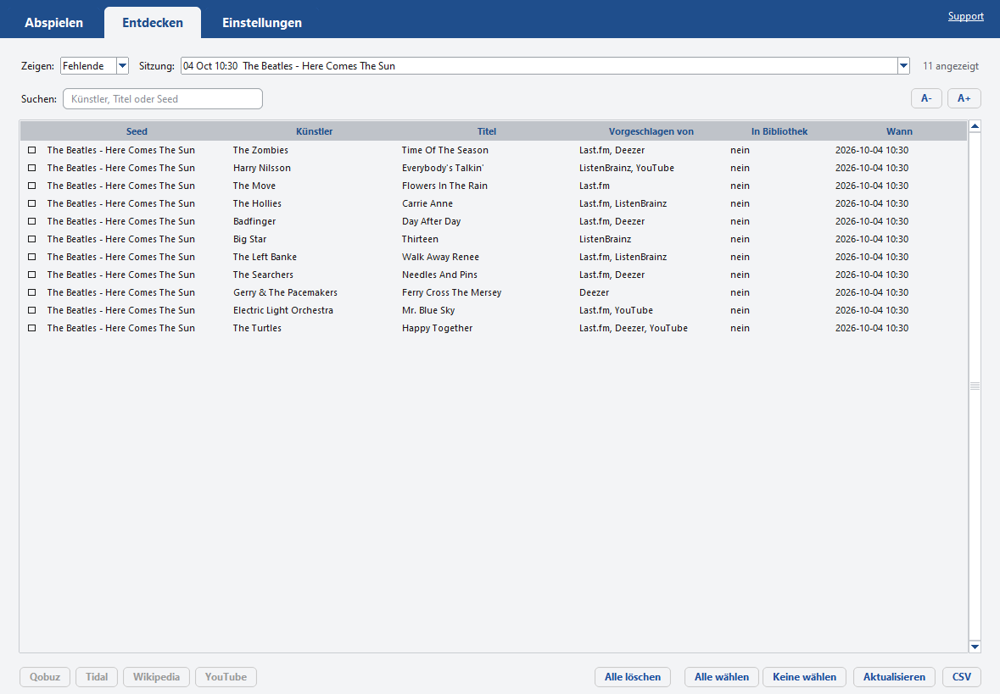

Entdecken listet jeden Titel, nach dem eine Playlist gesucht hat, und ob du ihn besitzt.

- **Zeigen** wählt Fehlende (Titel, die du nicht besitzt), Vorhandene oder Alle.
- **Sitzung** beschränkt auf eine Playlist. Es öffnet mit der neuesten, bis du selbst eine wählst, mit **Alle Sitzungen** zuerst in der Liste und dem Rest, neueste zuerst. **Suchen** sucht in allen Spalten. Eine Playlist mit Playing Now als Seed heißt **Playing Now (Multiple Tracks)**, und jede ihrer Zeilen zeigt den Titel aus Playing Now, von dem sie kam, als Seed.
- Wähl eine Zeile, und jede Seite, die du unter Einstellungen > Entdecken angehakt hast, hat unten einen Knopf. Shops, YouTube und Tidal suchen nach Künstler und Titel; Nachschlage-Seiten wie Wikipedia und Discogs suchen den Künstler, für die Diskografie.
- **Label** findet heraus, wer den gewählten Titel veröffentlicht hat, und öffnet das Label auf Bandcamp, damit du bei denen kaufen kannst, die die Platte herausgebracht haben. Es fragt zuerst MusicBrainz, dann Discogs, wenn du ein Token hast. Ein selbst veröffentlichter Titel öffnet den Künstler auf Bandcamp. Jede Antwort wird gemerkt, ein zweiter Klick geht also sofort. Nimm den Haken bei Plattenlabel unter Einstellungen > Entdecken > Nachschlagen weg, wenn du es nicht willst.
- Hake Zeilen an oder nimm **Alle wählen**, und **YouTube-Playlist erstellen** öffnet sie in deinem Browser als eine Playlist, sodass du die Fehlenden vor dem Kauf hören kannst. **Tidal-Playlist erstellen** legt sie stattdessen in deine Tidal-Playlist namens 24bit7, anstelle dessen, was dort war, mit **In der Tidal-App öffnen** und **Im Tidal-Web öffnen** neben der Zeile, die sagt, wie es gelaufen ist. Welche dieser Knöpfe erscheinen, stellst du unter Einstellungen > Entdecken > Playlist erstellen ein.
- **Alle löschen** leert den Verlauf, und **Auswahl löschen** entfernt nur die angehakten Zeilen. Beide fragen vorher.
- **CSV** speichert die Liste als Tabellendatei. **A-** und **A+** oben rechts stellen die Schriftgröße der Tabelle ein.

---

## Einstellungen

Die Einstellungen sind in Seiten gegliedert, jede aus umrandeten Abschnitten. Lass den Mauszeiger auf dem Titel einer Einstellung ruhen, um die Erklärung zu sehen (wo es eine gibt, wird der Zeiger zum Fragezeichen). Alles wird gespeichert, sobald du es änderst, und die laufende App übernimmt es ohne Neustart.

### Quellen

Welche Dienste Musik vorschlagen, getrennt eingestellt für Ähnliche Künstler, Ähnliche Titel und Top-Titel des Künstlers. Die KI-Playlist verwendet immer die KI und hat daher hier keinen Tab.

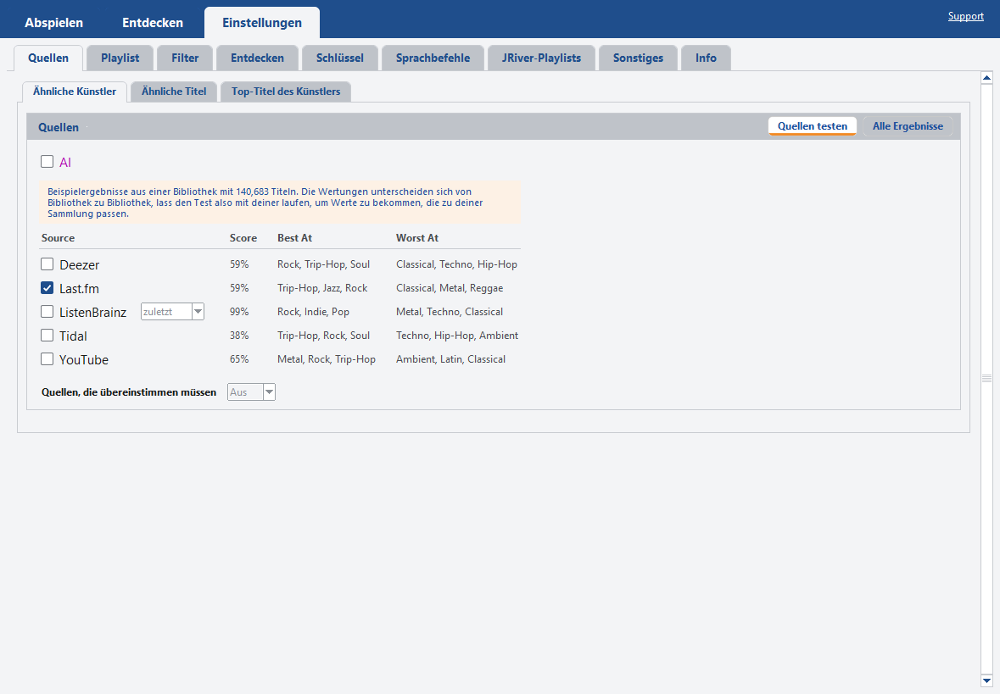

- **Quellen**: Hake jede beliebige Kombination an. Eine reicht; mehrere sind besser. Bei einer Quelle ohne Schlüssel steht "(noch kein Schlüssel)".
- **Quellen, die übereinstimmen müssen**: wie viele angehakte Quellen einen Künstler oder Titel vorschlagen müssen, bevor er verwendet wird. Höher heißt eine gleichmäßigere Playlist mit weniger Überraschungen. Siehe [Mischen der Quellen](#mischen-der-quellen).
- **ListenBrainz-Verfahren**: alle Zeiten oder kürzliches Hören.
- **Tidal** braucht seine beiden kostenlosen Schlüssel (Einstellungen > Schlüssel). Bei Ähnliche Künstler ist es mit **!!** markiert: Seine Künstlervorschläge sind schwächer als seine Titelvorschläge, und wenn du den Mauszeiger darauf ruhen lässt, steht das da.
- **Quellen testen** rechts in der Leiste Quellen fragt jede Quelle, was einer festen Auswahl von Seed-Titeln aus 17 Genres ähnelt, und zählt, wie viele Antworten in deiner Bibliothek sind. Wähl **Vollständig** oder **Schnell** (das Fenster sagt ungefähr, wie lange jedes dauert), und hake **KI einbeziehen** an, um auch die KI zu testen, was ein paar Cent kostet. Es läuft im Hintergrund und pausiert, während eine Playlist erstellt wird, du kannst 24bit7 also weiter benutzen, und die Konsole sagt, wann es fertig ist. Jede Quelle zeigt dann **Wertung** (wie viele ihrer Vorschläge in deiner Bibliothek sind, verglichen mit der besten Quelle in jedem Genre; gemessen wird die Reichweite, nicht der Geschmack), **Am besten bei** und **Am schwächsten bei** (ihre drei besten und schwächsten Genres), und **Alle Ergebnisse** zeigt jedes Genre gegen jede Quelle. Bis du es laufen lässt, stammen die Werte aus der Bibliothek des Entwicklers, mit dem Hinweis, dass deine abweichen werden. Das Genre ist nur die Beschriftung jedes Test-Seeds: Nichts wird nach deinen Genre-Tags beurteilt.
- **Moderator**, für Ähnliche Künstler und Ähnliche Titel: Aus, Locker, Ausgewogen oder Streng. Siehe [Moderator](#moderator).

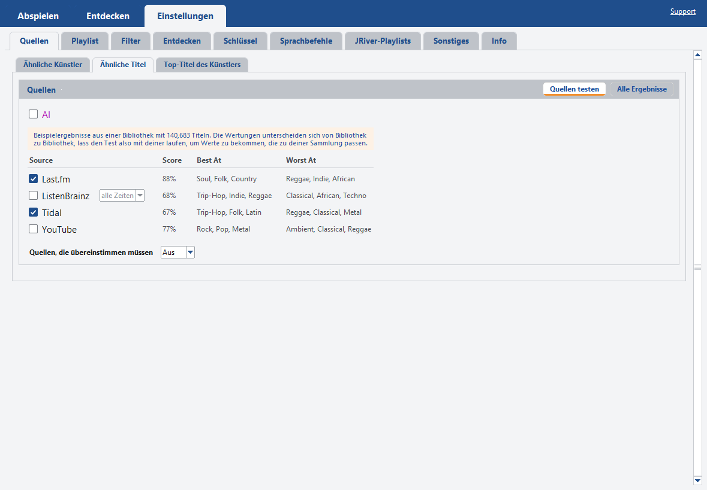

### Playlist

Wie jede Abspieloption ihre Playlist erstellt, mit einem Tab für jede Option.

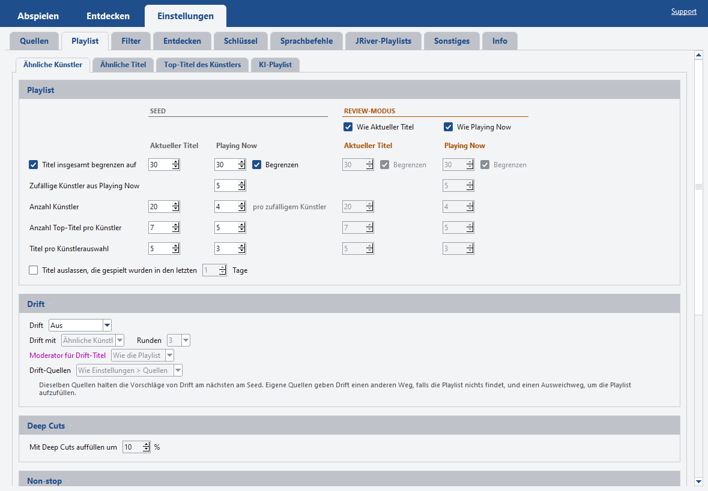

- **Playlist**: Ähnliche Künstler stellt **Titel insgesamt begrenzen auf** ein, wie viele Künstler, aus wie vielen Top-Titeln jedes Künstlers gewählt wird und wie viele pro Künstler genommen werden. Ein ähnlicher Künstler zählt erst, wenn er einen Titel aus deiner Bibliothek liefert; einer, der das nicht tut, wird übersprungen und der nächste gelesen. Nimm den Haken bei der Grenze weg, um jeden gefundenen Titel zu behalten; sind dazu die letzten beiden Werte gleich (etwa 5 von 5), gibt es gar keine Zufallsauswahl. Ähnliche Titel stellt ein, wie viele Titel, wie viele ein einzelner Künstler höchstens bekommt und, für jede Spalte, die Reihenfolge und **Abwechslung**. Top-Titel des Künstlers stellt gemischt oder nach Beliebtheit ein. KI-Playlist stellt ein, wie viele Titel und wie viele ein einzelner Künstler höchstens bekommt, damit eine Stimmung, die die KI mit einer Band verbindet, nicht nur aus dieser Band besteht.
  Unter Windows (Haupt) haben Ähnliche Künstler und Ähnliche Titel vier Spalten: **Seed** (Aktueller Titel und Playing Now) und **Review-Modus** (Aktueller Titel und Playing Now). Playing Now fügt **Zufällige Künstler aus Playing Now** oder **Zufällige Titel aus Playing Now** hinzu, und seine Anzahl Künstler oder Titel gilt pro zufällig gewähltem Künstler oder Titel; die Voreinstellungen (5 Künstler mit je 4 ähnlichen oder 5 Titel mit je 6 ähnlichen) ergeben ungefähr so lange Playlists wie Aktueller Titel. Die Spalten des Review-Modus folgen ihrem Seed, solange **Wie Aktueller Titel** oder **Wie Playing Now** angehakt ist; nimm einen Haken weg, um dem Review-Modus eine eigene kurze Auswahl zu geben. Top-Titel des Künstlers hat Aktueller Titel und Review-Modus. Alles andere im Abschnitt gilt für beide, und Sprachbefehle gehen nie in Review oder verwenden Playing Now, Geräte haben daher nur die Spalte Aktueller Titel.
- **Titel auslassen, die gespielt wurden in den letzten ... Tagen** lässt alles weg, was JRiver kürzlich gespielt hat, damit ein Lieblingstitel nicht am selben Abend wiederkommt. Der Seed-Titel wird nie weggelassen. Anfangs aus.
- **Drift** (Aus, Keep It Tight oder Weit) sucht erneut, wenn deine Bibliothek die angestrebte Länge nicht erreicht. Ähnliche Künstler und Ähnliche Titel haben außerdem **Moderator für Drift-Titel**. Siehe [Drift](#drift).
- **Deep Cuts**: **Mit Deep Cuts auffüllen um**, 10% bis 100%, für Ähnliche Künstler, Ähnliche Titel und KI-Playlist. Eingeschaltet wird es, Verteilt oder Gemischt, unter Mehr Optionen im Abspielen-Tab. Siehe [Deep Cuts](#deep-cuts).
- **Non-stop** (Aus, Keep It Tight oder Wander) hält eine Playlist am Laufen, wenn sie ihren letzten Titel erreicht. Siehe [Non-stop](#non-stop).
- **Versteckte Titel** lässt den letzten Titel eines Albums aus, wenn er länger als eine eingestellte Anzahl Minuten ist (anfangs 6). Das sind oft eine lange Stille und ein versteckter Bonustitel, die in einer Playlist fehl am Platz wirken. Alben, Songs und Playlists, die du beim Namen nennst, laufen immer vollständig.
- **Wenn gar nichts klappt**, anfangs aus: Hake **Wenn nichts gefunden wird** an und wähl, was passiert, wenn eine Playlist nichts findet oder nichts außer dem Seed-Titel selbst. **Genre mischen** mischt Songs aus deiner Bibliothek im Genre des Seeds: das Genre-Tag des Seed-Titels oder das häufigste Genre des Künstlers in deiner Bibliothek, in ähnlichem Tempo, wenn der Seed ein BPM-Tag hat und genug Titel innerhalb von 10% davon liegen. Es spielt die übliche Anzahl Titel dieser Playlist-Art, mit Kürzlich gespielte auslassen, Filtern und der Grenze pro Künstler, und ohne den Seed-Künstler. **Datei ausführen** startet eine eigene Datei, etwa eine .bat, und Nach dem Erstellen ausführen entfällt dann. **Playlist spielen** spielt eine deiner JRiver-Playlists oder Smartlists, gewählt mit **Wählen...**, so, wie JRiver sie liefert. Hake **Erst im Raum sagen, warum** an (anfangs aus, eine Einstellung für alle Playlist-Arten), und ein Sprachbefehl oder Tastenkürzel hört vor der Musik, warum: die Stimme von Windows, als kurze WAV-Datei gespeichert und in dieser Zone abgespielt, sie steht also in Playing Now. Die Ansage ist auf Englisch und braucht JRiver auf demselben PC. Ohne Haken bei Wenn gar nichts klappt sagt die Konsole "Nichts Passendes gefunden. Bitte versuch einen anderen Seed.", und eine Playlist aus der App zeigt dasselbe in einer Meldung. Es läuft nicht, wenn schon eine hinzugefügte Playlist gespielt hat.
- **Nach dem Erstellen ausführen** führt eine Datei deiner Wahl aus, sobald eine Playlist in JRiver ist: eine .bat, eine .exe oder ein PowerShell- oder Python-Skript. Es erfährt nichts über die Playlist und kann also tun, was du willst. Non-stop-Nachschub führt sie nicht aus.

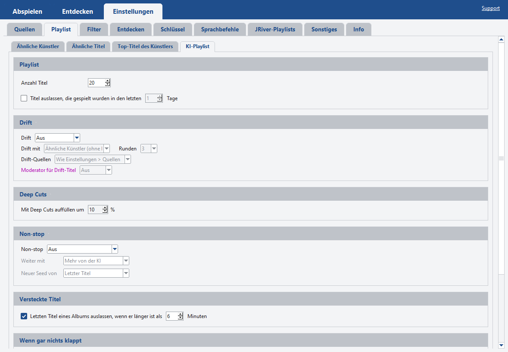

Der Tab KI-Playlist hat eigene Drift-Möglichkeiten, auch Drift mit der KI, und **Moderator für Drift-Titel** für das, was Drift aus deinen Musikquellen hinzufügt.

### Filter

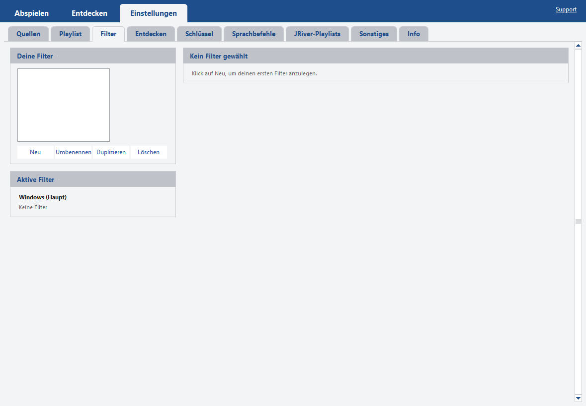

Eine Sammlung benannter Filter, die eingrenzen, was 24bit7 wählt, einschließlich Drift-Runden und Non-stop-Nachschub. Jeder Filter hat:

- **Gilt für**: Alle Geräte, Windows (Haupt) (der Abspielen-Tab und jeder Lautsprecher ohne eigene Einstellungen) oder einen Lautsprecher mit eigenen Einstellungen. Gelten mehrere Filter, muss ein Titel alle bestehen.
- **Nur auswählen aus**: eine JRiver-Playlist oder Smartlist, sodass nur ihre Titel verwendet werden können. Alles, was du im Smartlist-Editor von JRiver einrichten kannst, beachtet 24bit7.
- **Regeln**, alle oder eine erfüllt: Bewertung, Jahr, Zuletzt gespielt, Anzahl Wiedergaben, Importiert am, Genre, Künstler, Album, Dauer, Dateityp, Bittiefe, Abtastrate und Speicherort. Zum Beispiel erspart "Abtastrate höchstens 48 kHz" JRiver das Umrechnen in Echtzeit für einen Sonos.

Ein Titel ohne Wert für ein Feld besteht diese Regel. Der Seed-Titel wird nie herausgefiltert. Die Konsole jeder Playlist sagt, welche Filter galten und wie viele Titel sie weggelassen haben. Alben, Songs, gemischte Wiedergabe und JRiver-Playlists, die per Sprache gewünscht werden, laufen wie gewünscht.

### Entdecken

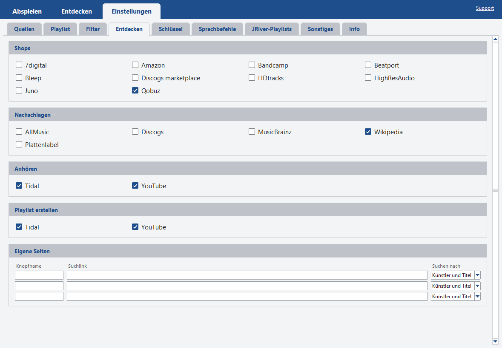

Die Seiten, die im Entdecken-Tab einen Knopf bekommen: **Shops** (mindestens einer bleibt angehakt), **Nachschlagen**-Seiten für Diskografien, darunter **Plattenlabel** (der Label-Knopf, anfangs angehakt), und **Anhören**-Seiten (YouTube und Tidal). **Playlist erstellen** wählt, welche Knöpfe erscheinen, wenn du Zeilen anhakst: YouTube öffnet sie als eine Playlist in deinem Browser, und Tidal legt sie in deine Tidal-Playlist namens 24bit7 (vorher unter Schlüssel anmelden). **Eigene Seiten** fügt bis zu drei eigene hinzu: Such auf der Seite nach irgendetwas, kopier die Adresse aus deinem Browser und ersetz deine Suchwörter durch `{query}`.

### Schlüssel

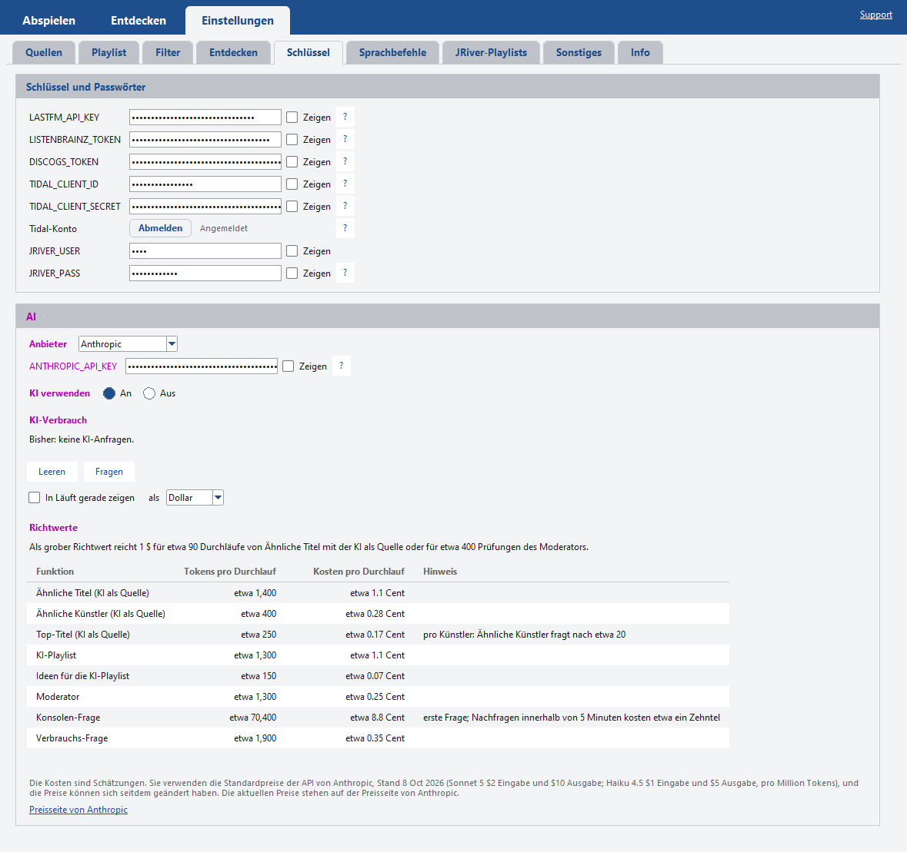

Schlüssel und Passwörter für jeden Dienst, versteckt, bis du **Zeigen** anhakst. Jedes **?** erklärt, wo du den Schlüssel bekommst:

- **Last.fm**: eingebaut, du kannst das Feld also leer lassen. Ein eigener kostenloser Schlüssel wird stattdessen verwendet, wenn du ihn einträgst.
- **ListenBrainz**: kostenlos und sehr lohnend.
- **Discogs**: kostenlos, für die Mitwirkenden eines Albums und als zweite Quelle für Label.
- **Tidal**: kostenlos. Melde dich auf developer.tidal.com mit einem Tidal-Konto an, öffne Dashboard, wähl Create App und kopier dann Client ID und Client Secret in die beiden Tidal-Felder. Tidal braucht beide. Um auch Playlists an Tidal zu senden, drück in der Zeile Tidal-Konto auf **Bei Tidal anmelden**, nachdem du die Weiterleitungsadresse und die Playlist-Berechtigungen, die sein **?** beschreibt, deiner App auf developer.tidal.com hinzugefügt hast. Die eigene Anmeldeseite von Tidal öffnet sich in deinem Browser; 24bit7 sieht dein Passwort nie und merkt sich die Anmeldung, bis du **Abmelden** drückst.
- **KI**: nötig für KI-Playlist, KI als Quelle, den Moderator und Konsolen-Frage. Sie steht zuletzt, in einem eigenen Kasten, beginnend mit **Anbieter**: **Anthropic** (Claude), **OpenAI**, **Google Gemini** oder **Ollama (Local)**. Nur die Felder des gewählten Anbieters erscheinen, und jeder Schlüssel bleibt gespeichert, beim Zurückwechseln geht also nichts verloren. Die Cloud-Anbieter kosten Geld, höchstens ein paar Cent pro Playlist, und jeder braucht seinen eigenen Schlüssel (das **?** sagt, wo du ihn bekommst). **Ollama** lässt ein Modell kostenlos auf deinem eigenen PC laufen: Installier es von ollama.com, lade ein Modell (zum Beispiel `ollama pull gemma3:4b`) und wähl es dann unter **OLLAMA_MODEL**, wo **Aktualisieren** zeigt, was Ollama installiert hat. Die Adresse ist schon eingetragen. Kleinere lokale Modelle liefern gröbere Ergebnisse und kennen sich weniger mit Musik aus, und Konsolen-Frage ist mit Ollama nicht verfügbar, da sie mehr schickt, als ein lokales Modell fassen kann. Läuft Ollama nicht oder ist das Modell nicht installiert, sagt es die Konsole. Bisher ist nur Anthropic vollständig getestet: OpenAI, Google Gemini und Ollama sollten funktionieren, und Rückmeldungen dazu sind im JRiver-Forum oder auf GitHub sehr willkommen. **KI verwenden** unter dem Anbieter, An oder Aus, pausiert alles, was KI-Guthaben verbraucht, ohne den Schlüssel zu entfernen: KI-Playlist und die Auswahl des Moderators werden grau, die KI als Quelle wird übersprungen, Drift mit KI weicht auf die Quellen aus, und Konsolen-Frage und Stimmung erkennen ruhen, mit einer Zeile pro Playlist in der Konsole. Schalt wieder An, und jede Einstellung ist, wie du sie gelassen hast. **KI-Verbrauch** steht darunter: die Tokens, die jede KI-Funktion seit dem letzten Zurücksetzen verbraucht hat, mit geschätzten Kosten, und **Richtwerte** dazu, was 1 $ bringt und was jede Funktion pro Durchlauf kostet (dein eigener Durchschnitt, sobald du sie dreimal verwendet hast). **Fragen** fragt die KI, wohin die Tokens gehen und mit welchen Einstellungen es weniger würden, und antwortet in der Konsole. **In Läuft gerade zeigen** setzt die Summe rechts in Läuft gerade, in Dollar oder Tokens; ein Klick darauf wechselt. Die Kosten sind Schätzungen nach den Standardpreisen des gewählten Anbieters zum angezeigten Datum, die sich seitdem geändert haben können; deine tatsächliche Rechnung steht in der Konsole deines Anbieters. Mit Ollama zeigen die Richtwerte Kostenlos.
- **JRiver** Benutzername und Passwort: nur, wenn du sie in JRiver unter Tools > Options > Media Network > Authentication festgelegt hast. Neuere JRiver-Versionen brauchen sie womöglich für **Als Playlist speichern** in Review.

Schlüssel verlassen deinen PC nie, außer zu dem Dienst, zu dem sie gehören, und sie stehen nie in einem Log.

### Die Seite Sprachbefehle

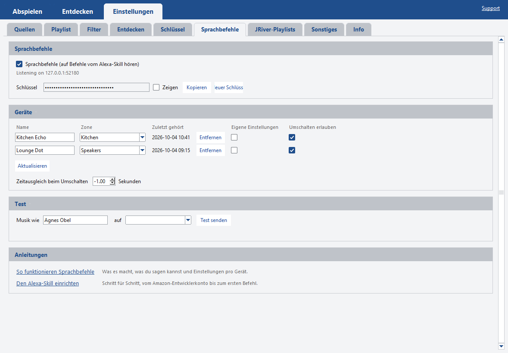

Schaltet Sprache ein, enthält den Schlüssel, den der Alexa-Skill schickt, legt **Neue Playlists** fest und listet jedes Alexa-Gerät mit der Zone, in der es spielt. **Umschalten erlauben** wählt, in welche Zonen "switch" die Musik bringen kann; zwei Geräte in derselben Zone teilen sich einen Haken, und eine Zone, in der kein Gerät spielt, wird nicht angeboten. **Zeitausgleich beim Umschalten** stimmt das Umschalten auf einen Sonos oder anderen DLNA-Lautsprecher fein ab: Wiederholt er den letzten Moment, den du im anderen Raum gehört hast, stell es Richtung Minus; springt er ein wenig, Richtung Plus. **Neue Playlists** legt fest, was eine per Sprache angeforderte Playlist tut, wenn in der Zone schon etwas läuft: **Nach diesem Titel** (Standard) lässt den Song zu Ende spielen, entfernt, was danach eingereiht war, und spielt die neue Playlist als Nächstes; **Sofort abspielen** übernimmt sofort. Eine gestoppte oder pausierte Zone startet in beiden Fällen sofort, und Alben, Songs, deine JRiver-Playlists und Shuffles spielen immer sofort. **Test** schickt einen gespielten Befehl, als hätte ein Gerät ihn gehört. Siehe [Sprachbefehle](#sprachbefehle) und [Den Alexa-Skill einrichten](#den-alexa-skill-einrichten).

### JRiver-Playlists

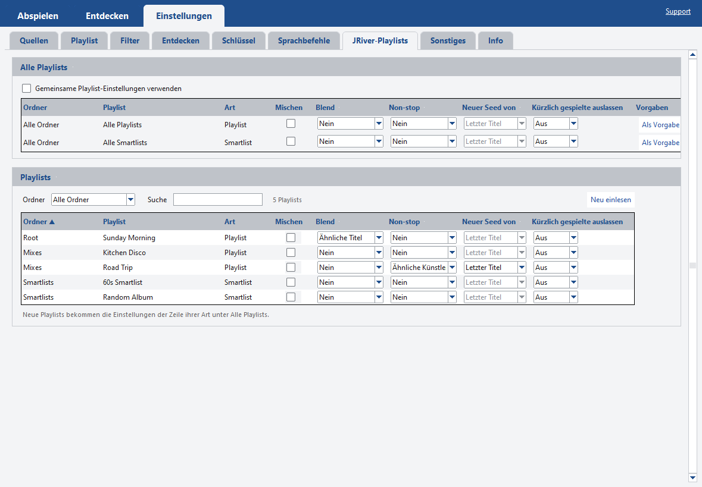

Wie deine eigenen JRiver-Playlists und Smartlists laufen, wenn du sie per Sprache anforderst: **Mischen**, **Blend**, **Non-stop**, **Neuer Seed von** (Letzter Titel, 2. Titel oder **Ganze Playlist**, also Keep It Tight: Jeder Nachschub nimmt einen Titel der Playlist selbst als Seed) und **Kürzlich gespielte auslassen**. **Als Vorgabe setzen** in den Zeilen Alle Playlists und Alle Smartlists kopiert diese Zeile in die Playlists ihrer Art, die in der Tabelle angezeigt werden (filtere vorher nach Ordner, um nur einen Ordner einzustellen), und neue Playlists beginnen damit. **Blend** webt neue Musik in die Playlist ein, einer von deinen, dann ein neuer, aus ähnlichen Künstlern oder ähnlichen Titeln, bis zu 50 neue Songs: Die Playlist startet sofort, und die neuen Songs kommen ein paar Sekunden später dazu. Lass den Mauszeiger auf Blend oder Non-stop ruhen für eine Erklärung. Hake **Gemeinsame Playlist-Einstellungen verwenden** an, um alle auf einmal einzustellen, oder nimm den Haken weg und gib jeder Playlist ihre eigene Zeile. Die Tabelle zeigt Ordner und Art jeder Playlist, sortiert nach Ordner oder Name und kann einen Ordner allein zeigen. Eine Playlist, an der nichts geändert ist, läuft genau so, wie JRiver sie hat.

### Sonstiges

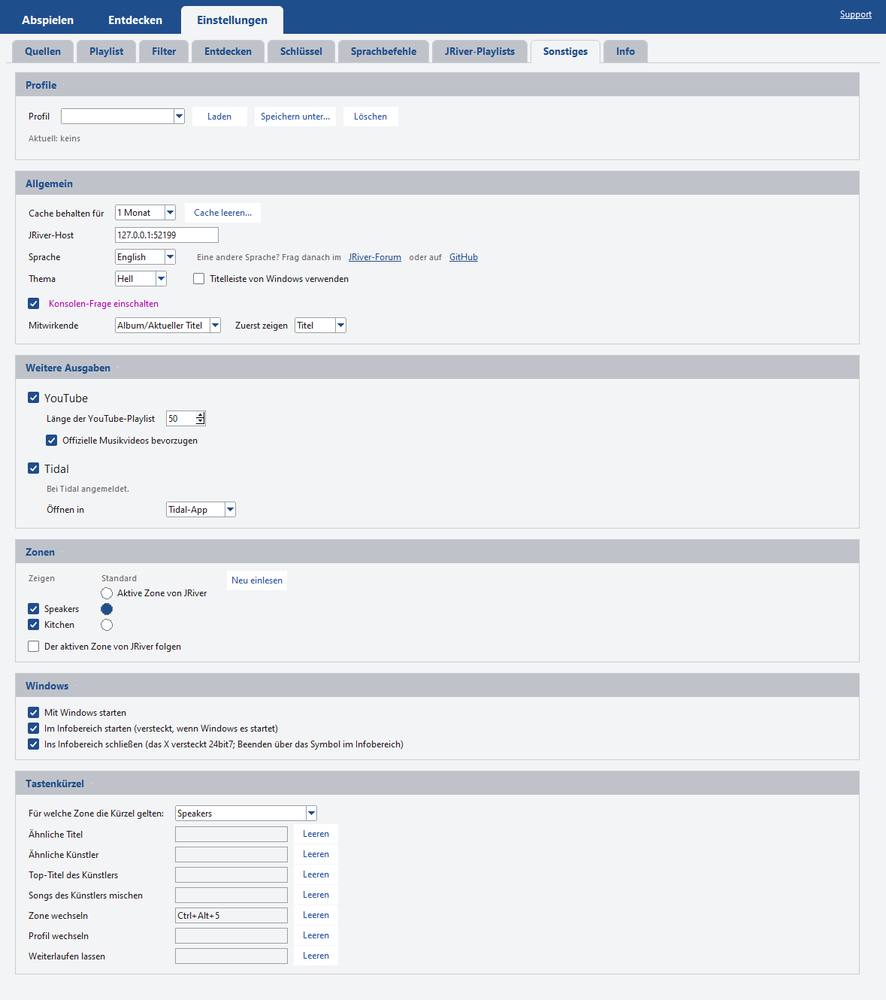

- **Profile**: Speicher deine Einstellungen mit **Speichern unter...** als Profil (DJ, Entdecken, Ohne KI...) und wechsle mit **Laden** zwischen ihnen, was 24bit7 neu startet, um das Profil anzuwenden; JRiver spielt weiter. Hake **Umschalten erlauben** neben den Profilen an, die das Tastenkürzel **Profil wechseln** durchgehen soll (neue Profile sind anfangs angehakt). Ein Profil enthält die Optionen im Abspielen-Tab, Quellen, Playlist-Einstellungen, Filter, JRiver-Playlists, hinzugefügte Playlists, die Vorhör-Zone, Standardzone und Folgen unter Zonen, die Zone der Tastenkürzel, die Wahl im Fenster KI-Playlist, KI verwenden sowie Cache- und Konsolen-Einstellungen für Windows (Haupt). Schlüssel, die JRiver-Verbindung, welche Zonen angezeigt werden, Alexa-Geräte mit eigenen Einstellungen, Tastenkürzel, Sprache und Aussehen bleiben, wie sie sind. Ein Profil, das vor 1.23.0 gespeichert wurde, lässt die Zonen, wie sie sind, bis du es erneut speicherst. **Aktuell** nennt das verwendete Profil, mit "(geändert)", sobald etwas davon abweicht. Profile sind kleine Dateien in einem Ordner `profiles` neben 24bit7, sie überstehen also Updates und lassen sich auf einen anderen PC kopieren.
- **Allgemein**: **Cache behalten für** (1 Monat, 1 Jahr oder Dauerhaft) mit **Cache leeren...** (älter als ein Monat, älter als ein Jahr oder alles), der JRiver-Host, falls JRiver auf einem anderen PC läuft, **Sprache** (Englisch oder Deutsch, mit Neustart; darunter, wo du nach einer anderen Sprache fragen kannst), das **Design** (Hell oder Dunkel, beim Neustart angewendet), **Akzentfarbe** (die Farbe der Reiter, Schaltflächen und Überschriften im dunklen Design und die der Konsole in beiden Designs: **Farbe wählen** öffnet die Farbauswahl von Windows, **Standard verwenden** kehrt zum Grün zurück, und eine Vorschau darunter zeigt Logo, zwei Schaltflächen und die Konsole in deiner Farbe, bevor du neu startest; eine Farbe, die zu dunkel zum Lesen ist, wird heller gemacht, eine Farbe nahe Magenta wird davon weggerückt, denn Magenta kennzeichnet alles, was KI-Guthaben verbraucht, und sie wird in Profilen gespeichert), **Titelleiste von Windows verwenden** (ohne Haken reichen die Tabs bis oben ins Fenster, mit eigenem Minimieren, Maximieren und Schließen), **Mitwirkende zeigen** (Album/Aktueller Titel oder Album/Alle Titel, mit **Zuerst zeigen** auf Titel oder Album) und **Konsolen-Frage einschalten**.
- **Weitere Ausgaben**: die Dienste, die die Ausgabe-Liste im Abspielen-Tab neben deinen Zonen anbietet. **YouTube**, anfangs angehakt, hat darunter seine **Länge der YouTube-Playlist** (bis zu 50) und **Offizielle Musikvideos bevorzugen**. **Tidal** sagt, ob du angemeldet bist, und **Öffnen in** wählt, wo eine gefüllte Playlist öffnet: in der Tidal-App (Voreinstellung) oder auf der Tidal-Website. Nimmst du den Haken bei dem weg, auf das Ausgabe gerade steht, geht Ausgabe zurück auf Gleiche Zone. Die Playlist-Knöpfe von Entdecken stellst du separat ein, unter Einstellungen > Entdecken.
- **Zonen**: welche JRiver-Zonen in den Listen Zone und Ausgabe erscheinen, mit welcher Zone Läuft gerade öffnet und ob es der aktiven Zone von JRiver folgt. Ein DLNA-Lautsprecher wie Sonos erscheint erst, wenn in JRiver DLNA Controller angehakt ist (Tools > Options > Media Network > Advanced); drück danach auf **Neu einlesen**.
- **Windows**: **Mit Windows starten** startet 24bit7 bei der Anmeldung. **Im Infobereich starten** hält es versteckt, wenn Windows es startet. **Ins Infobereich schließen** lässt den Schließen-Knopf des Fensters 24bit7 verstecken statt beenden, sodass Sprache weiter zuhört; beenden über das Symbol im Infobereich.
- **Tastenkürzel**: je eine Taste für Ähnliche Titel, Ähnliche Künstler, Top-Titel des Künstlers, Songs des Künstlers mischen, **Zone wechseln** (bringt das Laufende in die nächste unter Umschalten erlauben angehakte Zone), **Profil wechseln** (lädt das nächste unter Umschalten erlauben in Profile angehakte Profil, von A bis Z, und startet 24bit7 neu, während JRiver weiterspielt; während des Erstellens gedrückt, sagt die Konsole, dass gewechselt wird, sobald die Playlist fertig ist), **Weiterlaufen lassen** (Non-stop, einmalig, für das, was in der Kürzel-Zone läuft) und ein Feld **Laden** für jedes gespeicherte Profil, das dieses Profil genauso lädt oder nichts tut, wenn es schon geladen ist, sodass eine Fernbedienung oder Automatisierung immer beim gemeinten Profil landet. Sie funktionieren überall in Windows, auch mit 24bit7 im Infobereich, sodass eine Fernbedienung, die Tastendrücke sendet (ein Flirc, eine Harmony, eine Handy-App), vom Sofa aus eine Playlist starten kann. Klick in ein Feld und drück die Tasten; Esc bricht ab. Buchstaben und Zahlen brauchen Strg, Alt, Umschalt oder Win; F-Tasten und Medientasten gehen auch allein. Gehört eine Kombination schon einem anderen Programm, sagt 24bit7 es.

### Info

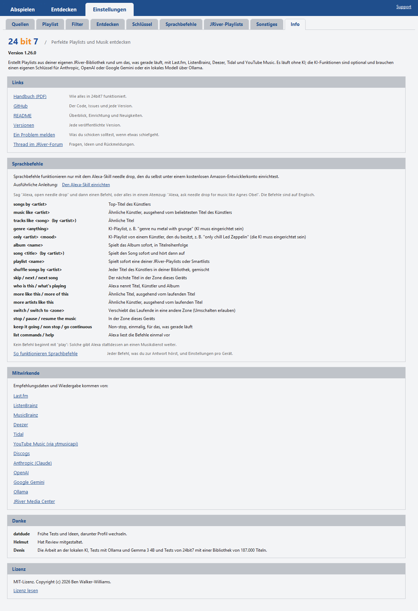

Die Version, die du verwendest, Links zu diesem Handbuch, GitHub und den Versionshinweisen, die Sprachbefehle auf einen Blick, Dank an die Dienste, die 24bit7 verwendet, und an die Menschen, die geholfen haben, es zu gestalten.

---

## Wie Playlists entstehen

### Mischen der Quellen

Jede angehakte Quelle liefert eine Rangliste. 24bit7 führt sie mit Gewichtung nach Position zusammen: Weit oben in einer Liste bringt viel, in mehreren Listen zu stehen bringt mehr. Es holt mehr, als es braucht, und kürzt dann, sodass das Ergebnis die Übereinstimmung der Quellen widerspiegelt und nicht die Eigenheiten einer einzelnen.

**Quellen, die übereinstimmen müssen** legt fest, wie viele Quellen einen Künstler oder Titel vorschlagen müssen, bevor er verwendet wird. Schaffen zu wenige diese Hürde, lockert 24bit7 sie Schritt für Schritt, nie unter 2, und sagt es in der Konsole. Das hält das Rauschen fern, das manche Dienste mitbringen, etwa was ihre Hörer an diesem Tag sonst noch gespielt haben.

Ist die KI eine Quelle und ist keiner ihrer Vorschläge in deiner Bibliothek, fragt 24bit7 sie noch einmal, nennt, was danebenlag, und bittet um andere. Das gilt für Ähnliche Künstler, Ähnliche Titel und die KI-Runden von Drift, und die Konsole sagt, wenn es passiert.

### Ähnliche Titel

Ähnliche Künstler fragt: "Wer klingt wie dieser Künstler?" Ähnliche Titel fragt: "Was klingt wie dieser Song?" Das folgt der Stimmung des Seeds viel genauer: Zwei Songs desselben Künstlers führen an verschiedene Orte. Seine Quellen sind Last.fm, ListenBrainz, Tidal, YouTube Music und, wenn angehakt, die KI. Ein Titel, auf den sich zwei oder drei Quellen einigen, steht über einem, den nur eine Quelle vorschlägt. Standardmäßig nimmt es die ähnlichsten Treffer der Reihe nach, derselbe Seed ergibt also dieselbe Playlist. Mit **Abwechslung** sammelt es bis zu doppelt so viele Treffer wie nötig und wählt zufällig, die ähnlichsten am wahrscheinlichsten, derselbe Seed ergibt also jedes Mal eine andere Playlist.

### YouTube Music als Quelle

YouTube Music wird gefragt: "Wenn jemand diesen Titel hört, was würdest du als Nächstes spielen?" Die Antwort ist eine Liste von etwa fünfzig Titeln, passend zur Stimmung des Titels.

- **Mit anderen Quellen angehakt** wird die Liste auf ihre Künstler eingedampft, und diese Liste stimmt beim Mischen ab wie jede andere.
- **Allein angehakt** spielt Ähnliche Künstler die Liste so, wie sie kommt: Jeder Titel wird in deiner Bibliothek gesucht, und die Treffer werden in der Reihenfolge von YouTube eingereiht. Der Seed-Künstler wird auf etwa ein Viertel der Playlist begrenzt.

Es braucht keinen Schlüssel und keine Anmeldung. Es stützt sich auf eine inoffizielle Bibliothek, ytmusicapi, und kann daher ausfallen, wenn YouTube etwas ändert, bis diese Bibliothek nachzieht.

### Schnellstart

Läuft in der Ausgabe-Zone nichts, startet der erste gefundene Titel sofort, und der Rest folgt in Playing Now, während er gefunden wird, die Musik beginnt also innerhalb von ein, zwei Sekunden. Läuft schon etwas, läuft es weiter, und die neue Playlist reiht sich dahinter ein. Ausgabe auf YouTube wartet auf die ganze Liste, da der Link nur einmal erstellt wird. Im Review-Modus wird gar nichts geschickt: Die Titel kommen in die Review-Liste, damit du auswählen kannst.

### Einreihen

Neue Titel werden rund um den aktuellen eingereiht: Der Rest von Playing Now wird geleert, der aktuelle Titel spielt ohne Lücke weiter, und die neue Playlist folgt ihm. Playing Now enthält dann genau "was ich gehört habe, plus was 24bit7 gewählt hat", was sich sauber als JRiver-Playlist speichern lässt. Eine gestoppte Zone startet die Playlist sofort. Kommt der Seed aus einer Zone und geht die Playlist in eine andere, eröffnet der Seed-Titel die Playlist in der neuen Zone.

### Überblenden

24bit7 ändert nicht, wie JRiver von einem Titel zum nächsten wechselt, aber Überblenden lässt eine Mischung schön fließen. Setz in JRiver unter Tools > Options > Audio > Track Change **Switch tracks** auf **S-Curve** mit etwa sechs Sekunden und lass **Use gapless for sequential album tracks** angehakt. Dann blenden Mischungen von einem Song in den nächsten über, während Alben, die der Reihe nach laufen, nahtlos bleiben. **S-Curve (aggressive)** holt den nächsten Titel kräftiger herein, eher wie ein DJ. Die Einstellung gilt pro Zone, setz sie also in jeder Zone, in der du sie haben willst. Ein Sonos- oder anderer DLNA-Lautsprecher bekommt davon nichts mit, da er jeden Titel selbst abspielt.

### Drift

Eine Bibliothek hat nicht immer genug, um die angestrebte Länge zu erreichen. Mit **Drift** sucht 24bit7 ausgehend vom bereits Gefundenen weiter, drei Seeds pro Runde, und schaut nach ihren ähnlichen Titeln oder ähnlichen Künstlern, je nachdem, was **Drift mit** sagt.

- **Keep It Tight** nimmt nur Titel der ersten Runde als Seeds, sodass sich nichts mehr als zwei Schritte von deinem Seed entfernt. War die erste Runde kurz, gehen womöglich die Seeds aus, und die Playlist bleibt kurz; die Konsole sagt es dann.
- **Weit** nimmt Seeds aus der ganzen Playlist, auch aus dem, was Drift selbst gefunden hat, kann also weiter wandern und sich dabei in mehrere Richtungen verzweigen. **Runden** legt fest, wie oft es versucht, von 1 bis 6. Mehr Runden füllen mehr Lücken, wandern aber weiter vom Seed weg. Mit Ausgabe an JRiver wird der erste Durchgang sofort eingereiht, und jede Runde kommt dazu, sobald sie gefunden ist.

**Drift-Quellen** können Einstellungen > Quellen folgen oder **Eigene Quellen** mit eigenem **Quellen, die übereinstimmen müssen** verwenden, sodass der erste Durchgang beständig bleibt und das Auffüllen abenteuerlicher wird. Dieselben Quellen halten die Vorschläge von Drift am nächsten am Seed; Eigene Quellen geben Drift einen anderen Weg.

Findet die erste Runde gar nichts, beginnt Drift mit **Eigene Quellen** noch einmal beim Seed selbst, mit seinen eigenen Quellen, und macht mit dem weiter, was das findet. Mit denselben Quellen wie die Playlist würde es nur die gerade gescheiterte Suche wiederholen, daher sagt die Konsole das stattdessen.

In einer KI-Playlist kann Drift aus deinen Musikquellen auffüllen, was kein Guthaben verbraucht, oder die KI erneut fragen und ihr sagen, was schon versucht wurde.

### Deep Cuts

So gut die Quellen auch sind, sie neigen zum Bekannten: Last.fm und ListenBrainz beruhen auf dem, was Millionen Menschen hören, und die Top-Titel eines Künstlers sind seine Hits. In einer großen Sammlung bleiben so Ecken, die nie drankommen. **Deep Cuts** füllt jede Playlist aus diesen Ecken auf, nur mit deiner Bibliothek und ihren eigenen Tags, ohne KI und ohne Daten von außen.

- **Einschalten:** **Deep Cuts** unter Mehr Optionen im Abspielen-Tab: **Aus**, **Verteilt** (gleichmäßig über die Playlist, damit der Anfang das Gefühl des Seeds behält) oder **Gemischt** (zufällig dazwischen). Der erste Titel bleibt immer vorn. Es gilt für Ähnliche Künstler, Ähnliche Titel und KI-Playlist und deren Non-stop-Nachschub; Top-Titel des Künstlers ist die Liste eines Künstlers und bekommt daher nie Deep Cuts.
- **Wie viele:** **Mit Deep Cuts auffüllen um** unter Einstellungen > Playlist, für jede Abspieloption: anfangs 10%, bis zu 100%. Sie kommen obendrauf: 10% von 30 Titeln ergibt 3, und 100% verdoppelt die Playlist, eine gleichmäßige Mischung.
- **Das Genre** ist das eigene Genre-Tag des Seed-Titels (ein Tag wie "Dub; Reggae" zählt als beides). Für einen gesuchten Titel, den du nicht besitzt, ist es das häufigste Genre des Künstlers in deiner Bibliothek; für eine KI-Playlist, die keinen Seed-Titel hat, das Genre, das die meisten Vorschläge der KI teilen. Ohne Genre sagt es die Konsole, und es kommt nichts dazu. Am besten funktioniert es, wenn deine Genres gut gepflegt sind: Ein breites Genre wie "Rock/Pop" ergibt lockerere Deep Cuts als ein sauberes "Trip-Hop".
- **Ähnliche Künstler** nimmt die Künstler dieses Genres, deren Titel im letzten Jahr am wenigsten gespielt wurden, über alle ihre Titel betrachtet, sodass ein letzte Woche gespielter Song einen Künstler nicht "aktuell" macht. Aus dem am wenigsten gespielten Fünftel wählt es zufällig und spielt dann einen ihrer bekanntesten Titel, die du besitzt.
- **Ähnliche Titel und KI-Playlist** nehmen die am wenigsten gespielten Titel des Genres: die wenigsten Wiedergaben, dann am längsten nicht gespielt, nie gespielte zuerst. Aus dem am wenigsten gespielten Fünftel wählen sie zufällig.
- **Was draußen bleibt:** alles, was schon in der Playlist ist, Titel unter anderthalb Minuten (Intros und Zwischenspiele), versteckte Albumabschlüsse, wenn Versteckte Titel an ist, alles, was deine Filter oder das Auslassen kürzlich gespielter Titel weglassen, und mehr als ein Titel pro Künstler. Ein Titel auf einem Sampler mit dem Namen "Künstler - Titel" zählt als dieser Künstler.
- **Der Moderator** prüft Deep Cuts, wenn er an ist, wie jeden anderen Titel und ersetzt alle, die er herausnimmt.
- **YouTube und Tidal:** Steht Ausgabe auf einem davon, wird jeder Deep Cut auch dort gesucht; was es dort nicht gibt, bleibt draußen.
- **In der Konsole:** *Deep Cuts (Trip-Hop, verteilt): 6 aus Titeln, die du selten hörst: Tosca - Chocolate Elvis, …*, oder der Grund, warum keine dazukamen. Entdecken listet sie mit "Deep Cuts" als Quelle.

### Moderator

Die meisten Playlists stimmen bis auf einen Titel: die Stadionhymne mitten in einer Reihe akustischer Songs. Der Moderator schickt jede Playlist einmal an die KI (das schnelle Modell des gewählten Anbieters), mit dem Seed, und entfernt Titel, die einen Hörer aus der Stimmung reißen würden. Er beurteilt Stimmung, Energie und Atmosphäre, nie das Genre allein. Titel, die er nicht gut genug kennt, werden behalten, und jede Entfernung wird mit Grund protokolliert.

- **Locker** entfernt nur klare Ausreißer, höchstens ein Fünftel der Titel.
- **Ausgewogen** entfernt alles, was Stimmung, Energie oder Atmosphäre merklich verschiebt, höchstens zwei Fünftel.
- **Streng** behält nur Titel nah am Seed, egal wie viele übrig bleiben. Drift kann eine zu kurze Playlist auffüllen.

Vorab werden ein paar Titel mehr gefunden, damit Entfernte ersetzt werden. Das kostet einen Bruchteil eines Cents pro Playlist (mit Ollama nichts). Scheitert die Prüfung, wird die Playlist ganz normal erstellt, und die Konsole sagt, warum. Auch ein einzelner Titel wird bei Ausgewogen und Streng geprüft; Locker überspringt ihn und sagt es, da höchstens ein Fünftel eines Titels keiner ist. Wann immer der Moderator eingestellt ist, aber nicht laufen kann (keine KI eingerichtet oder KI verwenden aus), sagt die Konsole einmal pro Playlist, warum.

Drift-Runden werden gegen die bisherige Playlist und den Seed geprüft, was einen Ausreißer viel leichter erkennbar macht. **Moderator für Drift-Titel** (Ähnliche Künstler und Ähnliche Titel) kann Drift strenger prüfen als die erste Runde oder gar nicht; Wie die Playlist folgt der Stufe der Playlist selbst. Liegt die Hälfte oder mehr von dem, was ein Seed gebracht hat, daneben, fliegt auch der Rest raus (die Konsole nennt jeden Titel), und Drift nimmt diese Kette nicht mehr als Seed, innerhalb der Grenze der Stufe. Das passiert nie, wenn die Runde dann leer wäre: Dann gehen nur die markierten Titel. Der Moderator bittet die KI um ihre beständigste Antwort, sodass dieselben Titel dasselbe Urteil bekommen, soweit es jeder Anbieter zulässt, und Streng behält einen Titel, der nur knapp danebenliegt.

### Non-stop

Mit **Non-stop** beobachtet 24bit7 die Zone, und wenn der letzte Titel einer Playlist, die es erstellt hat, zu spielen beginnt, fügt es weitere hinzu. **Keep It Tight** nimmt für jeden Nachschub einen Titel der ursprünglichen Playlist als neuen Seed, jedes Mal einen anderen, sodass der Abend nah am Anfang bleibt; wenn alle verwendet sind, geht es als **Wander** weiter, und die Konsole sagt es. Wander folgt der Musik:

- **Ähnliche Künstler und Ähnliche Titel** machen mit ähnlichen Künstlern oder ähnlichen Titeln weiter, ausgehend vom **letzten Titel** (sodass die Musik im Lauf des Abends weiterwandert) oder vom **2. Titel** (sodass sie näher am Anfang bleibt).
- **Top-Titel des Künstlers** kann zuerst die übrigen Songs des Künstlers aus deiner Bibliothek spielen, gemischt, und dann bei seinem beliebtesten Titel weitermachen.
- **KI-Playlist** kann die KI um mehr bitten oder mit ähnlichen Künstlern oder ähnlichen Titeln weitermachen, was kein Guthaben verbraucht.

Jeder Nachschub geht durch deine Filter und überspringt alles, was die Zone schon hatte. Nur Playlists, die 24bit7 geschickt hat, werden aufgefüllt: Ein Album, das du selbst in JRiver startest, endet ganz normal. Hast du die Wiedergabe gestoppt oder pausiert, kommt nichts dazu; drück wieder auf Play, und Non-stop macht weiter.

### Abgleich mit der Bibliothek

Empfehlungen kommen als Namen, und Namen sind unordentlich. 24bit7 kommt zurecht mit Akzenten (JAŸ-Z und JAY-Z), ähnlich aussehenden Satzzeichen, Versionsangaben wie "(Remastered)", "&" und "+" gegenüber "and", "$" für "s" (Travi$ Scott), Wörtern in Klammern in beiden Richtungen, Initialen mit Punkten (UNKLE und U.N.K.L.E.), Sortiernamen ("XX, The"), Künstlerfeldern von JRiver mit mehreren Werten, Bandnamen ("The Jimi Hendrix Experience" findet "Jimi Hendrix") und einem weggelassenen "g" ("Smokestack Lightnin'" findet "Smokestack Lightning"). Die ganze Bibliothek liegt ab dem Start von 24bit7 im Speicher, der Abgleich geht also sofort.

### Ausgabe auf YouTube

Mit Ausgabe auf YouTube wird die Playlist wie üblich erstellt, dann wird zu jedem Titel das Video gesucht, und die Liste öffnet sich in deinem Browser als Sofort-Playlist: keine Anmeldung, nichts wird in einem Konto gespeichert. Ein Video wird nur genommen, wenn der Künstler passt, denn eine Coverversion ist schlimmer als eine Lücke. Der Ton auf YouTube ist verlustbehaftet, das ist also zum Reinhören vor dem Kauf gedacht oder für jemanden, der die Musik nicht besitzt.

### Ausgabe auf Tidal

Mit Ausgabe auf Tidal wird die Playlist wie üblich erstellt, dann wird jeder Titel auf Tidal nach Künstler und Titel gesucht, die Studioversion zuerst, und die Liste kommt in deine Tidal-Playlist namens **24bit7**, anstelle dessen, was dort war, die sich dann in der Tidal-App öffnet (oder auf der Tidal-Website, wie es **Öffnen in** unter Einstellungen > Sonstiges sagt; auch dort, wenn die App nicht installiert ist). Sie wird beim ersten Mal angelegt, und 24bit7 füllt immer nur die eine mit genau diesem Namen, benenne sie also in Tidal um, um eine Playlist zu behalten, die dir gefällt. Titel, die Tidal nicht hat, bleiben draußen, und die Zeile Fertig zählt sie. Tidal beantwortet etwa zwei Anfragen pro Sekunde, eine erste Playlist mit 30 neuen Titeln dauert also etwa eine halbe Minute; schon gefundene Titel kommen aus dem Cache. Nimmt Tidal deine Anmeldung nicht mehr an, sagt die Konsole, dass du dich unter Einstellungen > Schlüssel neu anmelden sollst.

### Cache und Verlauf

Jede Antwort jedes Dienstes wird in einer lokalen Datenbank aufbewahrt, standardmäßig einen Monat (Cache behalten für, unter Einstellungen > Sonstiges: 1 Monat, 1 Jahr oder Dauerhaft), sodass eine wiederholte Playlist mit demselben Seed nichts kostet, auch kein KI-Guthaben. **Cache leeren...** entfernt Antworten, die älter als ein Monat oder ein Jahr sind, oder alle. Eine Antwort, dass MusicBrainz einen Künstler nicht kennt, wird immer nach einem Monat neu geprüft. Dieselbe Datenbank hält jede Playlist und jeden Treffer und jedes Fehlende fest, und das zeigt Entdecken.

---

## Sprachbefehle

Mit Sprachbefehlen bittest du laut um Musik. Sag in der Küche "Alexa, ask needle drop for music like Agnes Obel", und ein, zwei Sekunden später startet auf dem Küchenlautsprecher eine Playlist aus deiner eigenen Bibliothek.

Das läuft über einen eigenen Alexa-Skill, den du einmal einrichtest. Das geht nicht mit einem Klick: [Den Alexa-Skill einrichten](#den-alexa-skill-einrichten) führt dich hindurch. 24bit7 funktioniert auch vollständig ohne.

**Der Skill ist englisch.** Die Befehle sagst du auf Englisch, und Alexa antwortet auf Englisch. Dein Alexa-Gerät muss dafür auf Englisch eingestellt sein; die Sprache eines Geräts stellst du in der Alexa-App ein. Die Konsole von 24bit7 zeigt trotzdem alles auf Deutsch.

### Wie alles zusammenspielt

1. Du sprichst mit einem **Alexa-Gerät**.
2. **Dein Alexa-Skill**, den Amazon betreibt, hört den Befehl und schickt ihn mit einem geheimen Schlüssel und der ID des Geräts an die Adresse deines PCs im Internet.
3. **Tailscale Funnel** gibt deinem PC diese Adresse und reicht die Anfrage an 24bit7 weiter. An deinem Router musst du nichts ändern.
4. **24bit7** prüft den Schlüssel, schaut nach, in welcher Zone das Gerät spielt und welche Einstellungen es verwendet, und erstellt oder spielt dann die Musik dort.

### Was du sagen kannst

Öffne zuerst den Skill ("Alexa, open needle drop") und sag dann den Befehl, oder sag alles in einem Atemzug: "Alexa, ask needle drop for music like Agnes Obel".

| Sag | Du bekommst |
|---|---|
| "songs by *artist*" | Top-Titel des Künstlers |
| "music like *artist*" | Ähnliche Künstler, ausgehend vom beliebtesten Titel des Künstlers |
| "tracks like *song*" oder "tracks like *song* by *artist*" | Ähnliche Titel |
| "genre *anything*", etwa "genre nu metal with grunge" | KI-Playlist (KI muss eingerichtet sein) |
| "only *Künstler und Stimmung*", etwa "only chill Led Zeppelin" oder "only Queen anthems" | Eine KI-Playlist nur dieses Künstlers: Die KI wählt aus seinen Titeln in deiner Bibliothek, also kommt niemand anderes dazu. Der Künstler muss in deiner Bibliothek sein. Ohne Stimmung ("only Led Zeppelin") seine bekanntesten Songs (KI muss eingerichtet sein) |
| "album *name*" | Spielt das Album sofort, in Titelreihenfolge |
| "song *title*" | Spielt den Song sofort und hört dann auf |
| "playlist *name*" | Spielt sofort eine deiner JRiver-Playlists oder Smartlists, mit ihren Einstellungen aus Einstellungen > JRiver-Playlists |
| "shuffle songs by *artist*" | Jeder Titel des Künstlers in deiner Bibliothek, gemischt, beginnend mit einem seiner bekanntesten Songs |
| "skip", "next" oder "next song" | Der nächste Titel in der Zone dieses Geräts |
| "who is this" oder "what's playing" | Alexa nennt Titel, Künstler und Album, die in der Zone dieses Geräts laufen |
| "more like this" oder "more of this" | Ähnliche Titel zum Laufenden. Der aktuelle Titel läuft weiter, und die neue Playlist ersetzt, was danach eingereiht war |
| "more artists like this" oder "music like this" | Ähnliche Künstler zum Laufenden, ebenso nach dem aktuellen Titel |
| "switch" oder "switch to *zone*" | Bringt das Laufende in eine andere Zone, beim selben Song und an derselben Stelle; die verlassene Zone stoppt |
| "stop the music", "pause the music" oder "resume the music" | Stoppt, pausiert oder setzt die Zone dieses Geräts fort |
| "keep it going", "non stop" oder "go continuous" | Schaltet Non-stop einmalig für das ein, was in der Zone dieses Geräts läuft |
| "list commands" oder "help" | Alexa liest die Befehle einmal vor |

**Switch** bringt die Musik aus der laufenden Zone (der des fragenden Geräts, wenn sie läuft) in eine andere Zone, die unter **Umschalten erlauben** angehakt ist. Bei zwei Zonen geht sie direkt in die andere; bei drei oder mehr fragt Alexa, in welche, und du antwortest "to the kitchen", oder du sagst es gleich: "switch to the kitchen". Es geht beim selben Song und an derselben Stelle weiter, eine pausierte Zone kommt pausiert an, und Non-stop folgt der Musik. Eine Sonos- oder andere DLNA-Zone macht ebenfalls an derselben Stelle weiter: Sie startet leise, springt an die richtige Stelle, sobald sie spielt, und der verlassene Raum stoppt einen Moment später. Feinabstimmen kannst du das mit Zeitausgleich beim Umschalten unter Einstellungen > Sprachbefehle. Ein einfaches "Alexa, stop" geht an den Lautsprecher selbst, um eine JRiver-Zone zu stoppen, brauchst du also "ask needle drop to stop the music".

Haben mehrere Alben oder Songs denselben Titel, fragt Alexa nach dem Künstler, und du antwortest "by *artist*". Haben zwei Playlists denselben Namen, fragt sie, welche, und du antwortest "by smartlist", "by playlist" oder "by" und den Ordner. Um die Frage zu überspringen, sag es gleich: "playlist vocal jazz smartlist".

Kein Befehl beginnt mit "play". Alexa gibt alles, was mit "play" beginnt, gern an einen Musikdienst statt an den Skill.

Skip, who is this und die "more like this"-Befehle brauchen immer den Namen des Skills: "Alexa, ask needle drop to skip". Ein einfaches "Alexa, skip" geht an den Lautsprecher selbst, der keine eigene Warteschlange hat, während er eine JRiver-Zone spielt. Eine Alexa-Routine kann dir einen kürzeren Satz geben: Lass "next song" die eigene Aktion "ask needle drop to skip" ausführen.

Den Namen des Skills wählst du selbst. Dieser heißt "needle drop", weil Alexa die erste Wahl ständig falsch verstanden hat.

### Was du hörst

- **"Ready."**, wenn der Skill geöffnet ist und wartet.
- **"Sorry, I didn't catch that. Say list commands to hear them."** einmal, wenn ein Befehl nicht erkannt wird. Die ganze Liste wird nur vorgelesen, wenn du danach fragst.
- **"Which zone?"** nach "switch", wenn drei oder mehr Zonen angehakt sind.
- **Ein kurzer Ton**, wenn ein Befehl angenommen ist. Die Musik folgt fast sofort.
- **"Please wait, request pending."**, wenn noch eine andere Playlist erstellt wird. Deine kommt dran, sobald sie fertig ist.
- **"That's *track* by *artist*, from *album*."** nach "who is this".
- **"Nothing's playing on *zone*."** nach skip, who is this oder einem "more like this"-Befehl, wenn die Zone gestoppt ist, und **"Nothing to skip to."** beim letzten Titel.
- **Eine gesprochene Erklärung**, wenn etwas nicht stimmt, etwa ein Gerät ohne Zone. [Probleme mit Sprache](#probleme-mit-sprache) nennt jede einzelne.

Alben, Songs, Playlists und gemischte Wiedergabe müssen nicht erstellt werden und ersetzen das Laufende daher sofort. Playlists, die erstellt werden, nutzen den [Schnellstart](#schnellstart) und reihen sich hinter das Laufende ein.

### Was du siehst

Während ein Sprachbefehl eine Playlist erstellt, sitzt oben rechts auf dem Hauptbildschirm ein kleines 24bit7-Abzeichen, über allem anderen, auch über JRivers Theater View. Es zeigt, was du dir gewünscht hast, und die Zone, mit einem Punkt, der wandert, solange es arbeitet (magenta, während die KI auswählt). Es bleibt stehen, solange [Drift](#drift) noch Titel sucht, damit du weißt, dass noch mehr kommen. Ist die Playlist fertig, sagt es, wie viele Titel hinzugefügt wurden oder warum keine, und blendet sich nach ein paar Sekunden aus. Ein Befehl, aus dem nichts wird, erscheint dort auch, mit dem, was Alexa gesagt hat.

Das Abzeichen nimmt nie den Fokus, und Klicks gehen einfach hindurch, sodass Fernbedienung und JRiver wie gewohnt weiterlaufen. Es gibt es nur für Sprachbefehle: Am Schreibtisch zeigt die Konsole dasselbe. Seine Farben folgen deiner Akzentfarbe (Einstellungen > Sonstiges).

### Weiterlaufen lassen

Ist **Non-stop** für eine Abspieloption angehakt, läuft eine per Sprachbefehl erstellte Playlist weiter, wenn sie ihren letzten Titel erreicht. "Shuffle songs by" läuft genauso weiter, wenn die gemischte Liste zu Ende ist. Auch deine eigenen JRiver-Playlists können weiterlaufen, eingestellt pro Playlist unter Einstellungen > JRiver-Playlists. Alben und Songs enden ganz normal, außer du sagst **"keep it going"**: Das schaltet Non-stop einmalig für das ein, was in der Zone läuft, auch für ein Album, das du in JRiver gestartet hast, mit den Non-stop-Einstellungen von Ähnliche Titel für diese Zone: Wander, wenn Non-stop dort aus ist, sonst der dort gewählte Modus. Es endet, wenn etwas anderes die Musik ersetzt.

Eine JRiver-Playlist mit **Blend** wartet nicht auf ihr Ende: Neue Songs werden von Anfang an eingewoben, einer von deinen, dann ein neuer, bis zu 50 neue Songs ausgehen.

### Geräte und ihre Einstellungen

Jedes Alexa-Gerät, das mit 24bit7 spricht, erscheint beim ersten Mal unter **Einstellungen > Sprachbefehle > Geräte**. Gib ihm einen Namen und wähl seine JRiver-Zone, und von da an spielen seine Befehle dort.

Standardmäßig verwendet jedes Gerät dieselben Einstellungen wie die Windows-App, genannt **Windows (Haupt)**. So gibst du einem Gerät eigene:

1. Hake unter **Einstellungen > Sprachbefehle > Geräte** für das Gerät **Eigene Einstellungen** an.
2. **Einstellungen > Quellen**, **Playlist** und **JRiver-Playlists** zeigen jetzt eine Reihe von Tabs: Windows (Haupt), dann einen pro angehaktem Gerät.
3. Jeder Geräte-Tab beginnt mit angehaktem **Wie Windows (Haupt)** und folgt der Windows-App. Nimm den Haken weg, um die Einstellungen dieses Geräts zu ändern. Jede Seite ist getrennt, ein Gerät kann also eigene Quellen haben, während seine Playlist weiter Windows (Haupt) folgt.

Ein Gerät mit eigenen Einstellungen kann außerdem unter **Gilt für** in einem Filter stehen, etwa um die Küche auf eine Playlist "Küchen-Favoriten" zu beschränken. Schlüssel, Suchseiten und Zonen bleiben gemeinsam.

Mit zwei Lautsprechern lassen sich leicht zwei Einstellungen vergleichen: derselbe Befehl in Küche und Wohnzimmer, einmal mit Moderator und einmal ohne. Nimm den Haken bei **Eigene Einstellungen** weg, und das Gerät geht zurück zu Windows (Haupt); seine eigenen Einstellungen bleiben fürs nächste Mal erhalten.

### Gut zu wissen

- Sprache funktioniert nur, solange 24bit7 und JRiver laufen. **Einstellungen > Sonstiges > Windows** kann 24bit7 mit Windows starten, versteckt im Infobereich.
- Playlists werden nacheinander erstellt, aus der App oder per Sprache.
- Jede per Sprachbefehl erstellte Playlist erscheint in der Konsole, unter dem eigenen Tab des Geräts und in Alle. Ein Befehl, aus dem nichts wurde, erscheint dort auch, mit dem, was Alexa gesagt hat.

---

## Den Alexa-Skill einrichten

Hier richtest du den Alexa-Skill ein, der gesprochene Befehle an 24bit7 schickt. Beim ersten Mal dauert es etwa eine Stunde und kostet nichts, geht aber nicht mit einem Klick: Du legst auf der Entwicklerseite von Amazon deinen eigenen Skill an und öffnest einen sicheren Weg aus dem Internet zu 24bit7 auf deinem PC.

Amazon baut seine Entwicklerkonsole ab und zu um, daher beschreiben diese Schritte, was zu tun ist, und nicht den genauen Namen jedes Knopfes. Passt eine Beschriftung nicht, such nach dem nächstliegenden.

### Was du brauchst

- Einen Windows-PC mit 24bit7 und JRiver Media Center oder Media Server auf demselben PC.
- Ein Amazon-Entwicklerkonto (kostenlos), angemeldet mit **demselben Amazon-Konto wie deine Alexa-Geräte**. Ein Skill in Entwicklung funktioniert nur auf Geräten, die auf das Konto registriert sind, mit dem er angelegt wurde.
- Ein Tailscale-Konto (für private Nutzung kostenlos).
- Mindestens ein Alexa-Gerät, auf Englisch eingestellt. Alles mit eingebautem Alexa funktioniert, auch ein Sonos-Lautsprecher mit Alexa.

### Schritt 1: Sprachbefehle in 24bit7 einschalten

1. Geh zu **Einstellungen > Sprachbefehle**.
2. Hake **Sprachbefehle** an. Ein Schlüssel wird für dich erstellt, und die Statuszeile sollte sagen, dass es auf 127.0.0.1:52180 zuhört.
3. Gib unter **Test** einen Künstler ein, wähl eine Zone und drück **Test senden**. Die Playlist sollte in dieser Zone entstehen. Das beweist, dass der Empfang funktioniert, bevor irgendetwas anderes beteiligt ist.

Der Schlüssel ist versteckt. Hake **Zeigen** daneben an oder nimm **Kopieren**, wenn du ihn in Schritt 5 brauchst.

### Schritt 2: deinem PC mit Tailscale Funnel eine Adresse geben

1. Installier Tailscale von tailscale.com auf dem PC und melde dich an.
2. Schalt in der Admin-Konsole von Tailscale auf der Seite DNS **MagicDNS** und **HTTPS certificates** ein.
3. Öffne PowerShell und führ aus:

   ```
   tailscale funnel --bg 52180
   ```

   Beim ersten Mal bittet Tailscale dich, Funnel für dein Netzwerk zu erlauben, mit einem Link dazu. Erlaube es und führ den Befehl dann noch einmal aus.
4. Prüf es und notier dir deine Adresse:

   ```
   tailscale funnel status
   ```

   Es zeigt eine Adresse wie `https://your-pc.your-tailnet.ts.net`, weitergeleitet an `http://127.0.0.1:52180`.
5. Teste es von außerhalb deines Heimnetzes. Öffne auf deinem Handy, mit ausgeschaltetem WLAN, deine Adresse gefolgt von `/ping`. Eine Antwort **wrong key** ist genau richtig: Die Anfrage hat 24bit7 erreicht, und 24bit7 hat sie abgelehnt, weil der Browser den Schlüssel nicht mitgeschickt hat.

`--bg` lässt Funnel im Hintergrund laufen, und nach einem Neustart kommt es von selbst wieder.

### Schritt 3: den Skill anlegen

1. Geh zur Alexa-Entwicklerkonsole auf developer.amazon.com und melde dich mit demselben Amazon-Konto an wie deine Geräte.
2. Leg einen neuen Skill an:
   - **Name:** was du willst. Nur du siehst ihn.
   - **Sprache:** Englisch, etwa English (UK), da die Befehle englisch sind; deine Geräte müssen dieselbe Sprache verwenden.
   - **Art:** ein eigener Skill (custom).
   - **Hosting:** **Alexa-hosted (Python)**, damit Amazon den Code kostenlos betreibt und du kein AWS-Konto brauchst. Wähl die Region, die dir am nächsten ist.
   - **Vorlage:** ohne Vorlage beginnen (start from scratch).
3. Warte etwa eine Minute, während Amazon ihn einrichtet.

### Schritt 4: das Interaktionsmodell hinzufügen

Das Interaktionsmodell ist die Liste der Sätze, die der Skill versteht.

1. Öffne [alexa/interaction_model.json](https://github.com/24bit7/24bit7/blob/main/alexa/interaction_model.json) auf GitHub und kopier alles.
2. Geh in der Konsole zu **Build**, dann **Interaction Model**, dann **JSON Editor**. Füg es über alles dort ein, dann **Save** und **Build**.
3. Die Datei setzt den Aufrufnamen, die Wörter, die den Skill öffnen, auf **needle drop**. Du kannst ihn vor dem Build in der Zeile `invocationName` ändern. Nimm nur einfache Wörter in Kleinbuchstaben.

Wähl Wörter, die Alexa nicht mit etwas anderem verwechseln kann. Dieses Projekt hat zuerst "bit seven" verwendet, und Alexa hat jedes Mal "bet seven" gehört. Öffnet sich der Skill nicht, zeigt der Sprachverlauf in der Alexa-App genau, was Alexa gehört hat.

### Schritt 5: den Code hinzufügen

1. Geh zum Tab **Code**. Links ist ein Ordner `lambda` mit `lambda_function.py`.
2. **Leg zuerst die Einstellungsdatei an.** Leg im Ordner `lambda` eine Datei `skill_settings.py` an. Kopier [alexa/skill_settings.py](https://github.com/24bit7/24bit7/blob/main/alexa/skill_settings.py) von GitHub hinein und trag dann zwei Werte ein:
   - `BIT7_URL`: deine Adresse aus Schritt 2, beginnend mit `https://`, in Anführungszeichen, mit nichts nach `.ts.net`.
   - `BIT7_KEY`: der Schlüssel aus Einstellungen > Sprachbefehle, in Anführungszeichen.

   Lass `CHIME` leer, und Alexa sagt "Ready", wenn sich der Skill öffnet. Für einen anderen Ton bei Annahme wähl einen aus der Alexa Skills Kit Sound Library und setz seine `soundbank://`-Adresse in eine Zeile `ACK_TONE`, wie die Datei zeigt.
3. Öffne `lambda_function.py` und füg [alexa/lambda_function.py](https://github.com/24bit7/24bit7/blob/main/alexa/lambda_function.py) von GitHub darüber ein.
4. **Save**, dann **Deploy**.

Deine Adresse und dein Schlüssel stehen nur in `skill_settings.py`. Der Code in `lambda_function.py` enthält keins von beiden und kann also bedenkenlos geteilt werden.

### Schritt 6: testen

**Zuerst in der Konsole.** Geh zum Tab **Test** und stell das Testen auf **Development**. Tipp `open needle drop`. Es sollte "Ready" antworten. Tipp dann einen Befehl wie `album dummy`. Die Konsole ist noch kein Gerät, das 24bit7 kennt, die Antwort sollte also **"This device isn't set up yet"** sein, was beweist, dass der ganze Weg funktioniert. Die Konsole erscheint dann unter Einstellungen > Sprachbefehle als neues Gerät: Gib ihr eine Zone, um weiter aus der Konsole zu testen, oder drück **Entfernen**.

**Dann auf einem Gerät.**

1. Sag "Alexa, open needle drop". Es sollte "Ready" sagen.
2. Sag einen Befehl, etwa "music like Agnes Obel". Beim ersten Mal hörst du "This device isn't set up yet".
3. Geh in 24bit7 zu **Einstellungen > Sprachbefehle** und drück unter Geräte auf **Aktualisieren**. Das Gerät erscheint als "New device 1". Gib ihm einen Namen und wähl seine Zone.
4. Probier den Befehl noch einmal. Alexa spielt einen kurzen Ton, und die Musik startet ein, zwei Sekunden später in dieser Zone.

Wiederhol das für jedes Gerät.

### Schritt 7: am Laufen halten

Sprache funktioniert nur, solange 24bit7 und JRiver laufen, lass also beide von selbst starten:

- In 24bit7 unter **Einstellungen > Sonstiges > Windows**: Hake **Mit Windows starten** an und lass **Im Infobereich starten** angehakt. **Ins Infobereich schließen** verhindert, dass der Schließen-Knopf des Fensters Sprache versehentlich ausschaltet.
- Lass in JRiver Media Center oder Media Server mit Windows starten. Media Server allein reicht.
- Tailscale Funnel kommt nach einem Neustart schon von selbst wieder.

Starte den PC neu und probier einen Befehl, ohne etwas zu öffnen. Wenn die Musik spielt, bist du fertig.

### Probleme mit Sprache

Jeder Befehl, aus dem nichts wird, erscheint auch in der Konsole, unter dem Tab des Geräts und im Log, mit genau dem, was Alexa geantwortet hat.

| Alexa sagt oder tut | Was es bedeutet | Was du versuchen kannst |
|---|---|---|
| "24bit7 isn't answering. Is it running on the media PC?" | Der Skill hat 24bit7 nicht erreicht. | Prüf, ob 24bit7 läuft und Einstellungen > Sprachbefehle sagt, dass es zuhört. Führ `tailscale funnel status` aus. Prüf `BIT7_URL` in `skill_settings.py` Buchstabe für Buchstabe. |
| "24bit7 didn't accept the key..." | Der Schlüssel im Skill passt nicht zu dem von 24bit7. | Kopier den Schlüssel aus Einstellungen > Sprachbefehle erneut in `skill_settings.py`, dann Save und Deploy. Das musst du nach **Neuer Schlüssel** immer tun. |
| "This device isn't set up yet..." | 24bit7 weiß nicht, in welcher Zone dieses Gerät spielt. | Einstellungen > Sprachbefehle, **Aktualisieren**, eine Zone für das Gerät wählen. |
| "I can't find the ... zone in JRiver." | Die Zone wurde umbenannt, oder JRiver läuft nicht. | Starte JRiver oder wähl die Zone erneut. |
| "Sorry, something went wrong in the skill." | Der Code des Skills ist gescheitert. | Meist fehlt `skill_settings.py`, ist falsch benannt oder hat einen Tippfehler. Sie muss im Ordner `lambda` neben `lambda_function.py` liegen. Der Tab Code verlinkt auf die Logs des Skills, die den Fehler nennen. |
| "Please wait, request pending." | Eine andere Playlist wird noch erstellt. | Nichts: Deine kommt als Nächstes. |
| Der Skill öffnet sich gar nicht | Alexa hat den Aufrufnamen nicht erkannt. | Schau im Sprachverlauf der Alexa-App nach, was sie gehört hat, und wähl einen deutlicheren Namen. |
| Die Musik kommt stattdessen von Amazon Music oder Spotify | Der Befehl begann mit "play", oder der Name des Skills wurde überhört. | Lass "play" weg. Nimm "ask needle drop for ...", wenn der Skill immer wieder überhört wird. |
| Stille nach "Alexa, stop" und einer neuen Anfrage, auf einem Sonos oder anderen DLNA-Lautsprecher | Mit **Neue Playlists** auf Nach diesem Titel wartet die neue Playlist, bis der laufende Titel zu Ende ist. Ein einfaches "Alexa, stop" pausiert den Lautsprecher selbst, aber JRiver kann den Titel noch für laufend halten, also endet er nie. | Sag stattdessen "ask needle drop to stop the music", das stoppt die Zone in JRiver, oder stell **Neue Playlists** unter Einstellungen > Sprachbefehle auf Sofort abspielen. |
| Alexa versteht die Befehle nicht | Das Gerät ist auf Deutsch eingestellt. | Stell das Gerät in der Alexa-App auf Englisch; der Skill ist englisch. |

Um den Weg vom PC selbst aus zu prüfen, schickt das hier dieselbe Anfrage wie der Skill (mit deiner eigenen Adresse und deinem Schlüssel):

```
Invoke-RestMethod https://your-pc.your-tailnet.ts.net/ping -Headers @{'X-24bit7-Key'='your-key'}
```

Eine Antwort mit `ok: True` und der Version von 24bit7 heißt, dass auf der Seite des PCs alles funktioniert.

### Privat halten

- Der Empfang von 24bit7 nimmt nur Verbindungen vom PC selbst an. Der einzige Weg von außen ist die Funnel-Adresse, und jede Anfrage muss deinen Schlüssel mitbringen, sonst wird sie abgelehnt.
- Behandle Schlüssel und Adresse wie ein Passwort. Halt `skill_settings.py` aus Screenshots heraus, und stell deine echten Werte nie in ein öffentliches Repository.
- Wird der Schlüssel je bekannt, drück **Neuer Schlüssel** unter Einstellungen > Sprachbefehle, trag den neuen Schlüssel in `skill_settings.py` ein und führ Deploy aus. Der alte Schlüssel funktioniert sofort nicht mehr.
- Um Sprache auszuschalten, nimm den Haken bei Sprachbefehle weg. Um auch den Weg zu schließen, führ `tailscale funnel reset` aus.

---

## Wenn etwas schiefgeht

### Häufige Probleme

| Was passiert | Was du versuchen kannst |
|---|---|
| Läuft gerade sagt, dass nichts läuft, oder die Liste Zone ist leer | Prüf, ob JRiver mit eingeschaltetem Media Network läuft. Läuft JRiver auf einem anderen PC, trag seine Adresse unter Einstellungen > Sonstiges > JRiver-Host ein. Hast du in JRiver Benutzername und Passwort festgelegt, trag sie unter Einstellungen > Schlüssel ein. |
| Eine Quelle wird übersprungen, mit "keinen Schlüssel" in der Konsole | Trag ihren Schlüssel unter Einstellungen > Schlüssel ein oder nimm den Haken unter Einstellungen > Quellen weg. |
| KI-Optionen sind ausgegraut | Sie brauchen den gewählten Anbieter, eingerichtet unter Einstellungen > Schlüssel > KI: seinen Schlüssel und Guthaben auf dem Konto oder bei Ollama ein Modell. |
| YouTube Music liefert nichts mehr | YouTube hat wahrscheinlich etwas geändert. Meist geht es mit dem nächsten Update der Bibliothek ytmusicapi wieder; nimm den Haken solange weg. |
| Eine Playlist fällt zu kurz aus | Deine Bibliothek hat womöglich zu wenig von dem, was die Quellen vorschlagen. Senk **Quellen, die übereinstimmen müssen**, hake mehr Quellen an oder schalt **Drift** ein. |
| "Nichts Passendes gefunden" | Nichts, was die Quellen vorgeschlagen haben, ist in deiner Bibliothek, und es gab kein Genre zum Ausweichen (oder Wenn gar nichts klappt ist aus). Versuch einen anderen Seed, gib den Titeln des Seeds ein Genre-Tag oder hake **Wenn gar nichts klappt** unter Einstellungen > Playlist an. |
| Ein Titel passt nicht dazu | Probier den **Moderator** auf Locker oder Ausgewogen. |
| **Als Playlist speichern** in Review ergibt eine leere Playlist | JRiver hat die Playlist angelegt, aber die Titel ohne Anmeldung nicht hinzugefügt. Leg in JRiver einen Benutzernamen und ein Passwort fest (Tools > Options > Media Network > Authentication) und trag sie unter Einstellungen > Schlüssel ein. |
| Ein Lautsprecher wie Sonos fehlt bei den Zonen | Hake in JRiver DLNA Controller an (Tools > Options > Media Network > Advanced) und drück dann **Neu einlesen** unter Einstellungen > Sonstiges > Zonen. |
| Windows sagt "Der Computer wurde durch Windows geschützt" | Klick auf **Weitere Informationen** und dann auf **Trotzdem ausführen**. Die App ist nicht signiert. |

### Konsolen-Frage

Fällt eine Playlist zu kurz oder seltsam aus, kannst du fragen, warum. Hake **Konsolen-Frage einschalten** unter Einstellungen > Sonstiges an (es fragt vorher, da es KI-Guthaben verbraucht; mit Ollama nicht verfügbar), klick in die Konsole und drück **Fragen**. Tipp eine Frage und drück Enter: "Warum ist dieser Titel dabei?", "Warum ist die Playlist so kurz?", "Was hat der Moderator entfernt?". Die Antwort erscheint in der Konsole in Magenta, auf Deutsch, und das Feld bleibt für Nachfragen offen.

Die KI bekommt die angezeigte Playlist, deine Einstellungen ohne jeden Schlüssel und jedes Passwort, was gerade läuft, und den Code und die README von 24bit7, damit sie die Regeln und die Namen der Einstellungen kennt. Sie schlägt bis zu drei Änderungen vor. Die angezeigte Playlist kann jede der letzten 50 sein, aus dem Log geöffnet. Stell die Konsole vorher auf **Erweitert**, und sie bekommt auch die Debug-Zeilen. Die erste Frage kostet ein paar Cent; mit Anthropic kosten Nachfragen kurz danach viel weniger.

### Ein Problem melden

1. Mach das, was schiefgegangen ist. Bei einer früheren Playlist öffne sie stattdessen aus dem Log.
2. Klick in die Konsole und drück **Als Log speichern**. Bei offenen Tabs der Konsole steht es oben rechts.

24bit7 schreibt eine Datei mit Datum in den Ordner `logs` daneben, mit der Version, Angaben zu Windows und JRiver, der Größe der Bibliothek, deinen Einstellungen mit versteckten Schlüsseln und Passwörtern und der angezeigten Playlist, Debug-Zeilen eingeschlossen. Der Ordner öffnet sich mit der markierten Datei. Häng sie an, wenn du das Problem auf [GitHub](https://github.com/24bit7/24bit7/issues) meldest. Deutsch ist dort willkommen.

---

## Quellen und deine Daten

| Quelle | Wofür | Schlüssel |
|---|---|---|
| JRiver | Läuft gerade, Suche in der Bibliothek, Einreihen | Nein (standardmäßig auf demselben PC) |
| Last.fm | Ähnliche Künstler, ähnliche Titel, Top-Titel | Eingebaut, oder dein eigener (kostenlos) |
| ListenBrainz und MusicBrainz | Ähnliche Künstler, ähnliche Titel, Top-Aufnahmen, Plattenlabels | Kostenlos, nur für Top-Aufnahmen |
| Deezer | Ähnliche Künstler, Top-Titel, Namen prüfen | Keiner |
| Tidal | Ähnliche Künstler, ähnliche Titel, Top-Titel | Kostenlos |
| YouTube Music | Ähnliche Künstler und Titel, Ausgabe auf YouTube | Keiner |
| Discogs | Mitwirkende auf Alben, Plattenlabels | Kostenlos |
| Deine gewählte KI: Anthropic (Claude), OpenAI, Google Gemini oder Ollama | KI-Vorschläge, KI-Playlist, Moderator, Konsolen-Frage | Kostenpflichtig, Cent-Beträge pro Playlist; Ollama ist kostenlos und läuft auf deinem PC |

Deine Musikdateien verlassen deinen PC nie. Dienste bekommen die Künstler- und Titelnamen, nach denen sie gefragt werden, und Konsolen-Frage schickt die Konsole wie oben beschrieben. Alles, was 24bit7 lernt, liegt in `24bit7.db` neben der App, und deine Schlüssel in `.env`. Keine der beiden Dateien landet je in einem Log oder einer Version.
