# 24bit7 User Manual

24bit7 builds playlists from your own JRiver library around whatever is playing. Press a button and Playing Now is rebuilt around the current track while the music keeps going, using recommendations from Last.fm, ListenBrainz, Deezer, YouTube Music and, if you want it, AI. Anything it recommends that you don't own is logged, so the misses become a shopping list.

This manual explains every part of the app. The [README](https://github.com/24bit7/24bit7#readme) on GitHub has the overview and what's new in each version.

## Contents

1. [Getting started](#getting-started)
2. [The Play tab](#the-play-tab)
3. [The Discover tab](#the-discover-tab)
4. [Settings](#settings)
5. [How playlists are built](#how-playlists-are-built)
6. [Voice Commands](#voice-commands)
7. [Setting up the Alexa skill](#setting-up-the-alexa-skill)
8. [When something goes wrong](#when-something-goes-wrong)
9. [Sources and your data](#sources-and-your-data)

---

## Getting started

### What you need

- A Windows PC.
- JRiver Media Center or Media Server, with Media Network switched on: in JRiver, Tools > Options > Media Network > **Use Media Network to share this library**. 24bit7 talks to JRiver on the same PC by default, on port 52199.
- Nothing else to begin with. Deezer and YouTube Music need no keys, so a fresh install builds playlists straight away.

You can try 24bit7 without JRiver at all: the Search tab with Output set to YouTube needs no library.

### Installing

1. Download the zip for the latest version from the [Releases](https://github.com/24bit7/24bit7/releases) page. It's under **Assets** at the bottom of the release, below the two "Source code" downloads, which are only the Python files.
2. Unzip it anywhere you like and run `24bit7.exe`.
3. Windows will probably show a blue **"Windows protected your PC"** box the first time, because the exe isn't code-signed. Click **More info**, then **Run anyway**. It only asks once.

To run from source instead, you need Python 3.10 or newer. Run `pip install -r requirements.txt`, then run `gui.pyw`.

### The first run

24bit7 opens on Settings and says hello once. It comes with a Last.fm key built in, so Similar Artists starts on Last.fm, and Track Matching on Last.fm and YouTube Music, with nothing to set up. For more sources, add a free ListenBrainz token under **Settings > Keys**, then tick it in a playlist's config under **Settings > Playlist Settings**. Each key has a **?** button with the steps for getting it.

### Upgrading

Your settings and history live in two files next to the app: `.env` (settings and keys) and `24bit7.db` (cache and Discover history). Copy both into the new version's folder and everything carries over. Settings from older versions are converted automatically. When a release changes the Alexa skill, as 1.12.0 does, paste the new `alexa\interaction_model.json` and `alexa\lambda_function.py` into the Alexa developer console as in [Steps 4 and 5](#step-4-add-the-interaction-model), then Build and Deploy.

You don't have to keep an eye out for new versions: each time 24bit7 opens, it asks GitHub for the latest one, and if it's newer than yours, a line in the console says so, with a link to download it. When you're up to date, or offline, it says nothing.

---

## The Play tab

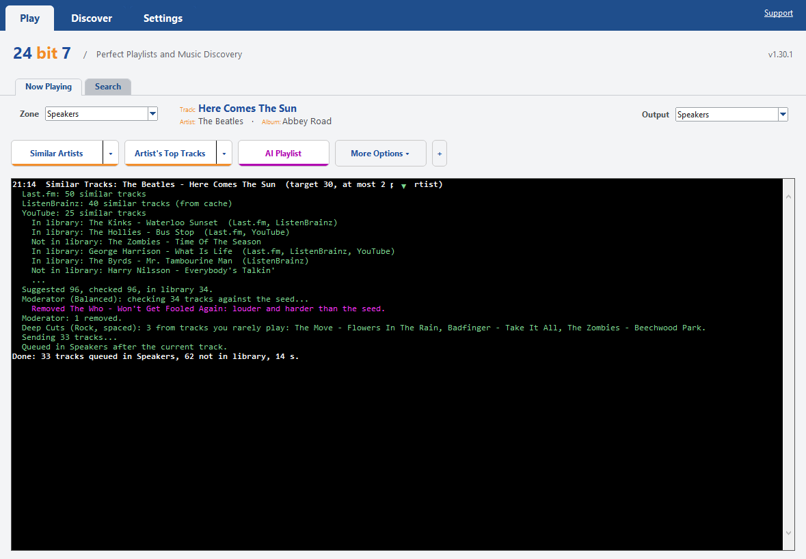

### The seed

Every playlist starts from a seed. The seed is whichever of the three small tabs is showing when you press one.

- **Now Playing** shows what JRiver is playing. **Zone** picks which JRiver zone you seed from. If that zone's Playing Now is empty, the playlists seed from the last track JRiver played.
- **JRiver Playlists** plays one of your own JRiver playlists or smartlists, as it is or with new tracks woven in. See [Playing your JRiver playlists](#playing-your-jriver-playlists). The row's playlist buttons grey out on this tab, as there's no artist or track to seed from; Radio still plays.
- **Search** lets you type any artist and track, whether you own it or not. Similar Artists, Artist's Top Tracks and Artist + Guests need only the artist. Press Enter for Similar Artists. If the artist you typed isn't in your library but one close to it is, such as Finger Eleven for "eleven finger", the console asks **Did you mean Finger Eleven?** at the end of the build: click it to build again from that artist.

**Seed**, under **More Options**, is **Current Track** or **Playing Now** for Similar Artists and Track Matching on the Now Playing tab. Current Track starts from the track that's playing. Playing Now starts from your whole Playing Now list: a few artists (or, for Track Matching, tracks from different artists) are picked at random, and each in turn brings its own share of similar ones, read from the top of its own list, so no artist is used twice. Tracks already in Playing Now are left out, and the new playlist replaces Playing Now as usual (use Review Mode to add to it instead). While it's on, the bars under the two buttons turn teal. With fewer than two tracks in Playing Now, the current track seeds instead. Artist's Top Tracks, AI Playlist, Search, voice commands, shortcuts and Non-stop always use the current (or typed) track. The figures are on the standard playlist's page, in the Playing Now column.

**Play Mode** or **Review Mode**, also under More Options, applies to every build from the Play tab. Play Mode sends the playlist to JRiver as it's found. Review Mode sends nothing: the tracks are listed in 24bit7 instead, in the console area, with a **Console | Review** switch to flip between them. Voice commands, shortcuts and Non-stop always play straight away.

### Playing your JRiver playlists

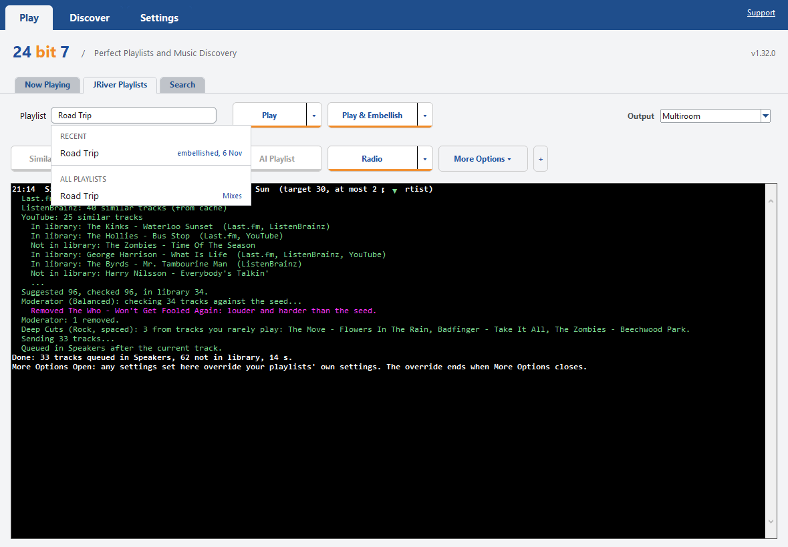

On the **JRiver Playlists** tab, click into the **Playlist** box for a list of your JRiver playlists and smartlists: the five you played here most recently at the top, then the rest A to Z, each with its folder. Type to narrow it. Then:

- **Play** plays the playlist as it is. Its arrow chooses **Play Shuffled** or **Play Ordered**, and it remembers which.
- **Play & Embellish** plays the playlist with new tracks woven in. The new tracks are found the way [Consensus](#consensus) finds them, with the playlist's own artists as the circle: an artist that several of them have on their similar lists is one they agree on, and it brings its top tracks that you own. The arrow chooses how many: **Add Half**, the default, adds one new track for every two on the playlist; **Double It** adds as many as there are; **Build It Out** adds every agreeing artist's top tracks you own, ten artists at a time, saying what each stage added, and **Cancel** keeps what's in. The playlist's first track plays first. Ordered keeps your order with the new tracks between; Shuffled shuffles the lot.

Both follow Play Mode or Review Mode, Output and Top-Up like any other build. The console is plain about what it found: when every agreeing artist is already on the playlist it says so, when it adds fewer than asked it says why, and a playlist of one artist stops, as there's nothing for the artists to agree on (Similar Artists from one of its tracks would grow it instead). A big playlist is sampled, ten artists at a time, as Seed: Playing Now samples Playing Now.

### Review

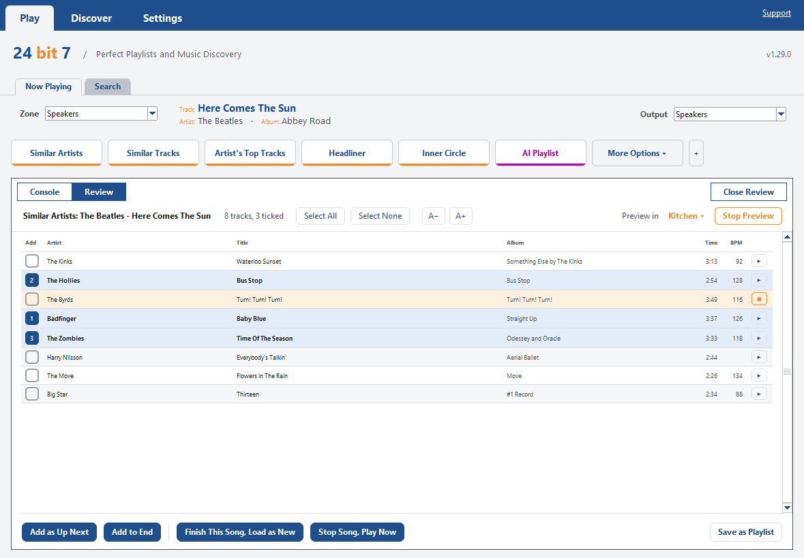

Tick the tracks you want, in the order you want them (each tick shows its number), with **Select All** and **Select None** for the lot, then choose what happens to them:

- **Add as Up Next**: after the current song, in tick order.
- **Add to End**: at the end of Playing Now.
- **Finish This Song, Load as New**: Playing Now becomes your ticked tracks once the current song ends.
- **Stop Song, Play Now**: the current song stops and your ticked tracks play straight away.
- **Save as Playlist**: a new JRiver playlist of the ticked tracks, nothing played. Newer JRiver builds may only let 24bit7 add the tracks with a Media Network login: if a saved playlist comes out empty, set a username and password in JRiver (Tools > Options > Media Network > Authentication) and enter them in Settings > Keys.

**Close Review**, at the top right above Stop Preview, drops the list and puts the console back, cleared.

The actions go wherever **Output** says when you press them (a zone, or the Now Playing zone for Same zone). With Output on **YouTube**, the four play actions become one, **Play on YouTube**, which opens the ticked tracks as a YouTube playlist in your browser. With Output on **Tidal**, they become **Send to Tidal**, which puts the ticked tracks in your Tidal playlist called 24bit7.

**Preview in** picks a zone with its own speakers or headphones, so you can hear a track before you add it. Choose a zone and a play mark appears on every row: click one and that track alone plays there, without ticking it, while the main room carries on; the previewing row turns orange, and **Stop Preview** stops it. The zone Output sends to is never offered. The preview zone needs its own output device; one sharing a sound card with the main room in WASAPI exclusive mode won't play. **A-** and **A+** set the text size of the list. The BPM column comes from your files' tags; JRiver can fill them in for the whole library with **Library Tools > Analyze Audio** (choose only files not yet analyzed), which also gives Steer's Faster and Slower something to check against.

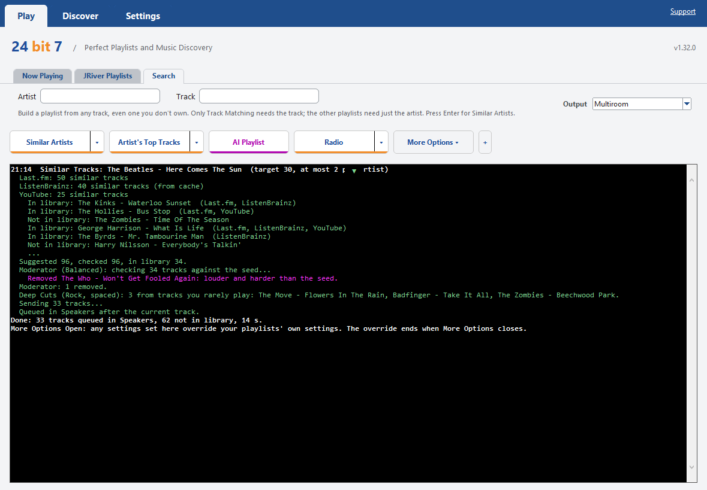

### The playlists

The Play tab's row is a list of playlists you own. Three buttons come ready-made, and two of them have a small arrow at the right: pressing the button builds, and the arrow opens a menu of more playlists nested under it. Eight playlists in all:

| Playlist | What you get |
|---|---|
| **Similar Artists** | A playlist from artists similar to the seed. Each artist, the seed included, adds a random pick from its top tracks, so the same seed gives a different playlist every time. Its menu reads Artist Matching for the button itself, then the three below. |
| **Track Matching** | In Similar Artists' menu. Tracks like the seed track, suggested song by song, so the playlist follows the song rather than the artist's reputation. |
| **Consensus** | In Similar Artists' menu. The seed's three closest artists, then only the artists their own lists agree on: what the things you're listening to have in common. Tight, and sometimes short, which the console says; Drift fills in if it's on. It's Artist Matching with [Consensus](#consensus) on. |
| **Artist + Guests** | In Similar Artists' menu. Twelve of the artist's top tracks, two at a time, with one track from a close similar artist you own between them. It's two configs, Artist's Top Tracks and Artist Matching, alternating two to one (see [Configs and Mix](#configs-and-mix)); if fewer guests turn up, the hosts carry on alone. It never uses AI credits. |
| **Artist's Top Tracks** | Fifteen of the artist's most popular tracks that you own, in random order; its menu reads Top 15, Random for the button itself. Its page sets the count and the order. From Search it needs only the artist. |
| **Top 10, Best First** and **Top 10, Best Last** | In Artist's Top Tracks' menu: the ten most popular, best first, or the same ten with the least popular first. |
| **AI Playlist** | Opens the AI Playlist window, with two modes. **Create**: describe a mood or a scene, or click an idea chip (More tracks like the song that's playing, then the AI's suggestions), and the AI chooses a playlist from your library. **Steer**: move what's playing in a direction. Needs the AI set up under Settings > Keys. See below. |

**Nesting.** Any playlist can sit under another, one level deep. While dragging a playlist, hold it over another button for a moment and it nests there: its own button leaves the row and it appears in the other's menu. The parent's button runs its **default**, which is the parent itself to start; right-click a row in the menu and **Make Default**, and the button's face carries that name instead. A row in the menu builds once. Right-click also offers **Out to the Row** and **Settings**, and any row but the default drags out of the menu: onto the row, into another button's menu, or onto the Settings pill. The parent's own row reads as its name, or as its **Title in Menu** if you set one on its page under Settings > Playlist Settings ("Top 15, Random", say), so the menu reads as a list of choices. Rest the pointer on a parent and it says what its default has on and how many more the arrow lists.

Each playlist is a whole recipe: one or more configs (a way of finding tracks: Artist Matching, Track Matching, Artist's Top Tracks or AI Playlist, with its sources, counts and Moderator), the settings for the whole playlist (Drift, Deep Cuts, Non-stop and the rest), the filters it runs under and a keyboard shortcut. Similar Artists, Track Matching, Artist's Top Tracks and AI Playlist are the standard playlists of their kinds: what a device's voice commands run unless [Settings > Devices](#devices) gives the device something else.

**+**, at the end of the row, opens the **Add a Playlist** window, with three tabs. **From Existing** lists every playlist with what it has on, the devices' own included, and puts a copy on the row: **Add** for a device's playlist, **Create Copy** for one that's on the row already, as "Name 2" right after it. **From Template** lists the four kinds as 24bit7 ships them, then Artist + Guests, Consensus, Top 10, Best First, Top 10, Best Last and Radio; Add puts the chosen one on the row at once, under its own name, with its default settings. **New** is a blank slate: a playlist with no config yet. Its page opens under [Settings > Playlist Settings](#playlist-settings) with the name box ready to type in, and **+ Add a Config** says what it builds. Until it has one it sits in grey on the row, and pressing it opens its page. Right-click a playlist to rename it, duplicate it, open its settings, move it left or right, or delete it. Hold a button and it drags: along the row, where the others move aside as you go so the gap shows where it will land, onto the pills that appear over the console, **Settings**, **Delete** (it asks first) and, while More Options is open, **Use Its Settings**, or over another playlist, held a moment, to nest under it. Rest the pointer on a playlist and it says what it has on.

Every playlist except Artist's Top Tracks is spread so the same artist never plays twice in a row, moving tracks as little as it can. When one artist is all that's left near the end, they play back to back.

**Save Playlist** appears at the top right of the row after a build that went to a JRiver zone. It saves that zone's Playing Now as a JRiver playlist, asking for a name first ("Road Trip (Embellished)", "Downtempo Radio" or "Agnes Obel Mix", say), so a chain of Top-Ups, an embellished playlist or an evening of Radio can be kept.

### Radio

**Radio** needs no seed. It plays a station of what you listen to. It's a playlist of its own kind, at the end of the row to start with: drag it where you like, delete it, add another from the Add a Playlist window's From Template tab, and Restore Default Playlists brings it back. 24bit7 takes the artists you've played ten or more times, gives each its genres as the sources tag them (Last.fm first, your own Genre tag only for an artist no source knows) and groups them into stations, such as Classic Rock or Downtempo. Each station has pillar artists: the artists the sources count as the genre's best that you own, plus your own most played in the station. Compilations are never pillars.

Each round takes three pillars at random and builds by [Consensus](#consensus) over them, adding pillars up to six until there's about an hour, and opens on a pillar's song. Each pillar gives two of its best-known songs; each artist the pillars agree on gives a few of its top tracks that you own, picked at random, so a station sounds different each round. Radio always plays on: when it reaches its last track, the next round comes from the pillars again, so a station keeps its sound all evening, whatever Non-stop is set to.

The first press makes the stations and plays the biggest. That takes a while the first time, as Last.fm is asked about each artist; later it only asks about artists it hasn't seen. After that a Radio button plays the last station you played, or the station set on its page. The arrow lists every station with its share of your plays. A station with a small arrow splits into the narrower stations it was made from (Rock into Blues, Grunge, Classic Rock and Hard Rock, say). Click a station to play it. Right-click for **Split** or **Join Back**, and **Add as a Button**, which puts a Radio button for that station on the row after this one. **Re-analyse**, at the foot of the list, makes the stations again from what you've played since. In between, artists you start playing join the nearest station's pillars by themselves.

Radio's page under [Settings > Playlist Settings](#playlist-settings) has two boxes. **This Button** holds what's this button's own: its **Station** (Last Played, or one station always) and, in Advanced, its **Shortcut**. **All Radio Buttons** holds what every Radio button shares, so a change on any Radio's page changes them all: **Stations**, **Sources** with Must agree, **Playlist Selection** (pick so many of each artist's top tracks, and Skip tracks played in the last few days) and **Filters**, and in Advanced the **Moderator**, which checks each round's other artists against the pillars' songs, and **Deep Cuts**, which adds tracks from lesser-played artists in the round's most common genre. **Stations** sets how many there are (Show [13] stations): fewer joins the closest together, more splits the biggest, and it takes seconds, as the genres are kept from the last analysis. If your music won't stand that many, the console says how many it made. Beside it are **Re-analyse** and when it last ran, then a row per station with its share of your plays, its artists and its first pillars. Click a station's name to rename it; the genre name stays beside it in grey, the name comes back with the station after a Re-analyse, and a Radio button set to that station follows the new name. The arrow beside a station is Split, as on the Play tab. Radio starts with the standard Similar Artists playlist's sources and selection, with the Moderator and Deep Cuts off. It has no configs, Mix, Drift, Consensus or If All Else Fails, nothing nests under it (its arrow lists the stations), and no voice phrase runs it.

Radio rests, greyed with a note, until there are forty artists you've played ten or more times. It follows Play Mode or Review Mode, Output and Top-Up like the other buttons.

### The AI Playlist window

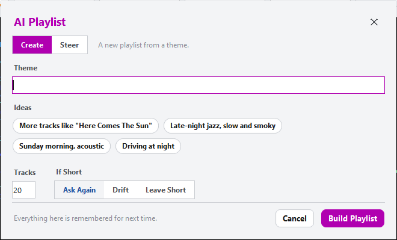

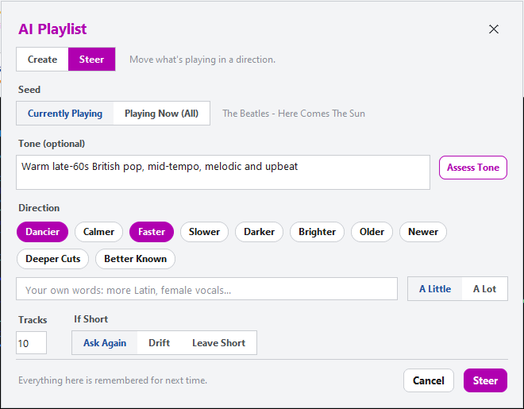

**Create** takes a theme, **Tracks** (how many to ask for) and **If Short**. **Steer** starts from a **Seed**, the current track or Playing Now (All, up to 50 tracks around the current one), with an optional **Tone**: **Assess Tone** asks the AI to describe the seed's tone and puts the phrase in the box, which you can edit; left empty, the AI works from the seed and direction alone. **Direction** is a row of chips that combine (Dancier, Calmer, Faster, Slower, Darker, Brighter, Older, Newer, Deeper Cuts, Better Known), a box for your own words, and **A Little** or **A Lot** for how far to move. Faster and Slower are checked against BPM tags where both the seed and a pick have them, and a pick heading the wrong way is left out with a console line.

Both modes ask the AI for about twice the count, since some picks won't be in your library, and keep the first matches. **If Short** says what happens when fewer match than asked: **Ask Again** asks the AI for more, up to two more rounds, telling it what it already suggested; **Drift** adds more from your music sources with your Drift settings; **Leave Short** stops with what matched. Everything in the window is remembered for next time, the mode included, and it all belongs to Profiles. A build from the window follows Play Mode / Review Mode and Output like any other.

### Output

**Output**, at the right of the Zone line (and of the Artist and Track boxes on Search), decides where the finished playlist goes:

- **Same zone**, the default: the zone you seeded from.
- **Any JRiver zone** by name.
- **YouTube**: the playlist opens in your browser as an instant YouTube playlist. JRiver isn't touched. See [YouTube output](#youtube-output).
- **Tidal**: the playlist goes into your Tidal playlist called 24bit7, and the console offers **Open in Tidal app** and **Open in Tidal web**. JRiver isn't touched. See [Tidal output](#tidal-output).

YouTube and Tidal only appear here while they're ticked under Settings > Other > Additional Outputs.

### More Options

**More Options** opens a second row, under a thin line. It remembers whether it was open, and that matters: while the row is open, its **Moderator**, **Deep Cuts** and **Non-stop** switches override every playlist's own settings, for every build, whether from the Play tab, a voice command, a shortcut or Non-stop adding more; closed, each playlist's page decides. Opening the row says so in the console, and the first time a small window explains it. Every switch on the row shows its setting and steps through the choices with a click; a right-click steps back. On the three overrides, Off turns the thing off for every playlist, and any other setting runs for every playlist, with what it leaves open (Deep Cuts' share, what Non-stop plays using) taken from the playlist's own page. Each build says what the row applied. While the row is open a third pill, **Use Its Settings**, appears over the console when you drag a playlist: drop it there and the switches take that playlist's settings. A playlist's own Moderator, Drift, Deep Cuts and Non-stop are on its page under [Settings > Playlist Settings](#playlist-settings): drag the playlist onto the Settings pill to get there.

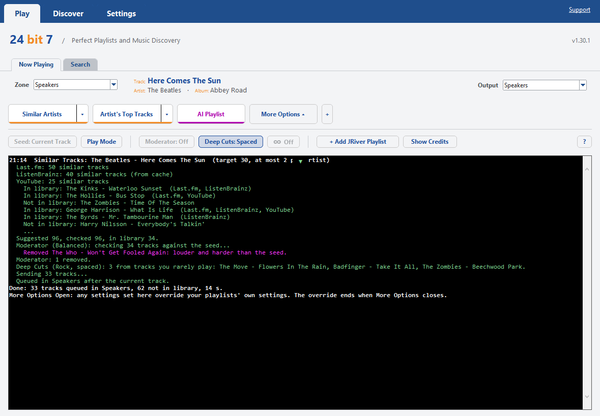

- **Seed: Current Track** or **Seed: Playing Now** (teal, or leaf green if your accent is teal). See [The seed](#the-seed).
- **Play Mode** or **Review Mode** (orange). See [The seed](#the-seed) and [Review](#review).
- **Moderator** (Off, Relaxed, Balanced or Strict, in magenta as it uses the AI), **Deep Cuts** (Off, Spaced or Shuffled) and **Non-stop** (Off, Keep It Tight or Wander): the overrides described above.
- **Top-Up** (teal while it waits): click it, then any playlist or Radio, and the new playlist goes into what's left of Playing Now instead of replacing it. The track playing carries on, the tracks already played are left alone, and the rest is shuffled in with the new ones, with nothing added twice and the same artist kept from playing twice in a row. It lasts one playlist; click it again to cancel, and closing More Options lets go of it too. In Review Mode the list shows only the new tracks, with a **Top-Up** action first that shuffles the ticked ones in. It's greyed while Output is YouTube or Tidal.
- **Show Credits** lists the producer, engineer, musicians and other credits for what's playing, from Discogs, in two lists: the playing track's own credits (or every track's, under its number and title) and the album's. Credits Discogs marks for some tracks only, such as a drummer on tracks 2 to 4, go to those tracks. Settings > Other > Show Credits chooses the current track or all tracks, and which list comes first. It needs a Discogs token.
- **+ Add JRiver Playlist** joins one of your JRiver playlists to the next build. See [Adding your own playlists](#adding-your-own-playlists).
- **?**, at the right-hand end of the row, switches the Play tab's hover notes on and off. On, resting the pointer on anything in the Play tab explains it; off, the default, nothing pops up. Notes saying why something is greyed out (no AI key, for example) always show. It remembers its setting.

### The console

The black panel shows what each build did: which sources answered, what matched in your library, and where it went. Every build is written the same way, so it reads at a glance:

- The first line has the time and what was built, such as `21:14  Track Matching: The Beatles - Here Comes The Sun`.
- The steps are indented beneath it, in green.
- `Note:` lines, in amber, are something to know. `Problem:` lines, in red, are something that went wrong. Where a setting would help, it's named at the end, such as `the playlist's page`.
- AI lines, such as the Moderator's, are magenta.
- Every build ends with one line: `Done: 30 tracks queued in Speakers, 62 not in library, 14 s.`

Click into the console for a strip of buttons:

- **Copy** copies what's on screen, or just what you've highlighted.
- **Clear** empties the screen. Nothing kept in the Log is deleted.
- **Export to Log** saves a report for when something goes wrong. See [Reporting a problem](#reporting-a-problem).
- **Query** asks the AI why a playlist came out the way it did. It only shows once Console Query is switched on. See [Console Query](#console-query).
- **Simple** or **Advanced**: Simple hides the debug lines, which are dim grey and start `[debug]`; Advanced shows them. They're always recorded, so switching works on the build already there, and Export to Log always includes them. Your choice is remembered.

While a build runs, the strip shows **Cancel** on its own. It stops the build at its next step, usually within a second or two (an AI request already out finishes first, and the console says so), and the last line says what, if anything, had already gone out: nothing, the first track that fast start began, or tracks a Drift round had sent. A cancelled Review build's list is dropped, and the Log shows the build as Cancelled.

#### The console's tabs

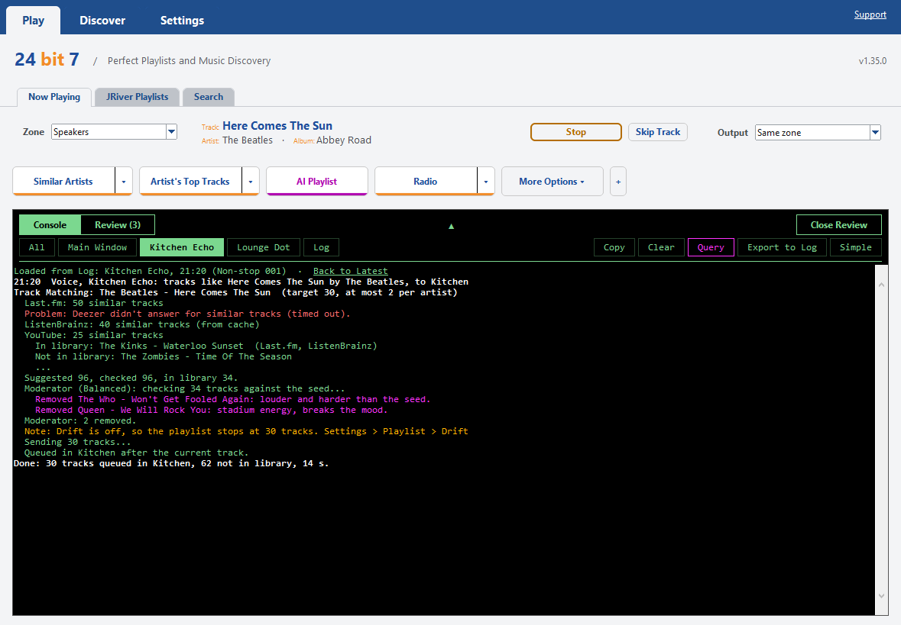

The small green arrow at the top middle of the console opens a row of tabs:

- **All**: the latest build from anywhere.
- **Main Window**: the latest build from the Play tab or a keyboard shortcut.
- **One per Alexa device**: that device's latest build, including commands that came to nothing. A device gets its tab after its first build.
- **Log**: every build kept, below.

A build only clears the screen when its own tab, or All, is showing, so a voice command in the kitchen won't wipe a build you're reading at the PC. With the tabs open, the strip sits at the top right. New lines don't pull you down while you're scrolled up. Open or closed is remembered.

#### The Log

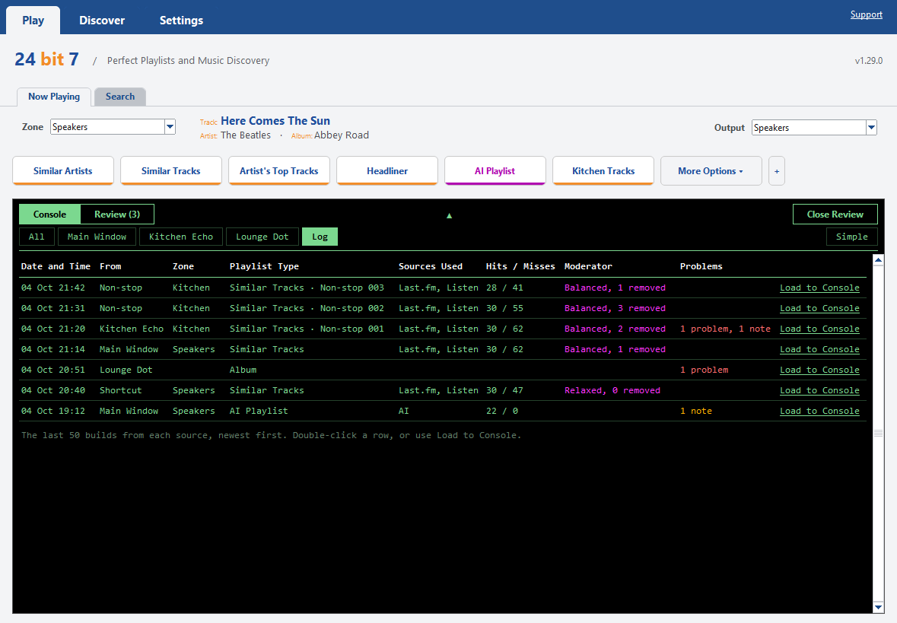

The Log lists the last 50 builds from each source, newest first: when, who asked (Main Window, Shortcut, an Alexa device, or Non-stop), the zone, the playlist, the sources used (hover for the full list), tracks queued and not in library, what the Moderator did, and how many problems and notes it had.

A Non-stop playlist shows as a chain. The build that started it becomes Non-stop 001 and each time it adds more takes the next number, so you can see how long an evening ran and spot which round went wrong.

Double-click a row, or click **Load to Console**, to open that build in its tab. A line at the top says it came from the Log, with **Back to Latest** to return. Copy, Query and Export to Log then work on that build.

### Adding your own playlists

Open **More Options** and press **+ Add JRiver Playlist** to join a JRiver playlist or smartlist to the next build from the Play tab. Each row has a handle to drag it up or down, the playlist, and how it joins:

- **Add before**: its tracks play first, in the playlist's own order.
- **Add after**: its tracks follow 24bit7's, in their own order.
- **Mix**: its tracks are woven through 24bit7's. **Spaced evenly** spreads both lists over the whole playlist so they finish together. **Mixed randomly** scatters them.

Rows play in the order they're listed. The picker shows the playlists you use most first, then the rest A to Z, with a search box; the x at the right of a most used playlist takes it out of that list, nothing more. Each change is noted in the console, saying what the next build will do.

Added playlists come through exactly as JRiver gives them, so a smartlist's own rules decide what's in it. 24bit7's filters, recent-play skip and hidden-track check leave them alone, and the only thing dropped is a song already in 24bit7's picks. If nothing in the build matches your library, the added playlists still play, so you never get silence.

They are for the Play tab only, with JRiver output. Voice, keyboard shortcuts and non-stop don't use them, and YouTube output leaves them out with a note in the console.

---

## The Discover tab

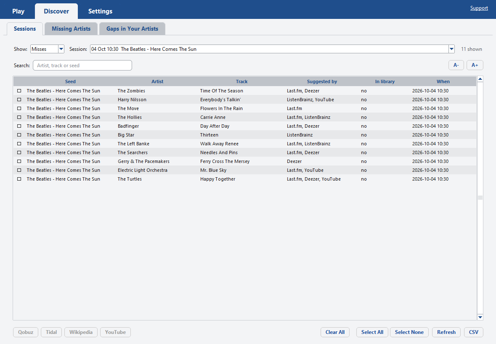

Discover lists every track a build looked for and whether you own it.

- **Show** picks Misses (tracks you don't own), Hits, or All.
- **Session** narrows it to one build. It opens on the latest build until you pick one yourself, with **All sessions** first in the list and the rest newest first. **Search** looks across every column. A build seeded from Playing Now reads **Playing Now (Multiple Tracks)**, and each of its rows shows the Playing Now track it came from as its Seed.
- Select a row and each site you've ticked under Settings > Discover has a button along the bottom. Stores, YouTube and Tidal search for the artist and track; reference sites such as Wikipedia and Discogs search for the artist, for the discography.
- **Label** finds who released the selected track and opens the label on Bandcamp, so you can buy from the people who put the record out. It asks MusicBrainz first, then Discogs if you have a token. A self-released track opens the artist on Bandcamp. Each answer is remembered, so a second click is instant. Untick Record Label under Settings > Discover > Reference if you don't want it.
- Tick rows, or **Select All**, and **Create YouTube Playlist** opens them in your browser as one playlist, so you can hear the misses before you buy. **Create Tidal Playlist** puts them in your Tidal playlist called 24bit7 instead, in place of what was there, with **Open in Tidal app** and **Open in Tidal web** beside the line that says how it went. Which of these buttons show is set under Settings > Discover > Create Playlist.
- **Clear All** empties the history and **Clear Selected** removes just the ticked rows. Both ask first.
- **CSV** saves the list as a spreadsheet file. **A-** and **A+**, at the top right, set the size of the table text.

---

## Settings

Settings are grouped into pages, each made of boxed sections. Rest the pointer on a setting's title for its explanation (the pointer turns to a question mark where there is one). Everything saves as you change it, and the running app picks it up without a restart.

### Playlist Settings

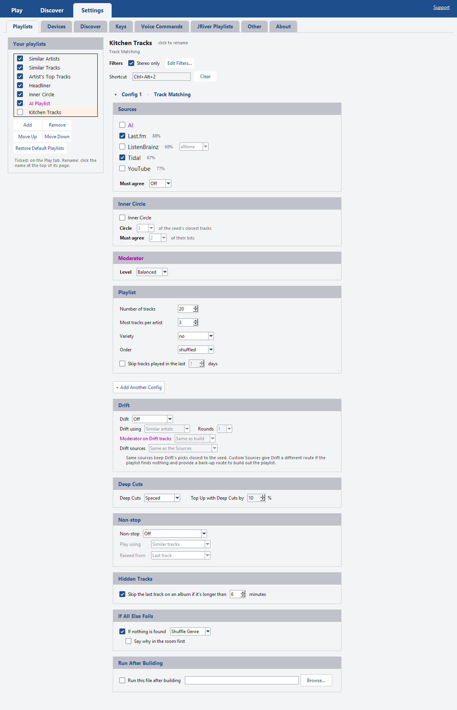

Your playlists on the left and the chosen playlist's page on the right.

**Your Playlist Buttons** lists every playlist on the Play tab, in row order. A playlist nested under another is indented beneath it, with a small arrow on the parent to fold its children away and a **default** tag on the one the parent's button runs. The chosen one has a green border. Beside the list: **+** opens the Add a Playlist window (From Existing, From Template or New, as on the Play tab), **Delete** removes the chosen playlist after asking, **▲** and **▼** move it among its neighbours, **▶** nests it under the playlist above it, and **◀** brings it out onto the row again. Right-click a nested playlist for Make Default and Out to the Row. **Restore Default Playlists**, under the list, puts back anything 24bit7 ships that's missing (a standard playlist, Artist + Guests, Consensus, a Top 10 or Radio), under the playlist it came under; nothing already there is moved. There are no ticks: a playlist is either a button on the Play tab or a device's (see [Devices](#devices)).

Click a playlist and its page is on the right. At the top, **Name** is the playlist's name everywhere (its button, the list, the console and what Alexa says), **Title in Menu** is how its row reads when it sits in a button's menu (a parent's own row too), and beside them **Preview:** shows the button with its menu open and this playlist's row outlined. Top right are **A-** and **A+**, which set the text size of every Settings screen, and the **Simple / Advanced** switch, one setting for you rather than for each playlist; in Advanced a dashed **Take a Tour** box sits under it.

**Simple** is a mode, not just a tidier view. Each playlist shows one config with its **Sources**, **Playlist Selection** and **Filters** (folded; click the header to open it), and that's all that runs: the advanced sections are off for every playlist while Simple is on. Switching to Simple says what it's turning off ("Simple turns off Drift and Non-stop on three playlists"), and switching back to Advanced brings every setting back as it was. Artist + Guests and Consensus need Advanced, so in Simple they're greyed on the Play tab with a Needs Advanced note. The More Options switches on the Play tab still override in either mode. 24bit7 starts in Advanced if any playlist already has something beyond Sources and Playlist Selection on, otherwise in Simple.

**Advanced** shows everything. Every section is open when its thing is on and closed when it's off; there's no fold of your own. Click a closed section's header and it opens so you can switch it on; leave it off and it's closed again next time. Rest the pointer on a section's title for a two-sentence note on what it does and why you'd want it. **Take a Tour** opens Artist + Guests, dims the page and lights one section at a time with that note in a pop-up (Back, Next, Close, and which step of fourteen you're on), so you can see each setting on a playlist that uses two of them.

#### Configs and Mix

A **config** is one way of finding tracks: **Artist Matching** (what Similar Artists does), **Track Matching**, **Artist's Top Tracks** or **AI Playlist**. Each config is a box, headed **Config 1 · Artist Matching** and so on; click the heading to fold the box away. A playlist made with New starts with none: **+ Add a Config** asks which kind, and the config starts from the standard playlist of that kind. On any playlist but a standard one, the kind on the heading is a dropdown (change it and the config starts again from the standard playlist of the new kind), and **Remove** on the heading takes the config off; take the last one off and the playlist is a blank slate again. Inside the box, top to bottom:

- **Sources**, across in one row: tick any combination. One is enough; several are better. A source whose key is missing says "(no key yet)", and in Advanced, once you've run Test My Sources (under Settings > Other), each source shows its score for your library as a small figure. The **ListenBrainz** dropdown picks all-time or recent listening. **Tidal** needs its two free keys (Settings > Keys). Under the row, **Must agree** is how many ticked sources must suggest an artist or track before it's used: higher means a smoother playlist with fewer surprises. See [Blending](#blending).
- **Playlist Selection**, as sentences with the numbers in them. For Artist Matching: **When Seed is Current Track**, then "Limit To [30] tracks, from [20] artists, pick [3] of each artist's top [5] tracks". A similar artist only counts once it gives a track from your library; one that doesn't is skipped and the next one down is read instead. Untick Limit To to keep every track found; with the last two the same (say 5 of 5) as well, there's no random pick at all. On the standard playlist a second line in teal, **When Seed is Playing Now**, reads "Limit To [30] tracks, sample [5] artists from Playing Now, take [4] similar artists each, pick [3] of each artist's top [5] tracks", and the defaults give about the same size of playlist as Current Track. Track Matching reads "Find [30] tracks, at most [3] per artist" and, for Playing Now, "Sample [5] tracks from Playing Now, take [6] similar tracks each, at most [3] per artist". Artist's Top Tracks sets how many and the order (most popular first, least popular first or random); AI Playlist sets how many tracks and the most any one artist gets, so a mood the AI links to one band doesn't fill up with them. Artist Matching and Track Matching also have **Match Tempo**, which uses your files' BPM tags to keep near the seed track's tempo, half and double time counting as a match. In Advanced it's **Off**, **Prefer** or **Strict**. Prefer puts the closest tempos first wherever there's a choice, such as which of an artist's top tracks to pick, and leaves nothing out. Strict takes only tracks within ten per cent of the seed's BPM and leaves out tracks with no BPM tag, so the playlist may come up short, and the console says how many went. In Simple it's one tick, for Prefer. A seed with no BPM tag gets a console note saying Match Tempo isn't in effect; JRiver can fill BPM tags in for the whole library with Tools > Library Tools > Analyze Audio. Then **Skip tracks played in the last [1] days** leaves out anything JRiver has played recently, so a favourite doesn't come round again the same evening; the seed track is never left out. Off by default. In Advanced, a standard playlist that reviews (Artist Matching, Track Matching and Artist's Top Tracks) has **Review Mode uses the same settings** on the line below, ticked to start. Untick it and an orange box opens with Review Mode's own lines, so Review Mode can offer a shortlist while Play Mode builds the full playlist.
- **Filters**: tick any of your named filters and every track this config finds must pass them, Drift and what Non-stop adds included. Each config has its own, so one can draw on the whole library while another stays stereo only. **Edit Filters...** opens the editor, see below.

**+ Add Another Config** puts a second config under the first, starting from the standard playlist of its kind, and **Remove** at the right of a config's heading takes it off again. With two or more configs a **Mix** section appears:

- **Combine**: **Shuffle** mixes every config's tracks in together (no two by the same artist in a row where it can be managed); **Append** plays one config's tracks, then the next's; **Alternate** takes turns, by the **Pattern** ("2 from config 1, then 1 from config 2"). Each config finds its own number of tracks, set in its box, so the playlist is as long as they add up to.
- **Drift from**: the config Drift carries on from; the Drift section below shows that config's Drift settings. Artist's Top Tracks has no Drift, so it isn't offered.
- **Continue as**: the config Non-stop carries on as when the playlist reaches its last track; the Non-stop section below shows that config's settings.

Artist + Guests is the example that ships: Config 1 is Artist's Top Tracks, Config 2 is Artist Matching with five artists and one track each, and the Mix alternates two to one. The console shows each config's build in turn ("Config 1 of 2: Artist's Top Tracks"), then the Mix line. In JRiver the first config's tracks start playing as soon as they're found and the rest are woven in behind the current track; to YouTube or Tidal the finished list goes once.

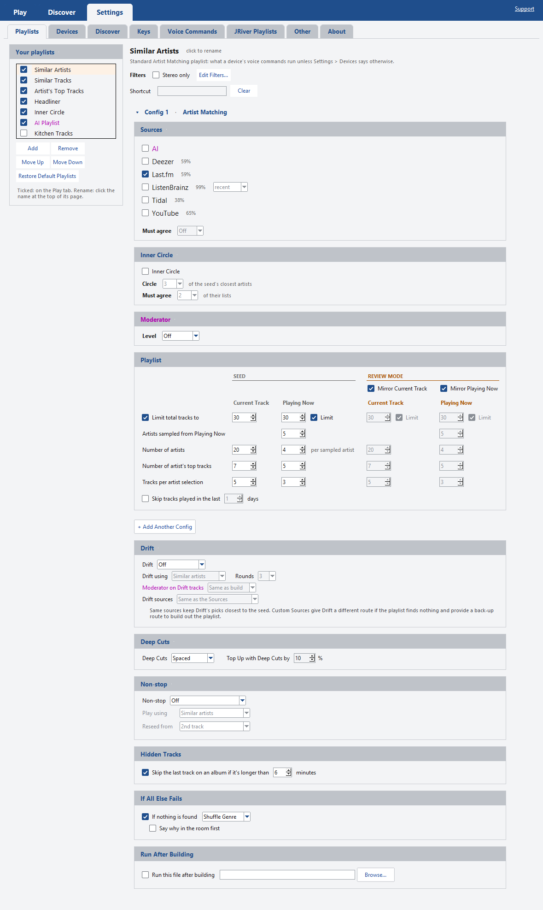

The sections for the whole playlist follow the configs, each open when it's on:

- **Consensus**, for Artist Matching and Track Matching: see [Consensus](#consensus). **Circle** (3 to 5) is how many of the seed's closest make the circle, and **Must agree** (2 up to the circle) how many of their lists a neighbour must be on. **If Consensus finds fewer than [10] tracks, finish the playlist with plain Artist Matching** (off to start) stops a tight circle leaving you short: the rest of the playlist comes from the seed's own list, and the console says how many came from each.
- **Moderator**, for Artist Matching and Track Matching: Off, Relaxed, Balanced or Strict (magenta, as it uses the AI). See [Moderator](#moderator).
- **Drift** (Off, Keep It Tight or Spread) searches again when your library falls short of the target length. Artist Matching and Track Matching also have **Moderator on Drift tracks**. See [Drift](#drift).
- **Deep Cuts**: Off, **Spaced** or **Shuffled**, and **Add Deep Cuts by**, 10% to 100%, for every kind but Artist's Top Tracks. See [Deep Cuts](#deep-cuts).
- **Non-stop** (Off, Keep It Tight or Wander) keeps a playlist going when it reaches its last track. See [Non-stop](#non-stop).
- **Shortcut**: keys that build this playlist from anywhere in Windows, even with 24bit7 in the tray. Click the box and press the keys; Esc cancels. The zone they play to is under Settings > Other > Keyboard Shortcuts. See [Keyboard shortcuts](#keyboard-shortcuts).
- **Hidden Tracks** skips the last track on an album when it's longer than a set number of minutes (6 by default). Those are often a long silence and a hidden bonus track, which feel out of place in a playlist. Albums, songs and playlists you ask for by name always play in full.
- **If All Else Fails**, off to start: tick **If nothing is found** and choose what happens when a build finds nothing, or nothing beyond the seed track itself. **Shuffle Genre** shuffles songs from your library in the seed's genre: the seed track's Genre tag, or the artist's most common genre in your library, at a similar tempo when the seed has a BPM tag and enough tracks are within 10% of it. It plays that kind's usual number of tracks, with Skip Recently Played, Filters and the per-artist limit applied and the seed artist left out. **Run File** starts a file of your own, such as a .bat, and Run After Building is skipped for that build. **Play JRiver Playlist** plays one of your JRiver playlists or smartlists, picked with **Choose...**, as JRiver gives it. Tick **Say why in the room first** (off to start, one setting for every kind) and a voice command or keyboard shortcut hears why before the music: Windows' own voice, saved as a short WAV file and played on that zone, so it shows in Playing Now. It needs JRiver on the same PC. With If All Else Fails unticked, the console says "I couldn't find a match. Please try another seed." and a build from the app shows the same in a message. It doesn't run when an added JRiver playlist has already played.
- **Run After Building** runs a file of your choice once a playlist is in JRiver: a .bat, an .exe, or a PowerShell or Python script. It's told nothing about the playlist, so it can do whatever you like. It doesn't run when Non-stop adds more.

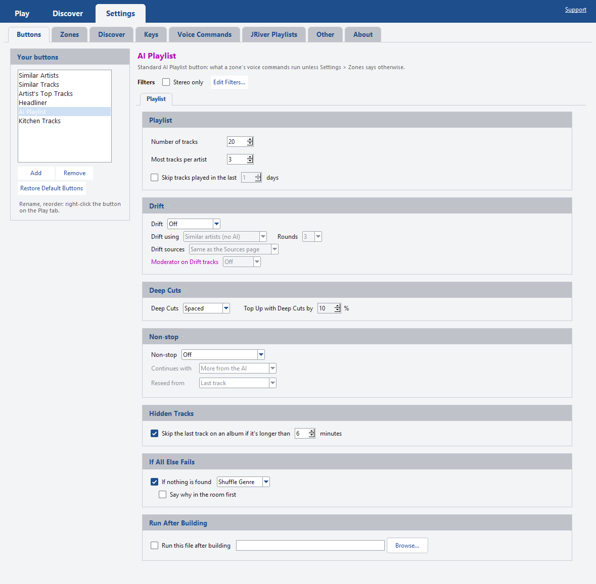

An AI Playlist config has no sources to pick, and its playlist's Drift section has its own choices, including drifting with the AI, and **Moderator on Drift tracks** for what Drift adds from your music sources.

#### Edit Filters

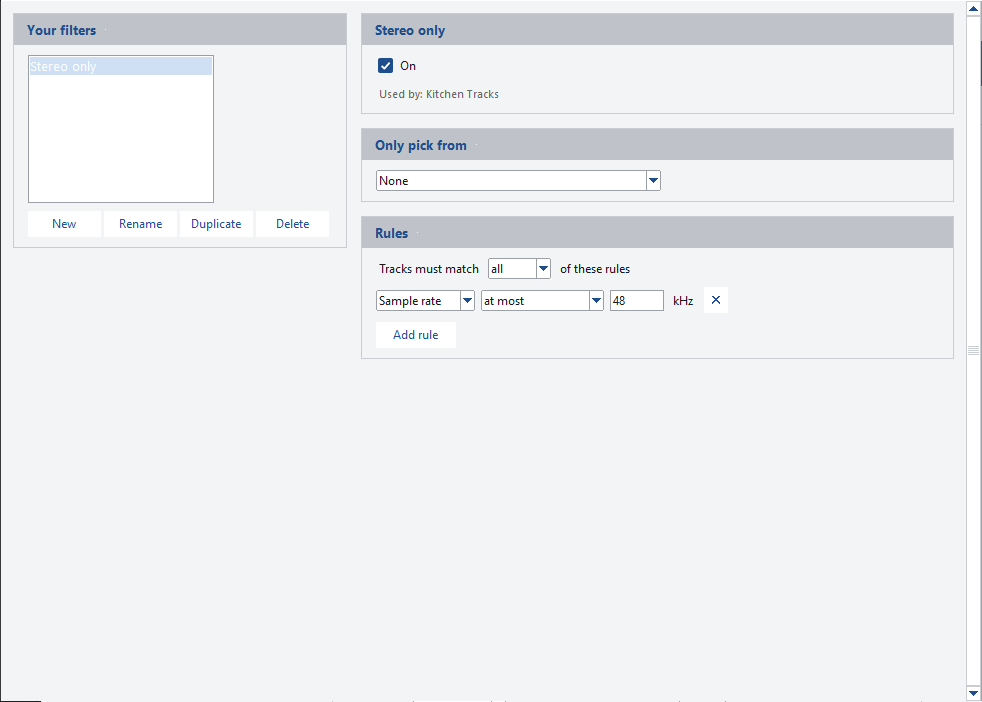

A window of named filters that narrow what 24bit7 picks, Drift rounds and what Non-stop adds included. Where a filter applies is decided by ticking it on a config, for every playlist that config builds, wherever it's sent. **Used by** on each filter says which playlists have it ticked, and which config where there are several. Each filter has:

- **Only pick from**: a JRiver playlist or smartlist, so only its tracks can be used. Anything you can set up in JRiver's smartlist editor, 24bit7 respects.
- **Rules**, matching all or any: Rating, Year, Last played, Play count, Date imported, Genre, Artist, Album, Duration, File type, Bit depth, Sample rate and File location. For example, "Sample rate at most 48 kHz" saves JRiver converting on the fly for a Sonos.

Tick **Every playlist** on a filter and it applies to every playlist 24bit7 builds, whether it's ticked on the playlist's page or not.

**Skipped Tracks** comes ready-made, off to start, with Every playlist ticked. It leaves out any track you've skipped by voice twice or more, and every track by an artist with three such tracks. Each skip you ask the skill for is counted in a field of 24bit7's own in JRiver, **24bit7 Voice Skips**, which you can see there too. Its page lists what it's leaving out now, under **Left Out Now**, each with **Let Back In**, which clears the count.

A track with no value for a field passes that rule. The seed track is never filtered out. Each build's console says which filters applied and how many tracks they left out. Where several apply, a track must pass them all. Albums, songs, shuffles and JRiver playlists asked for by voice play as asked.

### Devices

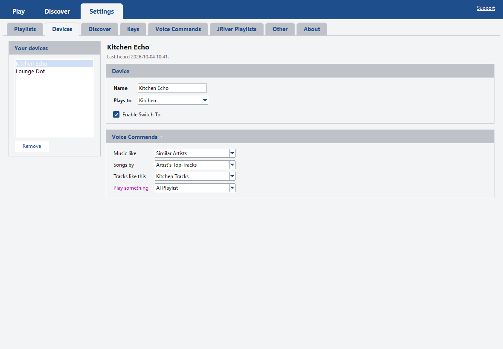

The **Devices** box on the left has a tab per Alexa device; a device appears the first time it speaks to 24bit7. Click a tab to see that device, double-click it to rename the device. Under the tabs, **Plays to** is the JRiver zone its commands play in, with **Remove**, which forgets the device (it comes back, blank, the next time it speaks), then **Enable Switch To**, whether "switch" can move the music to that zone. Four rows follow, one per phrase as you'd say it: **Music like**, **Songs by**, **Tracks like this** and **Genre** ("play something jazz", and "only <artist> <mood>" too). Each row names the playlist that phrase runs. Greyed, the phrase runs one of your playlists as it is, tagged **Standard** when it's the standard playlist of its kind; in full colour, the device has its own. Click a row and its page opens on the right, with **Copy Settings From:** and a list of your playlists on the first row. Ticked, as it starts, the phrase runs the playlist chosen in the list, any kind, and there's nothing more on the page: pick another and the phrase runs that one instead. Untick it and the device gets its own copy of the chosen playlist, named after it, with its settings below to change; the list greys out, showing what it was copied from. Tick it again to go back to copying, which deletes the device's own after asking. **Restore Default Device Playlists**, under the box, puts every device back on the standard playlists. Which zones are shown, the default zone and Follow are under [Settings > Other](#other). The page on the right is the same as on Playlist Settings.

### Discover

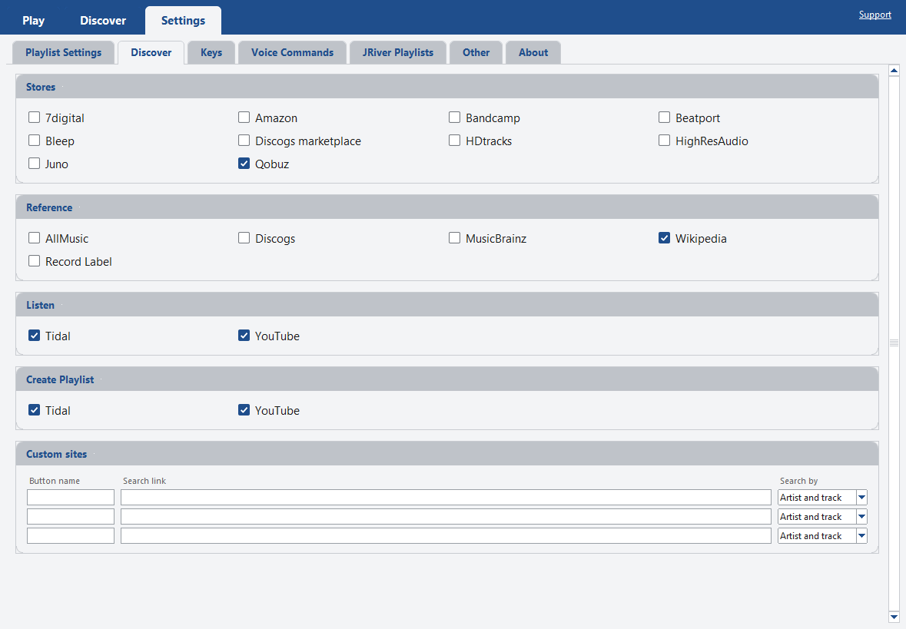

The sites that get a button on the Discover tab: **Stores** (at least one stays ticked), **Reference** sites for discographies, with **Record Label** among them (the Label button, ticked by default), and **Listen** sites (YouTube and Tidal). **Create Playlist** picks which buttons appear when you tick rows: YouTube opens them as one playlist in your browser, and Tidal puts them in your Tidal playlist called 24bit7 (sign in under Keys first). **Custom sites** adds up to three of your own: search for anything on the site, copy the address from your browser, and replace your search words with `{query}`.

### Keys

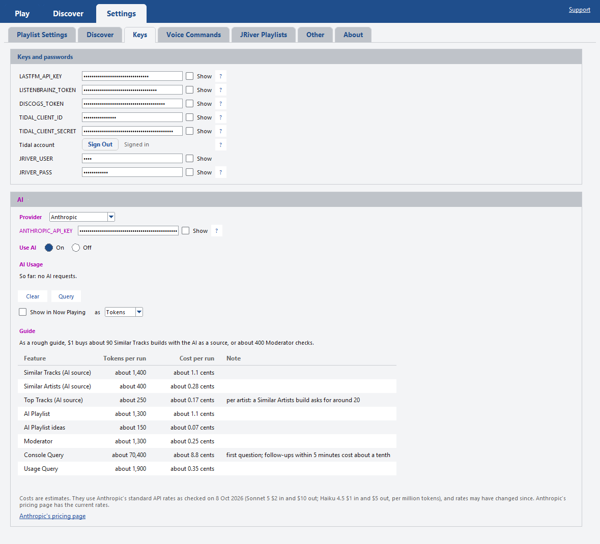

Keys and passwords for each service, hidden until you tick **Show**. Each **?** explains where to get the key:

- **Last.fm**: built in, so you can leave it empty. A free key of your own is used instead if you fill it in.
- **ListenBrainz**: free, and well worth adding.
- **Discogs**: free, for album credits and a second source for Label.
- **Tidal**: free. At developer.tidal.com, sign in with a Tidal account, open Dashboard and choose Create App, then copy the Client ID and Client Secret into the two Tidal fields. Tidal needs both. To send playlists to Tidal as well, press **Sign In to Tidal** on the Tidal account row, after adding the redirect address and playlist scopes its **?** describes to your app at developer.tidal.com. Tidal's own sign-in page opens in your browser; 24bit7 never sees your password, and remembers the sign-in until you press **Sign Out**.
- **AI**: needed for AI Playlist, AI as a source, the Moderator and Console Query. It sits last, in its own box, starting with **Provider**: **Anthropic** (Claude), **OpenAI**, **Google Gemini** or **Ollama (Local)**. Only the chosen provider's fields show, and every key stays saved, so switching back loses nothing. The cloud providers are paid, a few pence at most per build, and each needs its own key (the **?** says where to get it). **Ollama** runs a model on your own PC for free: install it from ollama.com, pull a model (for example `ollama pull gemma3:4b`), then pick it under **OLLAMA_MODEL**, where **Refresh** lists what Ollama has installed. The address is filled in for you. Smaller local models give rougher results, and Console Query isn't available with Ollama, as it sends more than a local model can hold. If Ollama isn't running, or the model isn't installed, the console says so. Only Anthropic has been fully tested so far: OpenAI, Google Gemini and Ollama should work, and reports on how they do are very welcome on the JRiver forum or GitHub. **Use AI** under the provider, On or Off, pauses everything that spends AI credits without removing the key: AI Playlist and the Moderator dropdown grey out, the AI as a source is skipped, Drift using the AI falls back to the sources, and Console Query and Assess Tone stand down, with one console line per build saying so. Switch back On and every setting is as you left it. **AI Usage** sits underneath: the tokens each AI feature has used since you last cleared the count, with estimated costs, and a **Guide** to what $1 buys and what each feature costs per run (your own average once you've used it three times). **Query** asks the AI where the tokens go and which settings would use fewer, and answers in the console. **Show in Now Playing** puts the total at the right of the row with the Now Playing and Search tabs, in dollars or tokens; click it to switch. The costs are estimates from the chosen provider's standard rates on the date shown, which may have changed since; your provider's own console has your actual bill. With Ollama the Guide shows Free.
- **JRiver** user name and password: only if you set them in JRiver under Tools > Options > Media Network > Authentication. Newer JRiver builds may need them for Review's **Save as Playlist**.

Keys never leave your PC except to the service they belong to, and they never appear in a log.

### The Voice Commands page

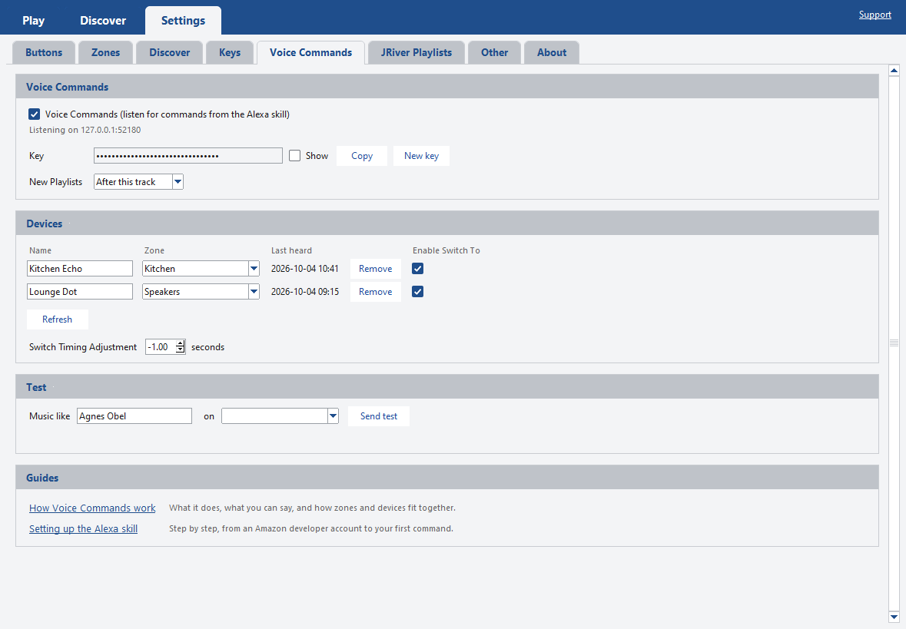

Switches voice on, holds the key the Alexa skill sends and sets **New Playlists**; the devices' zones and playlists are under [Settings > Devices](#devices). **Switch Timing Adjustment** fine-tunes switching to a Sonos or other DLNA speaker: if it repeats the last moment you heard in the other room, move it towards minus; if it skips a little, towards plus. **New Playlists** decides what a playlist asked for by voice does when the zone is already playing: **After this track** (the default) lets the song finish, clears what was queued after it and plays the new playlist next; **Play now** takes over straight away. A stopped or paused zone starts at once either way, and albums, songs, your JRiver playlists and shuffles always play at once. **Test** sends a pretend command, as if a device had heard it. See [Voice Commands](#voice-commands) and [Setting up the Alexa skill](#setting-up-the-alexa-skill).

### JRiver Playlists

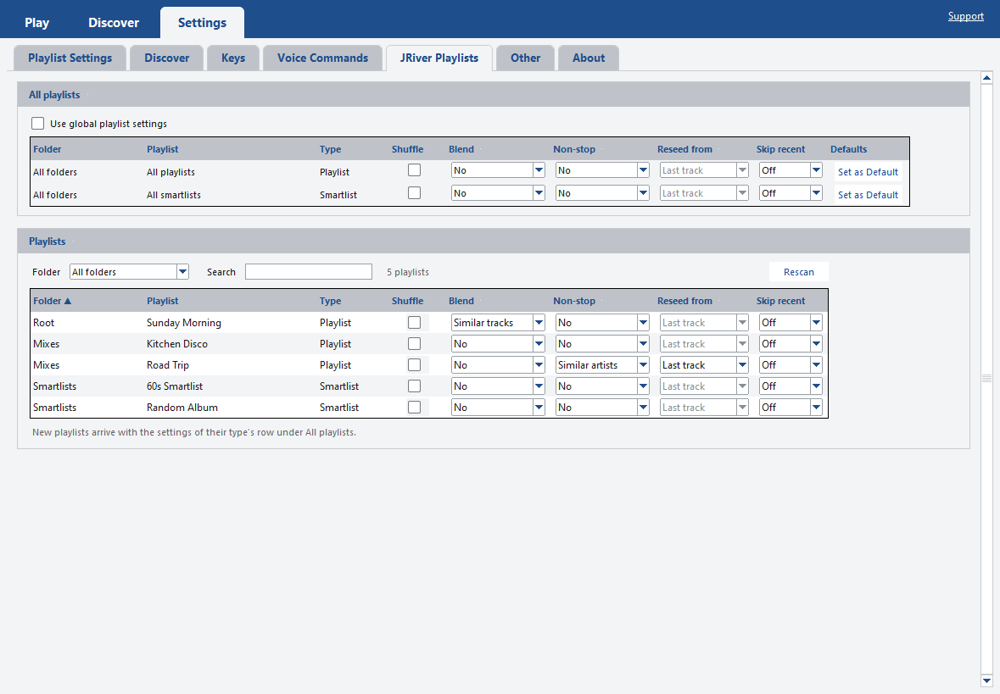

How your own JRiver playlists and smartlists play when you ask for them by voice: **Shuffle**, **Blend**, **Non-stop**, **Reseed from** (Last track, 2nd track, or **Whole playlist**, which is Keep It Tight: each time, it seeds from one of the playlist's own tracks) and **Skip recent**. **Set as Default** on the All playlists and All smartlists rows copies that row into the playlists of its type shown in the table (filter by folder first to set just one folder), and new playlists start with it. **Blend** weaves new music into the playlist, one of yours then one new, from similar artists or similar tracks, up to 50 new songs: the playlist starts at once and the new songs join a few seconds later. Rest the pointer on Blend or Non-stop for an explanation of each. Tick **Use global playlist settings** to set them all at once, or untick it and give each playlist its own row. The table shows each playlist's folder and type, sorts by folder or name, and can show one folder at a time. A playlist with nothing changed plays exactly as JRiver has it.

### Other

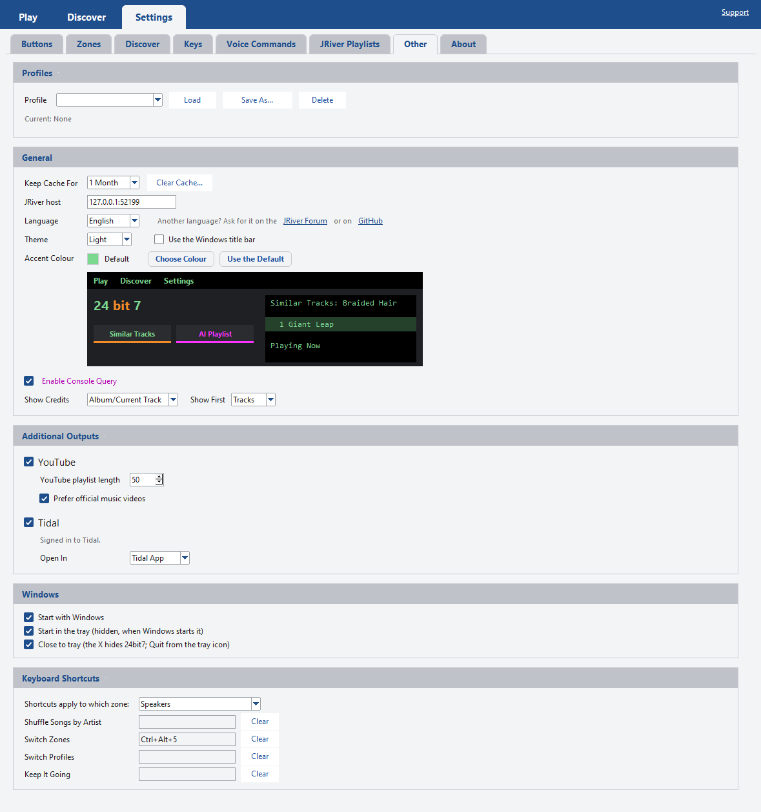

- **Profiles**: save your settings as a profile (DJ, Explore, No AI...) with **Save As**, and switch between them with **Load**, which restarts 24bit7 to apply the profile; JRiver keeps playing. Tick **Enable Switch To** beside the profiles you want the **Switch Profiles** keyboard shortcut to step through (new profiles start ticked). A profile holds your playlists with their configs, settings and filters, each device's playlist choices, the Filters, JRiver Playlists, the Play tab options and Add JRiver Playlist rows, the Preview zone, the Default zone and Follow setting, the zone the keyboard shortcuts apply to, the AI Playlist window's choices, Use AI, cache and console settings. Keys, the JRiver connection, which zones are shown, the devices' names and zones, keyboard shortcuts (a playlist's included) and appearance stay as they are. A profile saved before 1.29.0 loads into the standard playlists and leaves your own alone. **Current** names the profile in use, with "(changed)" once anything differs from it. Profiles are small files in a `profiles` folder beside 24bit7, so they survive updates and can be copied to another PC.
- **General**: **Keep Cache For** (1 Month, 1 Year or Permanent) with **Clear Cache...** (older than a month, older than a year, or everything), the JRiver host if JRiver runs on another PC, **Language** (English or Deutsch, applied with a restart; beside it, where to ask for another language), the **Theme** (Light or Dark, applied on restart), **Accent Colour** (the colour of the dark theme's tabs, buttons and titles, and of the console in either theme: **Choose Colour** opens Windows' colour picker, **Use the Default** goes back to the green, and a preview underneath shows the logo, two buttons and the console in your colour before you restart; a colour too dark to read is made lighter, one close to magenta is moved away from it, as magenta marks anything that uses AI credits, and it's saved in Profiles), **Use the Windows title bar** (unticked, the tabs run to the top of the window with their own minimise, maximise and close), **Show Credits** (Album/Current Track or Album/All Tracks, with **Show First** set to Tracks or Album), and **Enable Console Query**.
- **Additional Outputs**: the services the Play tab's Output list offers besides your zones. **YouTube**, ticked to start with, has its **playlist length** (up to 50) and **Prefer official music videos** under it. **Tidal** says whether you're signed in, and **Open In** picks where a filled playlist opens: the Tidal app (the default) or Tidal's website. Untick the one Output is set to and Output goes back to Same zone. Discover's playlist buttons are set separately, under Settings > Discover.
- **Zones**: which JRiver zones the Zone and Output lists show (untick one to hide it; **Rescan** asks JRiver for its zones again, and a DLNA speaker such as a Sonos only appears once DLNA Controller is ticked in JRiver, under Tools > Options > Media Network > Advanced), the **Default** zone Now Playing opens on when 24bit7 starts (picking a zone by hand always wins), and **Follow JRiver's active zone**, which makes Now Playing track whichever zone JRiver has active, so no zone is the default. Kept on this PC, not in profiles.
- **Sources**: **Test My Sources** asks every source what's similar to a fixed set of seed tracks across 17 genres, and counts how many of the answers are in your library. Choose **Full** or **Quick** (the window says roughly how long each takes), and tick **Include AI** to test the AI too, which costs a few pence. It runs in the background, pausing while a build runs, so you can keep using 24bit7, and the console says when it's ready. The two tables then show each source's **Score** (how many of its suggestions are in your library, against the best source for each genre; it measures reach, not taste), **Best At** and **Worst At** (its three best and worst genres), for artist sources and track sources, and **Full Results** shows every genre against every source. Each config's sources show the same score beside them. Until you run it, the figures come from the developer's library, with a note saying yours will differ. The genre is only the label on each test seed: nothing is judged by your Genre tags.
- **Windows**: **Start with Windows** launches 24bit7 when you sign in. **Start in the tray** keeps it hidden when Windows starts it. **Close to tray** makes the window's close button hide 24bit7 instead of quitting, so voice keeps listening; quit from the tray icon.
- **Keyboard Shortcuts**: a key each for Shuffle Songs by Artist, **Switch Zones** (moves what's playing to the next zone ticked under Enable Switch To), **Switch Profiles** (loads the next profile ticked under Enable Switch To in Profiles, A to Z, restarting 24bit7 while JRiver keeps playing; pressed during a build, the console says it will switch once the build has finished), **Keep It Going** (Non-stop, once, for whatever the shortcut zone is playing) and a **Load** box for each saved profile, which loads that profile the same way, or does nothing if it's already loaded, so a remote or an automation always lands on the profile it means. A playlist's own key is set in the **Shortcut** box on its page under Playlists. They work anywhere in Windows, even with 24bit7 in the tray, so a remote that sends key presses (a Flirc, a Harmony, a phone app) can start a playlist from the sofa. Click a box and press the keys; Esc cancels. Letters and numbers need Ctrl, Alt, Shift or Win; F-keys and media keys work on their own. If another program already owns a combination, 24bit7 says so.

### About

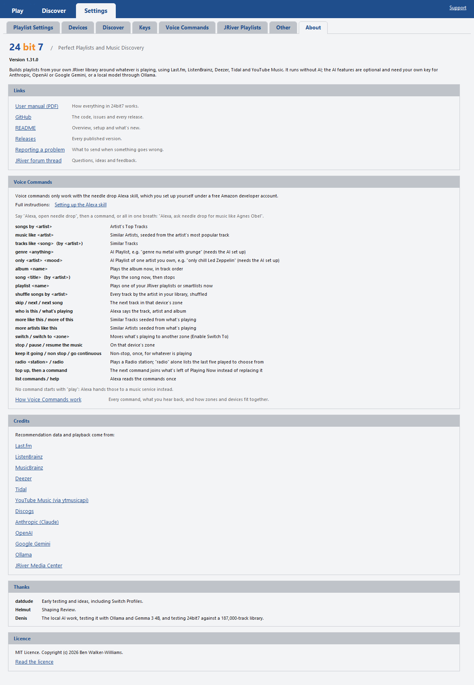

The version you're running, links to this manual, GitHub and the release notes, the voice commands at a glance, credits for the services 24bit7 uses, and thanks to the people who have helped shape it.

---

## How playlists are built

### Blending

Each ticked source returns a ranked list. 24bit7 merges them with position weighting: near the top of one list scores well, appearing on several lists scores better. It fetches more than it needs and trims, so the result reflects agreement between sources rather than the quirks of one.

**Must agree** sets how many sources must suggest an artist or track before it's used. If too few clear the bar, 24bit7 relaxes it one step at a time, never below 2, and says so in the console. This is what keeps out the noise some services add, such as whatever else their listeners happened to play that day.

When the AI is a source and none of its suggestions are in your library, 24bit7 asks it once more, listing what missed and asking for different ones. This applies to Similar Artists, Track Matching and Drift's AI rounds, and the console says when it happens.

### Track Matching

Similar Artists asks "who sounds like this artist?". Track Matching asks "what sounds like this song?", which follows the mood of the seed far more closely: two songs by the same artist lead to different places. Its sources are Last.fm, ListenBrainz, Tidal, YouTube Music and, if ticked, AI. A track two or three sources agree on ranks above one only a single source suggests. By default it takes the closest matches in order, so the same seed gives the same playlist. With **Variety** on, it collects up to twice as many matches as it needs and picks at random, the closest the most likely, so the same seed gives a different playlist each time.

### YouTube Music as a source

YouTube Music is asked "if someone is playing this track, what would you play next?". The answer is a queue of around fifty tracks chosen for the mood of the track.

- **Ticked with other sources**, the queue is boiled down to its artists, and that list votes in the blend like any other.
- **Ticked on its own**, Similar Artists plays the queue as it comes: each track is looked up in your library and the hits are queued in YouTube's order. The seed artist is kept to about a quarter of the playlist.

It needs no key and no sign-in. It relies on an unofficial library, ytmusicapi, so when YouTube changes something it can break until that library catches up.

### Consensus

A mode on an Artist Matching or Track Matching config. Instead of reading the seed's own list of similar artists (or tracks) from the top, it takes the seed's closest few, the **Circle** (3 to 5), fetches each one's own similar list, and keeps only what **Must agree** or more of those lists have in common, closest agreement first, after the circle itself. It's a tighter idea of "similar": not what's near the seed, but what the things near the seed are all near. With **Seed** on Playing Now, the sampled artists or tracks are the circle, so it finds what your whole Playing Now has in common. A neighbour that's really a circle member under another name (Nick Cave & The Bad Seeds beside Nick Cave) is skipped. Fewer in the circle and more agreeing is tighter and can come up short; the console says what the circle agreed on and how many, and Drift fills in if it's on. Tick **If Consensus finds fewer than** on its section and a short circle doesn't leave you short: the rest of the playlist is plain matching from the seed's own list, and the console says how many came from each. The ready-made **Consensus** playlist is Artist Matching with a circle of three agreeing on two.

### Fast start

With nothing playing on the output zone, the first track found starts straight away and the rest follows into Playing Now as it's found, so music starts within a second or two. If something is already playing, it carries on and the new playlist queues behind it. YouTube output waits for the full list, since the link is made once. With Behaviour on Review, nothing is sent at all: the tracks go to the Review list for you to pick from.

### Queueing

New tracks are queued around the current one: the rest of Playing Now is cleared, the current track keeps playing with no gap, and the new playlist follows it. Playing Now then holds exactly "what I was listening to, plus what 24bit7 chose", which saves cleanly as a JRiver playlist. A stopped zone starts the playlist straight away. If you seed from one zone and send to another, the seed track opens the playlist on the new zone.

### Crossfade

24bit7 doesn't change how JRiver moves from one track to the next, but a crossfade makes a mix flow nicely. In JRiver, under Tools > Options > Audio > Track Change, set **Switch tracks** to **S-Curve** at about six seconds, and keep **Use gapless for sequential album tracks** ticked. Mixes then fade from one song into the next, while albums played in order stay seamless. **S-Curve (aggressive)** brings the next track in harder, closer to a DJ. The setting belongs to each zone, so set it on every zone you want it in. It doesn't reach a Sonos or other DLNA speaker, which plays each track itself.

### Drift

A library doesn't always have enough to reach the target length. With **Drift** on, 24bit7 searches again from what it has already found, three seeds a round, looking up their similar tracks or similar artists, whichever **Drift using** says.

- **Keep It Tight** seeds only from the first round's tracks, so nothing strays more than two steps from your seed. If the first round was short it can run out of seeds and finish short; the console says when.
- **Spread** seeds from across the whole playlist, Drift's own finds included, so it can travel further while branching in several directions. **Rounds** sets how many times it tries, from 1 to 6. More rounds fill more gaps but wander further from the seed. With JRiver output, the first pass is queued straight away and each round is added as it's found.

**Drift sources** can follow the config's own sources, or use **Custom Sources** with their own **Sources that must agree**, so the first pass stays steady and Drift's rounds are more adventurous. The same sources keep Drift's picks closest to the seed; Custom Sources give Drift a different route.

If the first round finds nothing at all, Drift on **Custom Sources** starts again from the seed itself, with its own sources, and carries on from whatever that finds. On the same sources as the playlist it would only repeat the search that just failed, so the console says so instead.

In an AI Playlist, Drift can add more from your music sources, which uses no credit, or ask the AI again, telling it what's already been tried.

### Deep Cuts

However good the sources are, they lean towards the well known: Last.fm and ListenBrainz are built on what millions of people play, and an artist's top tracks are their hits. In a big collection that leaves corners that never come up. **Deep Cuts** tops each playlist up from those corners, using only your library and its own tags, no AI and no outside data.

- **Switching it on:** **Deep Cuts** on each playlist's page: **Off**, **Spaced** (evenly through the playlist, so the start keeps the seed's feel) or **Shuffled** (in at random). The first track always leads. It covers Similar Artists, Track Matching and AI Playlist, and what Non-stop adds to them; Artist's Top Tracks and Artist + Guests are built round one artist, so they never get deep cuts.
- **How many:** **Add Deep Cuts by** on each playlist's page: 10% to start, up to 100%. They're added on top: 10% of 30 tracks adds 3, and 100% adds as many again, an even mix.
- **The genre** is the seed track's own Genre tag (a tag like "Dub; Reggae" counts as both). For a searched track you don't own, it's the artist's most common genre in your library; for an AI Playlist, which has no seed track, the genre most of the AI's picks share. With no genre to go on, the console says so and nothing is added. It works best when your genres are well organised: a broad genre such as "Rock/Pop" gives looser deep cuts than a tidy "Trip-Hop".
- **Similar Artists** takes the artists in that genre whose tracks have been played least in the last year, judged across all their tracks, so one song played last week doesn't make an artist "recent". From the least played fifth it picks at random, then plays one of their best known tracks that you own.
- **Track Matching and AI Playlist** take the genre's least played tracks: fewest plays, then played longest ago, never played first. From the least played fifth they pick at random.
- **What's left out:** anything already in the playlist, tracks under a minute and a half (intros and interludes), hidden closers when Hidden Tracks is on, anything your Filters or Skip Played leave out, and more than one track per artist. A track on a various artists album named "Artist - Title" counts as that artist.
- **The Moderator**, if on, checks deep cuts like any other track, and replaces any it takes out.
- **YouTube and Tidal:** with Output set to either, each deep cut is looked up there too; ones it hasn't got are left out.
- **In the console:** *Deep Cuts (Trip-Hop, spaced): 6 from tracks you rarely play: Tosca - Chocolate Elvis, …*, or the reason none were added. Discover lists them with "Deep Cuts" as the source.

### Moderator

Most playlists are right apart from one track: the stadium anthem in the middle of a run of acoustic songs. The Moderator sends each playlist to the AI once (the chosen provider's quick model), with the seed, and removes tracks that would jolt a listener out of the mood. It judges tone, energy and mood, never genre on its own. Tracks it doesn't know well enough to judge are kept, and each removal is logged with its reason.

- **Relaxed** removes only clear clashes, at most a fifth of the tracks.
- **Balanced** removes anything that noticeably shifts the tone, energy or mood, at most two fifths.
- **Strict** keeps only tracks close to the seed, however many that leaves. Drift can top a short playlist up.

A few extra tracks are found up front so removals are replaced. It costs a fraction of a penny per playlist (nothing with Ollama). If the check fails, the playlist builds as normal and the console says why. A single track is checked too on Balanced and Strict; Relaxed skips it and says so, as at most a fifth of one track is none of it. Whenever the Moderator is set but can't run (no AI set up, or Use AI Off), the console says why once per build.

Drift rounds are checked against the playlist so far as well as the seed, which makes an odd one out much easier to spot. **Moderator on Drift tracks** (Similar Artists and Track Matching) can check Drift harder than the first round, or not at all; Same as build follows the build's own level. When half or more of what one seed brought in is off course, the rest of it goes too (the console names each track) and Drift doesn't seed from that chain again, within the level's limit. It never does this when it would leave the round with nothing: then only the flagged tracks go. The Moderator asks the AI for its most consistent answer, so the same tracks get the same verdict as far as each provider allows, and Strict keeps a track that's only borderline.

### Non-stop

With **Non-stop** on, 24bit7 watches the zone, and when the last track of a playlist it built starts playing, it adds more. **Keep It Tight** reseeds each time from a track of the original playlist, a different one each time, so the evening stays close to where it started; when every one has been used, it carries on as **Wander** and the console says so. Wander follows the music:

- **Similar Artists and Track Matching** carry on using similar artists or similar tracks, seeded from the **last track** (so the music wanders as the evening goes on) or the **2nd track** (so it stays closer to where it started).
- **Artist's Top Tracks** can first play the rest of the artist's songs in your library, shuffled, then carry on from their most popular track. Artist + Guests carries on the same way.
- **AI Playlist** can ask the AI for more, or carry on with similar artists or similar tracks, which use no credit.

A playlist follows the Non-stop settings of the playlist that built it, all evening; a playlist of several configs carries on as the one its Mix's Continue as says. A round that builds another kind (a Similar Artists playlist carrying on with similar tracks) runs the standard playlist of that kind, under the original playlist's filters. Every round passes through those filters and skips anything the zone already had. Only playlists 24bit7 sent get more: an album you start in JRiver yourself ends as normal.

### Library matching

Recommendations arrive as names, and names are messy. 24bit7 handles accents (JAŸ-Z and JAY-Z), look-alike punctuation, version tags such as "(Remastered)", "&" and "+" against "and", "$" for "s" (Travi$ Scott), bracketed words either way round, dotted initials (UNKLE and U.N.K.L.E.), sort names ("XX, The"), JRiver's multi-value artists, band credits ("The Jimi Hendrix Experience" finds "Jimi Hendrix"), and a dropped "g" ("Smokestack Lightnin'" finds "Smokestack Lightning"). The whole library is held in memory when 24bit7 starts, so matching is instant.

### YouTube output

With Output set to YouTube, the playlist is built as usual, then each track's video is looked up and the list opens in your browser as an instant playlist: no sign-in, nothing saved to an account. A video is only accepted if the artist matches, because a cover is worse than a gap. YouTube audio is lossy, so this is for hearing something before you buy it, or for someone who doesn't own the music.

### Tidal output

With Output set to Tidal, the playlist is built as usual, then each track is found on Tidal by artist and title, the studio version first, and the list goes into your Tidal playlist called **24bit7**, in place of what was there, which then opens in the Tidal app (or on Tidal's website, as **Open In** under Settings > Other says; the website too if the app isn't installed). It's made the first time, and 24bit7 only ever fills the one with exactly that name, so rename it in Tidal to keep a playlist you like. Tracks Tidal hasn't got are left out, and the Done line counts them. Tidal answers about two requests a second, so a first build of 30 new tracks takes around half a minute; tracks found before come from the cache. If Tidal stops accepting your sign-in, the console says to sign in again under Settings > Keys.

### Cache and history

Every answer from every service is kept in a local database for a month by default (Keep Cache For, under Settings > Other: 1 Month, 1 Year or Permanent), so a repeat build on the same seed costs nothing, AI credit included. **Clear Cache...** removes answers older than a month, older than a year, or all of them. An answer that MusicBrainz doesn't know an artist is always rechecked after a month. The same database records every build and every hit and miss, which is what Discover shows.

---

## Voice Commands

Voice Commands let you ask for music out loud. Say "Alexa, ask needle drop for music like Agnes Obel" in the kitchen, and a playlist from your own library starts on the kitchen speaker a second or two later.

It works through an Alexa skill of your own, which you set up once. That isn't a one-click job: [Setting up the Alexa skill](#setting-up-the-alexa-skill) takes you through it. 24bit7 works fully without it.

### How it fits together

1. You speak to an **Alexa device**.
2. **Your Alexa skill**, hosted by Amazon, hears the command and sends it with a secret key and the device's ID to your PC's address on the internet.
3. **Tailscale Funnel** gives your PC that address and passes the request to 24bit7. Your router needs no changes.
4. **24bit7** checks the key, looks up which zone that device plays to and which playlist it runs for the phrase, then builds or plays the music there.

### What you can say

Open the skill first ("Alexa, open needle drop"), then say the command, or say it all in one breath: "Alexa, ask needle drop for music like Agnes Obel".

| Say | You get |
|---|---|
| "songs by *artist*" | Artist's Top Tracks |
| "music like *artist*" | Similar Artists, seeded from the artist's most popular track |
| "tracks like *song*", or "tracks like *song* by *artist*" | Track Matching |
| "genre *anything*", such as "genre nu metal with grunge" | AI Playlist (needs the AI set up) |
| "only *artist and mood*", such as "only chill Led Zeppelin" or "only Queen anthems" | An AI Playlist of that one artist: the AI chooses from their tracks in your library, so nobody else gets in. The artist must be one you own. With no mood ("only Led Zeppelin"), their best known songs (needs the AI set up) |
| "album *name*" | Plays the album now, in track order |
| "song *title*" | Plays the song now, then stops |
| "playlist *name*" | Plays one of your JRiver playlists or smartlists now, with its settings from Settings > JRiver Playlists |
| "shuffle songs by *artist*" | Every track by the artist in your library, shuffled, opening on one of their best known songs |
| "skip", "next" or "next song" | The next track in that device's zone. The skip is counted for the [Skipped Tracks](#edit-filters) filter |
| "who is this" or "what's playing" | Alexa says the track, artist and album playing in that device's zone |
| "more like this" or "more of this" | Track Matching from what's playing. The current track carries on and the new playlist replaces what was queued after it |
| "more artists like this" or "music like this" | Similar Artists from what's playing, after the current track in the same way |
| "switch", or "switch to *zone*" | Moves what's playing to another zone, at the same song and point; the zone it left stops |
| "stop the music", "pause the music" or "resume the music" | Stops, pauses or resumes that device's zone |
| "keep it going", "non stop" or "go continuous" | Turns on Non-stop for whatever is playing in that device's zone, once |
| "list commands" or "help" | Alexa reads the commands once |

**Switch** moves the music from the zone that's playing (the asking device's own, if it is) to another zone ticked under **Enable Switch To**. With two zones it goes straight to the other one; with three or more, Alexa asks which and you answer "to the kitchen", or say it up front: "switch to the kitchen". It carries on from the same song and point, a paused zone arrives paused, and Non-stop follows the music. A Sonos or other DLNA zone carries on from the same point too: it starts quietly, jumps to the right place once it's playing, and the room you left stops a moment later. Fine-tune it with Switch Timing Adjustment under Settings > Voice Commands. A plain "Alexa, stop" goes to the speaker itself, so stopping a JRiver zone needs "ask needle drop to stop the music".

When several albums or songs share a title, Alexa asks which artist, and you answer "by *artist*". When two playlists share a name, she asks which, and you answer "by smartlist", "by playlist" or "by" and the folder. To skip the question, say it up front: "playlist vocal jazz smartlist".

No command starts with "play". Alexa tends to hand anything starting with "play" to a music service instead of the skill.

Skip, who is this and the "more like this" commands always need the skill's name: "Alexa, ask needle drop to skip". A plain "Alexa, skip" goes to the speaker itself, which has no queue of its own when it's playing a JRiver zone. An Alexa Routine can give you a shorter phrase: set "next song" to run the custom action "ask needle drop to skip".

The skill name is up to you. This one is "needle drop" because Alexa kept mishearing the first choice.

### What you hear

- **"Ready."** when the skill opens and is waiting.
- **"Sorry, I didn't catch that. Say list commands to hear them."** once, when a command isn't recognised. The full list is only read when you ask for it.
- **"Which zone?"** after "switch" when three or more zones are ticked.
- **A short tone** when a command is accepted. The music follows almost at once.
- **"Please wait, request pending."** if another playlist is still building. Yours runs as soon as it finishes.
- **"That's *track* by *artist*, from *album*."** after "who is this".
- **"Nothing's playing on *zone*."** after skip, who is this or a "more like this" command when the zone is stopped, and **"Nothing to skip to."** on the last track.
- **A spoken explanation** when something is wrong, such as a device without a zone. [Troubleshooting voice](#troubleshooting-voice) lists each one.

Albums, songs, playlists and shuffles need no building, so they replace whatever is playing at once. Playlists that are built use [fast start](#fast-start) and queue behind anything already playing.

### What you see

While a voice command builds a playlist, a small 24bit7 badge sits in the top right of the main screen, on top of everything, JRiver's Theater View included. It shows what you asked for and the zone, with a dot in your accent colour that moves while it works. It stays up while [Drift](#drift) is still finding tracks, so you know when more are on the way. When the playlist is done it says how many tracks went in, or why none did, then fades after a few seconds. A command that comes to nothing shows there too, with what Alexa said.

The badge never takes focus, and clicks go straight through it, so the remote and JRiver carry on as normal. It's for voice only: at the desk the console shows the same thing. Its colours follow your accent colour (Settings > Other).

### Keeping it going

With **Non-stop** on for the playlist that built it, a playlist a voice command built carries on when it reaches its last track. "Shuffle songs by" carries on the same way once the shuffle runs out, as the device's Songs By playlist says. Your own JRiver playlists can keep going too, set per playlist under Settings > JRiver Playlists. Albums and songs end as normal, unless you say **"keep it going"**: that turns on Non-stop once for whatever the zone is playing, even an album you started in JRiver, using the Non-stop settings of the device's Tracks Like This playlist: Wander if Non-stop is Off there, otherwise the mode chosen there. It ends when something else replaces the music.

A JRiver playlist with **Blend** set doesn't wait for its end: new songs are woven through it from the start, one of yours then one new, until up to 50 new songs run out.

### Devices and zones

Every Alexa device that speaks to 24bit7 appears under **Settings > Devices** the first time it's used. Give it a name (double-click its tab) and choose the JRiver zone it plays to, and from then on its commands play there. Its four rows say which playlist each phrase runs (Music like, Songs by, Tracks like this, Genre): to start with the standard playlist of that kind, greyed, until you pick another or give the device its own. The Play tab and keyboard shortcuts send to whichever zone Output or the shortcut setting names, and Non-stop follows the playlist that built the music wherever it plays.

So to give the kitchen its own sound, click the kitchen Echo's **Tracks like this** row, choose Track Matching or any other playlist in **Copy Settings From:** and untick it. The copy is the kitchen's own, off the Play tab; give it a Moderator and a filter of its own on its page. Two rooms make it easy to compare two sets of settings: the same command in the kitchen and the lounge, one with the Moderator on and one without. Keys, search sites and JRiver Playlists stay shared.

### Good to know

- Voice only works while 24bit7 and JRiver are running. **Settings > Other > Windows** can start 24bit7 with Windows, hidden in the tray.
- Playlists are built one at a time, from the app or from voice.
- Every playlist a voice command builds shows in the console, under the device's own tab and in All. A command that comes to nothing shows there too, with what Alexa said.

---

## Setting up the Alexa skill

This sets up the Alexa skill that sends spoken commands to 24bit7. It takes about an hour the first time and costs nothing, but it isn't a one-click setup: you create your own skill on Amazon's developer site and open a secure route from the internet to 24bit7 on your PC.

Amazon rearranges its developer console from time to time, so these steps describe what to do rather than every button's exact name. If a label doesn't match, look for the nearest equivalent.

### What you need

- A Windows PC running 24bit7, with JRiver Media Center or Media Server on the same PC.
- An Amazon developer account (free), signed in with the **same Amazon account as your Alexa devices**. A skill in development only works on devices registered to the account that created it.
- A Tailscale account (free for personal use).
- At least one Alexa device. Anything with Alexa built in works, including a Sonos speaker with Alexa.

### Step 1: switch on Voice Commands in 24bit7

1. Go to **Settings > Voice Commands**.
2. Tick **Voice Commands**. A key is made for you, and the status line should say it's listening on 127.0.0.1:52180.
3. Under **Test**, type an artist, pick a zone and press **Send test**. The playlist should build on that zone. This proves the listener works before anything else is involved.

The key is hidden. Tick **Show** beside it, or use **Copy**, when you need it in Step 5.

### Step 2: give your PC an address with Tailscale Funnel

1. Install Tailscale on the PC from tailscale.com and sign in.
2. In the Tailscale admin console, on the DNS page, switch on **MagicDNS** and **HTTPS certificates**.
3. Open PowerShell and run:

   ```
   tailscale funnel --bg 52180
   ```

   The first time, Tailscale asks you to approve Funnel for your network, with a link to follow. Approve it, then run the command again.
4. Check it and note your address:

   ```
   tailscale funnel status
   ```

   It shows an address like `https://your-pc.your-tailnet.ts.net`, proxying to `http://127.0.0.1:52180`.
5. Test it from outside your home network. On your phone, with Wi-Fi off, open your address followed by `/ping`. A reply saying **wrong key** is exactly right: the request reached 24bit7, and 24bit7 refused it because the browser didn't send the key.

`--bg` keeps Funnel running in the background, and it comes back by itself after a restart.

### Step 3: create the skill

1. Go to the Alexa developer console at developer.amazon.com and sign in with the same Amazon account as your devices.
2. Create a new skill:
   - **Name:** anything you like. Only you see it.
   - **Language:** the one your devices use, such as English (UK).
   - **Type:** a custom skill.
   - **Hosting:** **Alexa-hosted (Python)**, so Amazon runs the code for free and you don't need an AWS account. Pick the region nearest you.
   - **Template:** start from scratch.
3. Wait a minute or so while Amazon sets it up.

### Step 4: add the interaction model

The interaction model is the list of phrases the skill understands.

1. Open [alexa/interaction_model.json](https://github.com/24bit7/24bit7/blob/main/alexa/interaction_model.json) on GitHub and copy all of it.
2. In the console, go to **Build**, then **Interaction Model**, then **JSON Editor**. Paste over everything there, then **Save** and **Build**.
3. The file sets the invocation name, the words that open the skill, to **needle drop**. You can change it on the `invocationName` line before building. Keep it to plain lower-case words.

Pick words Alexa can't mistake for something else. This project first used "bit seven", and Alexa heard "bet seven" every time. If the skill doesn't open, the Alexa app's voice history shows exactly what Alexa heard.

### Step 5: add the code

1. Go to the **Code** tab. On the left is a folder called `lambda` holding `lambda_function.py`.
2. **Create the settings file first.** In the `lambda` folder, create a file called `skill_settings.py`. Copy in [alexa/skill_settings.py](https://github.com/24bit7/24bit7/blob/main/alexa/skill_settings.py) from GitHub, then fill in two values:
   - `BIT7_URL`: your address from Step 2, starting with `https://`, in quotes, with nothing after `.ts.net`.
   - `BIT7_KEY`: the key from Settings > Voice Commands, in quotes.

   Leave `CHIME` empty and Alexa says "Ready" when the skill opens. To use a different acceptance tone, pick one from the Alexa Skills Kit Sound Library and put its `soundbank://` address in an `ACK_TONE` line, as the file shows.
3. Open `lambda_function.py` and paste over it with [alexa/lambda_function.py](https://github.com/24bit7/24bit7/blob/main/alexa/lambda_function.py) from GitHub.
4. **Save**, then **Deploy**.

Your address and key only ever go in `skill_settings.py`. The code in `lambda_function.py` holds neither, so it's safe to share.

### Step 6: test it

**In the console first.** Go to the **Test** tab and set testing to **Development**. Type `open needle drop`. It should answer "Ready". Then type a command such as `album dummy`. The console isn't a device 24bit7 knows yet, so the reply should be **"This device isn't set up yet"**, which proves the whole route works. The console then appears in Settings > Voice Commands as a new device: give it a zone to keep testing from the console, or press **Remove**.

**Then on a device.**

1. Say "Alexa, open needle drop". It should say "Ready".
2. Say a command, such as "music like Agnes Obel". The first time, you hear "This device isn't set up yet".
3. In 24bit7, go to **Settings > Voice Commands** and press **Refresh** under Devices. The device appears as "New device 1". Name it and choose its zone.
4. Try the command again. Alexa plays a short tone and the music starts on that zone within a second or two.

Repeat for each device.

### Step 7: keep it running

Voice only works while 24bit7 and JRiver are running, so let both start on their own:

- In 24bit7, **Settings > Other > Windows**: tick **Start with Windows**, and leave **Start in the tray** ticked. **Close to tray** stops the window's close button switching voice off by accident.
- In JRiver, set Media Center or Media Server to start with Windows. Media Server on its own is enough.
- Tailscale Funnel already comes back by itself after a restart.

Restart the PC and try a command without opening anything. If the music plays, you're done.

### Troubleshooting voice

Every command that comes to nothing also appears in the console, under the device's tab and in the Log, with exactly what Alexa said back.

| Alexa says or does | What it means | What to try |
|---|---|---|
| "24bit7 isn't answering. Is it running on the media PC?" | The skill couldn't reach 24bit7. | Check 24bit7 is running and Settings > Voice Commands says it's listening. Run `tailscale funnel status`. Check `BIT7_URL` in `skill_settings.py` letter by letter. |
| "24bit7 didn't accept the key..." | The key in the skill doesn't match 24bit7's. | Copy the key from Settings > Voice Commands into `skill_settings.py` again, then Save and Deploy. You always need to do this after pressing **New key**. |
| "This device isn't set up yet..." | 24bit7 doesn't know which zone this device plays to. | Settings > Voice Commands, **Refresh**, choose a zone for the device. |
| "I can't find the ... zone in JRiver." | The zone has been renamed, or JRiver isn't running. | Start JRiver, or choose the zone again. |
| "Sorry, something went wrong in the skill." | The skill's code failed. | Usually `skill_settings.py` is missing, misnamed or has a typo. It must sit in the `lambda` folder next to `lambda_function.py`. The Code tab links to the skill's logs, which name the error. |
| "Please wait, request pending." | Another playlist is still building. | Nothing: yours runs next. |
| The skill doesn't open at all | Alexa didn't recognise the invocation name. | Check what it heard in the Alexa app's voice history, and choose a clearer name. |
| Music comes from Amazon Music or Spotify instead | The command started with "play", or the skill name was missed. | Leave out "play". Use "ask needle drop for ..." if the skill keeps being missed. |
| Silence after "Alexa, stop" and a new request, on a Sonos or other DLNA speaker | With **New Playlists** on After this track, the new playlist waits for the current track to finish. A plain "Alexa, stop" pauses the speaker itself, but JRiver can still think the track is playing, so it never finishes. | Say "ask needle drop to stop the music" instead, which stops the zone in JRiver, or set **New Playlists** to Play now under Settings > Voice Commands. |

To check the route from the PC itself, this sends the same request the skill does (with your own address and key):

```
Invoke-RestMethod https://your-pc.your-tailnet.ts.net/ping -Headers @{'X-24bit7-Key'='your-key'}
```

A reply with `ok: True` and 24bit7's version means everything on the PC side works.

### Keeping it private

- 24bit7's listener only accepts connections from the PC itself. The only way in from outside is the Funnel address, and every request must carry your key or it's refused.
- Treat the key and the address like a password. Keep `skill_settings.py` out of screenshots, and never commit your real values to a public repository.
- If the key is ever exposed, press **New key** in Settings > Voice Commands, put the new key in `skill_settings.py` and Deploy. The old key stops working at once.
- To switch voice off, untick Voice Commands. To close the route as well, run `tailscale funnel reset`.

---

## When something goes wrong

### Common problems

| What happens | What to try |
|---|---|
| Now Playing says nothing is playing, or the Zone list is empty | Check JRiver is running with Media Network on. If JRiver runs on another PC, set its address under Settings > Other > JRiver host. If you set a user name and password in JRiver, add them under Settings > Keys. |
| A source is skipped, with "no key" in the console | Add its key under Settings > Keys, or untick it in the playlist's config. |
| AI options are greyed out | They need the chosen provider set up under Settings > Keys > AI: its key and credit on the account, or for Ollama a model. |
| YouTube Music stops returning anything | YouTube has probably changed something. It usually comes back with the next update of the ytmusicapi library; untick it meanwhile. |
| A playlist comes out short | Your library may not hold enough of what the sources suggest. Lower **Must agree**, tick more sources, or switch on **Drift**. |
| "I couldn't find a match" | Nothing the sources suggested is in your library, and there was no genre to fall back on (or If All Else Fails is off). Try another seed, add a Genre tag to the seed's tracks, or tick **If All Else Fails** on the playlist's page. |
| One track sounds out of place | Try the **Moderator** on Relaxed or Balanced. |
| Review's **Save as Playlist** makes an empty playlist | JRiver made the playlist but wouldn't add the tracks without a login. Set a username and password in JRiver (Tools > Options > Media Network > Authentication), then enter them under Settings > Keys. |
| A speaker such as a Sonos is missing from the zones | Tick DLNA Controller in JRiver (Tools > Options > Media Network > Advanced), then press **Rescan** under Settings > Other > Zones. |
| Windows says "Windows protected your PC" | Click **More info**, then **Run anyway**. The app isn't code-signed. |

### Console Query

When a playlist comes out short or odd, you can ask why. Tick **Enable Console Query** under Settings > Other (it asks first, as it uses AI credit; it isn't available with Ollama), click into the console and press **Query**. Type a question and press Enter: "Why was this track included?", "Why was the playlist so short?", "What did the Moderator remove?". The answer appears in the console in magenta, and the box stays open for follow-ups.

The AI is sent the build on screen, your settings with every key and password left out, what's playing, and 24bit7's own code and README, so it knows the rules and the names of the settings. It suggests up to three changes, named as they appear in Settings. The build on screen can be any of the last 50, opened from the Log. Switch the console to **Advanced** first and it gets the debug lines too. The first question costs a few pence; with Anthropic, follow-ups soon after cost much less.

### Reporting a problem

1. Do the thing that went wrong. For a build that happened earlier, open it from the Log instead.
2. Click into the console and press **Export to Log**. With the console's tabs open, it's at the top right.

24bit7 writes a dated file to the `logs` folder beside it, with the version, Windows and JRiver details, library size, your settings with every key and password hidden, and the build on screen, debug lines included. The folder opens with the file selected. Attach it when you report the problem on [GitHub](https://github.com/24bit7/24bit7/issues).

---

## Sources and your data

| Source | Used for | Key |
|---|---|---|
| JRiver | Now playing, library search, queueing | No (on the same PC by default) |
| Last.fm | Similar artists, similar tracks, top tracks | Built in, or your own (free) |
| ListenBrainz and MusicBrainz | Similar artists, similar tracks, top recordings, record labels | Free, only for top recordings |
| Deezer | Similar artists, top tracks, checking names | None |
| Tidal | Similar artists, similar tracks, top tracks | Free |
| YouTube Music | Similar artists and tracks, YouTube output | None |
| Discogs | Album credits, record labels | Free |
| Your chosen AI: Anthropic (Claude), OpenAI, Google Gemini or Ollama | AI suggestions, AI Playlist, Moderator, Console Query | Paid, pennies per build; Ollama is free and runs on your PC |

Your music files never leave your PC. Services are sent the artist and track names they're asked about, and Console Query sends the console as described above. Everything 24bit7 learns is kept in `24bit7.db` beside the app, and your keys in `.env`. Neither file is ever included in a log or a release.
